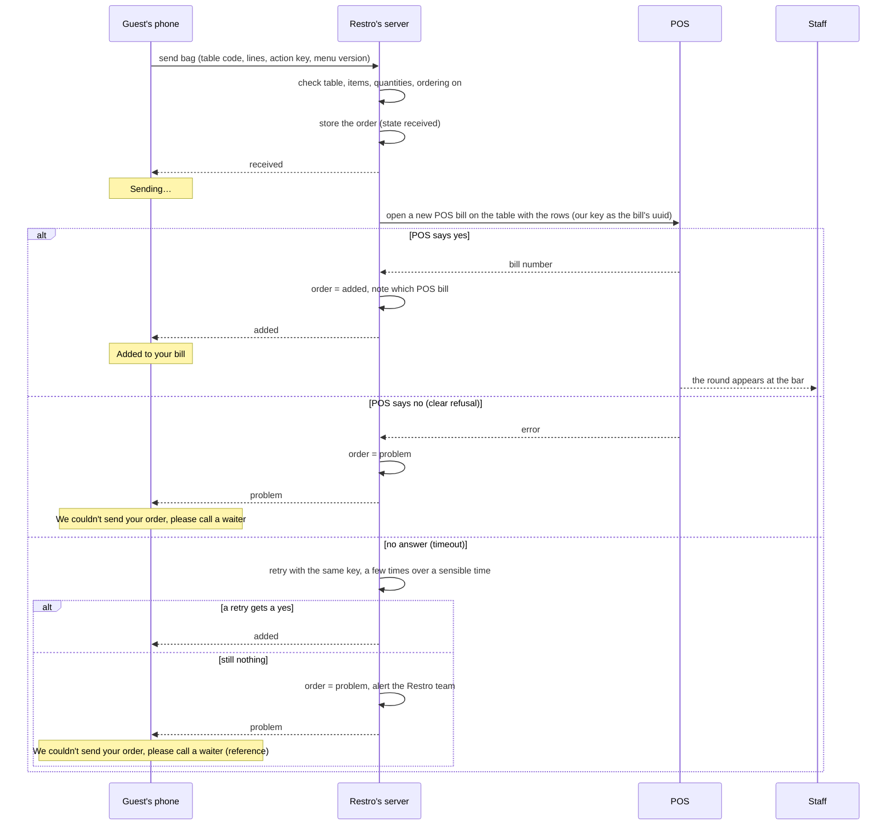
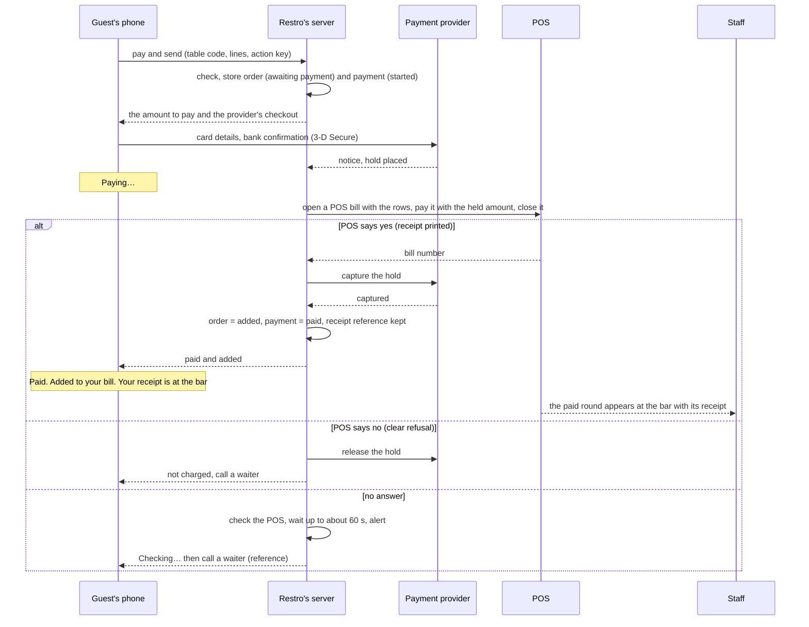
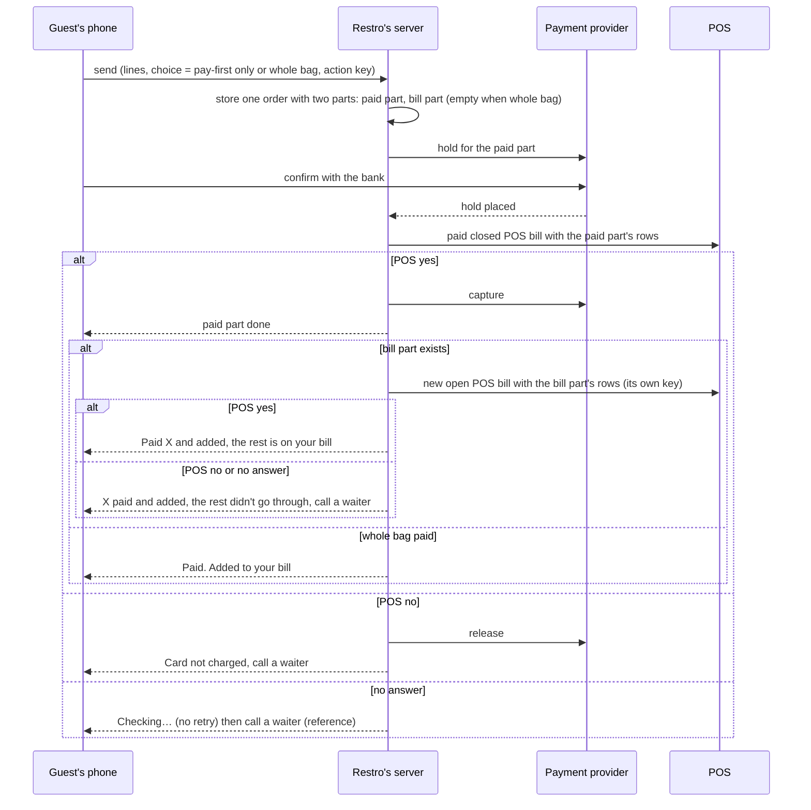
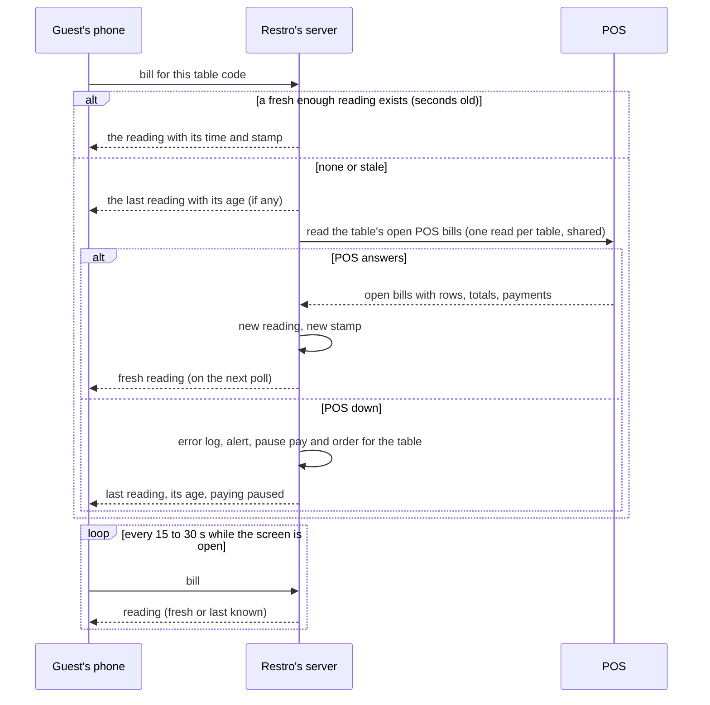
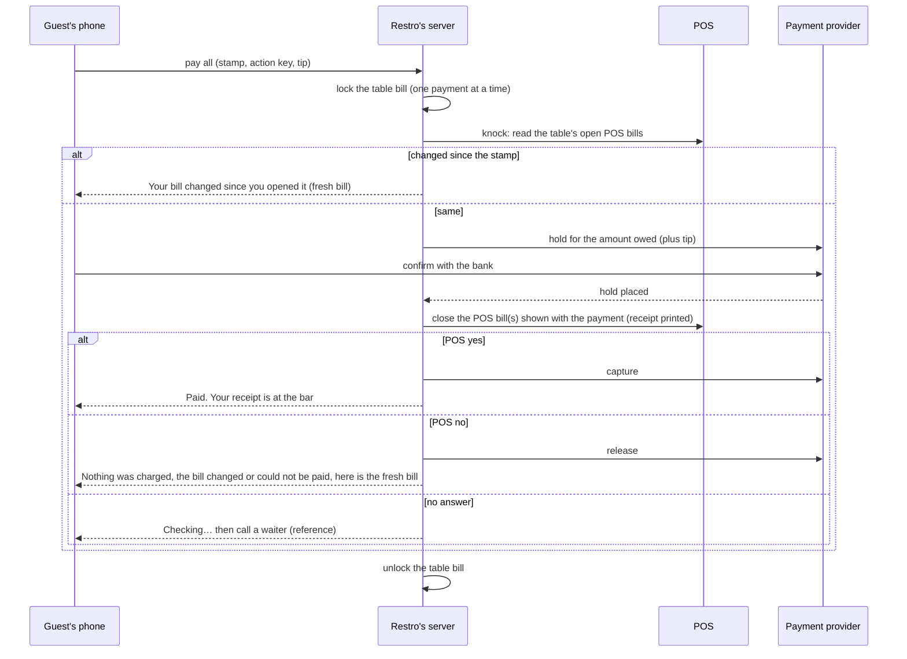
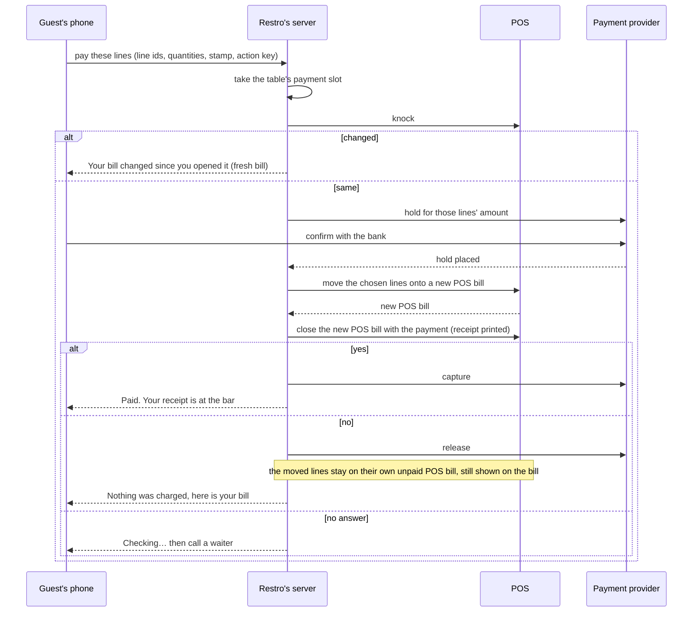
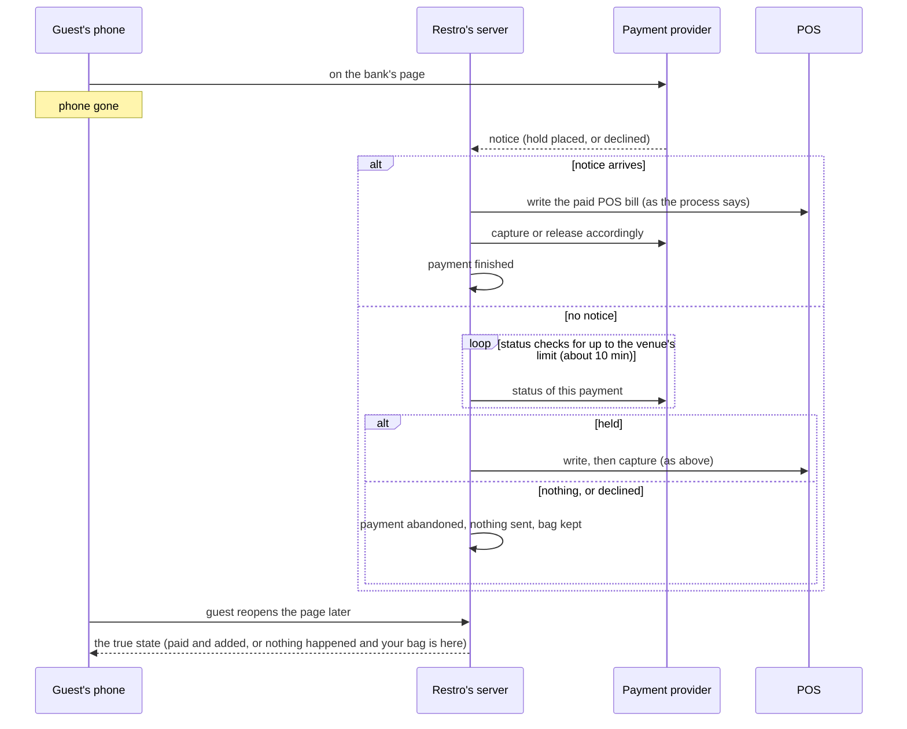

# Ordering and payment processes, step by step

Made by: Fable subagent for #35, 10-18

This maps the processes Martin settled on 10-18 (`bill-decisions-so-far.md`, the second opinion, the signed-in barsy reading, the split-payments research, A5 §5.1). It is a description of how things should work, not a decision file: where the decisions leave a gap, the gap is in "Open points" at the end, with a recommendation. Words are GLOSSARY.md's. Nothing here is POS-specific; each step has a short **barsy:** note naming the barsy action where the barsy reference states one, and "unknown" where it does not.

## How to read this

**Who acts.** Five actors appear in every diagram:
- **Guest's phone** (G): the guest page in the phone's browser, opened from a table code. It reads static files and talks to the small guest API. It never decides anything about money or bills; it shows what the server tells it (D72).
- **Restro's server** (S): the web app and the worker together. It holds Restro's own records (orders, payments), the shared reading of the table's bills, and the only door to the POS and the payment provider.
- **POS** (P): the venue's POS. The only truth about bills. Restro writes into it only as a waiter would (D110).
- **Payment provider** (PP): the venue's own payment account at its provider (D98). Holds, captures, releases, refunds, and the bank's confirmation page (3-D Secure).
- **Staff** (W): the waiters and the bar, working at the POS's own screens. They see what the POS shows them; Restro never talks to them directly, except through the POS and through the Restro team's alerts.

**Words used throughout.**
- **Bill**: what the guests at a table see: everything ordered at the table during the visit, what is paid and what is still owed. One bill per table on the phone, however many POS bills sit behind it.
- **POS bill**: one bill in the POS, open until settled, closed by the POS with a fiscal receipt. A table can hold several.
- **Order**: Restro's own record of one bag the guest sent: items, quantities, the price shown, the time, the table, and which POS bill it went onto. Kept until the venue is purged.
- **Payment** (Restro's record): amount, what it paid for, the provider's reference, the receipt reference. Kept for good.
- **Reading**: the latest copy of the table's open POS bills that Restro read from the POS, shared by every phone at the table, kept for minutes, shown with its time.
- **Stamp**: what a phone carries about the reading it was shown: the reading's time and a fingerprint of its lines and totals. The phone carries the stamp; nothing per guest is stored on the server.
- **Knock**: before a guest acts on the bill (pays), the server asks the POS "is this bill still open, and is it the same as what this guest was shown?" and compares with the stamp.
- **Payment mode** of an item: *on the bill* (ordered now, paid later) or *pay first* (paid before it is sent). A venue default, an item override, and one switch per table, "Disable prepayments", that puts everything at that table on the bill.
- **Hold, capture, release, refund**: as in GLOSSARY.md. Every guest payment goes **hold → write to the POS → capture**.
- **Action key**: the one-time key the phone attaches to each send or pay, so a double tap or a retry can never do the same thing twice (D72's `actionId`).

**Conventions.** Each process has a diagram and a numbered list that stands on its own. Each step says who acts, what happens, what the guest sees ("Sees:"), what happens when it fails ("Fails:"), and the barsy note. The guest's wording is indicative; the final strings are the bill-screen ticket's, in BG and EN.

**What is the same in every process (the building blocks).**
1. The guest page is static. Live things (the bill, an order's state, a payment's state) come from the guest API over the table code; the phone polls it a few times a minute at most. The menu itself never depends on the server being up (D102).
2. Every send or pay carries an action key; the server does the thing once per key, and a repeated key only returns the earlier result.
3. The server, never the phone, is the one that finishes anything: an order is "added" only when the POS confirmed it; a payment is finished or abandoned from the provider's own notice or a status check, even when the phone is gone.
4. One payment at a time per bag and per table bill. While one is open, other phones at the table see "someone at the table is paying".
5. A POS that does not answer pauses ordering and paying for that table and shows the last reading with its age; it never shows a blank or an invented total. Each failure goes into the connector's error log and alerts the Restro team (how at night: #39).
6. Restro writes nothing into the POS except as a waiter would: open a bill, add a round, split, take a payment and close, reverse a closed bill within the POS's rules. It never re-prices (rule 5): orders carry no prices into the POS; the POS prices the rows.
7. The fiscal receipt is always printed by the POS at the venue, never by Restro. The phone says where the receipt is; it never looks like a receipt.

---

## 1. Ordering on the bill

When: the bag holds only on-the-bill items, or the table's "Disable prepayments" switch is on (then every item is on the bill).



Steps:

1. **Guest's phone: build the bag.** The guest adds items from the menu; the phone adds up an estimate from the prices in the published menu (money module, D72). Only items the published menu marks orderable can be added; sold-out items are greyed (D22); "ask your waiter" items show a price but no button (D29).
   - Sees: the bag with its estimate and "Send to the bill".
   - Fails: the table's ordering is paused (the live overlay says so) → the button is replaced by "ordering paused, please call a waiter"; the bag stays.
   - barsy: none (static files).
2. **Guest's phone: send.** One tap. The phone sends the table code, the lines (our item ids, quantities, options), the menu version it used and a fresh action key. No prices travel (A5 §5.1).
   - Sees: "Sending…". The button is disabled; a second tap does nothing new.
   - Fails: no network → the phone keeps the bag and shows "no connection, try again"; the same action key is reused on retry, so nothing can be sent twice.
   - barsy: none.
3. **Restro's server: check and store.** The server resolves the table code to a table, re-reads the current menu, checks every line (orderable now, quantity caps, option rules), checks the table's payment mode (everything on the bill here), checks ordering is on for the venue, and stores the **order** (lines, quantities, price shown, time, table, state *received*) in one transaction. The order's own id is the key for the send.
   - Sees: still "Sending…".
   - Fails: a line is no longer orderable (sold out since the phone loaded) → the whole bag is refused with "X is sold out, remove it and send again"; the bag stays on the phone with the line marked. Unknown table code or a retired code → "this code is not in use, ask your waiter".
   - barsy: none yet.
4. **Restro's server → POS: open a new POS bill on the table with the rows.** Every guest order goes in as **its own new POS bill on the table**, carrying the order's key as the POS bill's duplicate-protection id (pending Martin, item 22). This is what makes a retry safe: a second attempt with the same key is refused by the POS, never doubled. The server sends no prices; the POS prices the rows.
   - Sees: still "Sending…".
   - Fails: see steps 5 to 7.
   - barsy: `Accounts_place` without `account_id` (a new bill), `account.uuid` = our key, `account.place_id` = the table, `orders` = the rows (`article_id`, `amount`, options as `modificators` where applicable), no `payments`, `flag_close_account` 0. Returns the bill's number. Needs the registered cash desk the venue assigned to Restro's API user (`Poses_getcurrent` to check at setup).
5. **POS says yes.** The server marks the order *added* and notes which POS bill it is on. The round shows on the POS's own screens and printers as any waiter's round would (D18: inside the venue's existing setup, no extra device).
   - Sees: "Added to your bill" and the bag empties. From now on the order is simply part of the bill (process 4); there are no delivery-style stages.
   - Fails: nothing here.
   - barsy: the bill number is what `Accounts_place` returned. Whether the venue's cash desk approval mode ("waiting for approval", `service_status_id` 2) holds the round back before the bar sees it is **unknown** (barsy open questions 4 and 5): see Open points.
6. **POS says no (a clear refusal).** The order is marked *problem* with the POS's reason kept in the connector's error log (never shown raw).
   - Sees: "We couldn't send your order, please call a waiter", with a short reference; the bag stays so the waiter can be told what was wanted.
   - Fails: nothing further; the Restro team is alerted if refusals repeat.
   - barsy: an error from `Accounts_place`. A duplicate-uuid error on a retry means the first attempt did go through: the server treats that as **yes** and reads the bill back to confirm (process 9).
7. **No answer (timeout or a crash mid-send).** The server does not know whether the POS has the round. It retries **with the same key** a few times over a sensible time (about a minute in total; A5's 60 s). A retry that gets "duplicate" means the first attempt landed: *added*. A retry that gets "yes" is *added*. If nothing comes back, the order becomes *problem*, the Restro team is alerted, and the table's ordering pauses (process 9).
   - Sees: "Sending…" the whole time, then either "Added to your bill" or "We couldn't send your order, please call a waiter" with a reference.
   - Fails: this is the failure branch. The bag stays on the phone.
   - barsy: the same `Accounts_place` with the same `uuid`. No method reads a bill back by uuid, so a late confirmation can only be found by reading the table's open bills and matching the rows and time (unknown precision; barsy open question 3 asks for `ref_id`).
8. **Afterwards.** The order appears on the bill at the next reading (process 4). Staff merge or move POS bills as they like at the POS; the one-bill view keeps showing everything on the table.

---

## 2. Ordering pay-first items only

When: every item in the bag is pay-first (by the venue default or an item override) and the table's "Disable prepayments" switch is off. Until in-app payment exists, pay-first items show "ask your waiter" instead of this process.



Steps:

1. **Guest's phone: build the bag.** As process 1, step 1. The bag shows "Pay X now" because every line is pay-first. A tip line may be offered on payment (D8): see Open points.
   - Sees: the bag, the amount, "Pay and send".
   - barsy: none.
2. **Guest's phone: pay and send.** One tap with a fresh action key. The phone sends the table code, the lines, the menu version and the key; no prices (the server re-prices from the current menu and that is the amount held).
   - Sees: "Paying…".
   - Fails: no network → as process 1, step 2.
   - barsy: none.
3. **Restro's server: check and store.** As process 1, step 3, plus: the server computes the amount from the current menu (integer minor units, money module) and stores the **order** in state *awaiting payment* and a **payment** record in state *started* (amount, what it pays for, action key). One payment at a time per bag: a second "pay" on the same bag while one is open just returns the open one.
   - Sees: still "Paying…".
   - Fails: a refused line → as process 1, step 3. The venue has no payment account connected, or the provider is unhealthy → "card payment is not available right now, please call a waiter" (and the whole pay-first mode is effectively "ask your waiter" until it is back).
   - barsy: none.
4. **Restro's server → Payment provider: ask for a hold.** The server opens a hold for the exact amount (plus tip if offered) on the venue's payment account and gets the provider's checkout for the guest. The amount can never be raised after the guest confirms (SCA rule).
   - Sees: the provider's checkout (card, Apple Pay or Google Pay where the provider offers them), then the bank's confirmation page.
   - Fails: the provider refuses to start → "card payment is not available right now, call a waiter"; the order goes to *abandoned*, nothing was sent.
   - barsy: none.
5. **Guest's phone ↔ Payment provider: the guest confirms.** The guest enters the card or uses a wallet and confirms with the bank.
   - Sees: the provider's and the bank's pages, then back to the bag screen showing "Paying…".
   - Fails: **declined** (card refused, 3-D Secure failed) → the provider says so; the payment is *declined*; the guest sees "Card declined" with "Try again" (another card or a wallet), "Call a waiter", and a small "Back to my bag". Nothing was sent. The guest never comes back from the bank page → process 8.
   - barsy: none.
6. **Payment provider → Restro's server: "hold placed".** The server learns it from the provider's own notice (or a status check), not from the phone. Payment state *held*.
   - Sees: "Paying…" still.
   - Fails: the notice is late or lost → the server's status check finds it (process 8). The phone just keeps polling the payment's state.
   - barsy: none.
7. **Restro's server → POS: write the paid, closed POS bill.** A new POS bill on the table with the rows, with one payment of the held amount by the venue's "paid through Restro" payment method, closed in the same call. The POS prints the fiscal receipt at the bar. This is one write with the order's key, so a retry is safe.
   - Sees: "Paying…".
   - Fails: steps 9 and 10.
   - barsy: `Accounts_place` without `account_id`, `account.uuid` = our key, `account.place_id` = the table, `orders` = the rows, `payments` = one `AccountPaymentInputData` (`paymethod_id` of the venue's card-not-present method for Restro, from `Paymentmethods_getlist`; `original_paid_sum`; `transaction_id` / `ref_num` = the provider's reference), `flag_close_account` 1. Returns the bill's number. `Accounts_close` is the same for an already open bill. **Unknown:** what barsy does when the payment sum does not equal the bill's total (the POS prices the rows itself; the hold is for the price shown): see Open points. **Unknown:** whether the API checks that the fiscal device can print before closing.
8. **POS says yes.** The server captures the hold for exactly the held amount, marks the payment *paid* and the order *added*, and records the receipt reference (read back from the POS bill) and the provider's capture reference (D32, finest grain).
   - Sees: "Paid. Added to your bill. Your receipt is at the bar", with the amount. The order then shows on the bill as a paid part (process 4).
   - Fails: the **capture fails after the receipt printed** (rare: the hold was approved seconds before). The server retries the capture; if it still fails, the venue gets a task ("collect X another way or reverse the payment at the POS by the 7th of next month") and the Restro team is alerted. Restro never refunds or reverses automatically once a receipt exists.
   - barsy: the receipt reference is `AccountData.unp` and the payment's `payment_print_data` / `ref_num`, read with `Accounts_get` (`extra_properties` payments_history) after the close. `Accounts_place` returns only the bill number. A later reversal is `Accounts_storno` with the payment (irreversible, needs a storno reason from `Accounts_getstornoreasons`).
9. **POS says no (a clear refusal).** The server **releases the hold** by an API call at once; the guest was never charged. Payment *released*, order *problem*.
   - Sees: "We couldn't send your order. Nothing was charged; your bank may show the hold for a few days. Please call a waiter", with a reference. The bag stays.
   - Fails: the release call itself fails → retried; the hold expires on its own eventually, but a hold left to lapse may cost the venue a fee, so the Restro team is alerted. With a provider that cannot hold (charged at step 5 instead): a clear "no" from the POS means an **automatic refund** here.
   - barsy: an error from `Accounts_place`.
10. **No answer.** The server cannot tell whether the POS printed a receipt. It must not retry blindly (that is how guests get charged twice) and must not release (the receipt may exist). It checks the POS: a retry with the same key that answers "duplicate" means the bill exists → read it back → step 8. A read that shows no such bill after a short wait → treat as "no" → step 9. If nothing can be learned within about 60 seconds, the Restro team is alerted and the payment stays *unclear* for a person to settle; the hold stays until then (it is released by hand or when the check later succeeds; never left to lapse past the day).
    - Sees: "Checking…" with **no retry button** for up to about 60 seconds, then "We can't confirm your order yet. Please call a waiter" with a reference. The bag stays.
    - Fails: this is the failure branch. With a provider that cannot hold: **no automatic refund** after a mere timeout, for the same reason.
    - barsy: same `uuid` retry of `Accounts_place`; `Accounts_getlist` filtered by `place_id`, both open and closed, to look for the bill by rows and time (no uuid lookup: unknown precision).

---

## 3. A mixed bag

When: the bag holds pay-first items and on-the-bill items, and "Disable prepayments" is off. The guest chooses between **"Pay X now, the rest goes on your bill"** (the default, one main button) and **"Pay everything now"** (a small link). The on-the-bill items **wait** until the pay-first payment is settled; then the paid POS bill goes in first and the round right after.



Steps:

### 3a. "Pay only the pay-first items" (the default button)

1. **Guest's phone: the choice.** The bag shows the pay-first lines with the amount and the main button "Pay X now, the rest goes on your bill"; "Pay everything now" is a small link (3b).
   - Sees: the bag split visually into "paid now" and "on your bill".
   - barsy: none.
2. **Guest's phone: send.** One tap, one action key, the lines and the choice. No prices.
   - Sees: "Paying…".
   - Fails: as process 1, step 2.
3. **Restro's server: check and store.** As process 2, step 3, but the **order** has two parts: the paid part (state *awaiting payment*) and the bill part (state *waiting for the payment*). Both are one order, one reference.
   - Fails: a refused line in either part refuses the whole bag (one order was asked for).
   - barsy: none.
4. **Hold, confirm, "hold placed".** Process 2, steps 4 to 6, for the paid part's amount only. The bill part waits; nothing is sent to the POS yet.
   - Sees: the provider's checkout, then "Paying…".
   - Fails: **declined** → "Card declined" with "Try again", **"Order the rest without it"** (the bill part is sent alone as process 1 and the paid part is dropped), "Call a waiter", and a small "Back to my bag". Abandoned → process 8: nothing at all is sent, the whole bag stays.
5. **Restro's server → POS: the paid, closed POS bill first.** Process 2, step 7, with the paid part's rows and its own key.
   - Fails: POS "no" → release the hold, nothing sent, "Card not charged; please call a waiter" (the bag stays). No answer → "Checking…" without retry (process 2, step 10); the bill part keeps waiting until the paid part is settled one way or the other.
   - barsy: `Accounts_place` with `payments` and `flag_close_account` 1.
6. **Capture.** Process 2, step 8. The paid part is *added* and *paid*.
   - Sees: the paid line marked "paid"; still "Sending the rest…".
7. **Restro's server → POS: the round right after.** Process 1, step 4, with the bill part's rows and **its own key** (a second new POS bill on the table).
   - Sees: "Paid X and added. The rest is on your bill".
   - Fails: POS "no" or no answer after the retries → the paid part stays paid; the bill part is *problem*; "X paid and added; the rest didn't go through, please call a waiter", with a reference, and the unsent lines stay in the bag so the waiter can be told.
   - barsy: `Accounts_place` without `payments`. Staff may later merge the two POS bills at the POS (`Accounts_mergebyplaceid`); the one-bill view does not care.

### 3b. "Pay the whole bag"

1. **Guest's phone: the small link "Pay everything now".** The amount becomes the whole bag.
2. **Then exactly process 2** for all the lines: one hold, one paid and closed POS bill with every row, one capture, one receipt. There is no bill part and no second write.
   - Sees: "Paid. Added to your bill. Your receipt is at the bar".
   - Fails: as process 2. "Order the rest without it" is not offered here (there is no "rest"); the alternatives are "Try again", "Call a waiter", "Back to my bag" (where the guest can pick the default button of 3a instead).

---

## 4. Opening the bill on the phone

When: the guest opens the bill screen from the menu. The reading is shared by every phone at the table; the knock happens only before a payment, never to show the screen.



Steps:

1. **Guest's phone: open the bill.** The phone asks the guest API for the table's bill with the table code. It shows at once whatever it already has (the last reading it received, if any) rather than a spinner.
   - Sees: the bill: lines (name, quantity, price), what is paid, what is still owed, the time of the reading ("as of 23:41"). No "who ordered what". If nothing is on the table yet: "Nothing on your bill yet". The paid pay-first orders of this visit appear as paid parts.
   - Fails: no network → the last copy the phone holds, marked with its age; "reconnecting…".
   - barsy: none.
2. **Restro's server: serve the shared reading.** If the table's reading is only seconds old, the server returns it. Otherwise it returns the last one with its age and refreshes it from the POS **once per table** for the next few seconds, so thirty phones at one table cause one POS read, not thirty. The reading is refreshed at most a few times a minute.
   - Sees: the bill, then a quiet refresh when the fresh reading lands.
   - Fails: see step 4.
   - barsy: none here.
3. **Restro's server → POS: read the table's open POS bills.** All open POS bills on the table, with their rows, totals and payments. The server turns them into one bill: Restro's own line ids (never POS ids), public item names from the menu where the POS row maps to a menu item (D75's fallback otherwise), integer minor units, the total still owed, and the reading's **stamp** (time plus a fingerprint of lines and totals).
   - Sees: the fresh bill, with its time.
   - Fails: see step 4.
   - barsy: `Accounts_getlist` with `filters.place_id` = the table and `status` 0 (open), `extra_properties` orders and payments; `total_real`, `total_paid`, `total_remain` per bill; `OrderData` rows. Or `Places_getlistwithaccountsonly` (its checksum allows a cheap "anything changed?" poll for all tables at once). Which to use is the connector's choice.
4. **POS down (no answer or an error).** The reading is not replaced. The server logs the failure in the connector's error log, alerts the Restro team (#39), and marks the table *paused*: no ordering, no paying, until a read succeeds again (process 9).
   - Sees: the last reading with its age ("as of 23:41, 6 minutes ago") and "We can't reach the venue's system right now; paying is paused". Never a blank, never a guessed total.
   - Fails: the pause lifts itself when the next read succeeds; no human step.
   - barsy: a failed `Accounts_getlist`.
5. **While the screen is open: polling.** The phone asks again every 15 to 30 seconds; the server answers from the shared reading. Other phones at the table see the same reading. If a payment is open at the table, the reading carries "someone at the table is paying" and the pay buttons are disabled for the others.
   - Sees: the bill updating as rounds land and payments are taken at the bar.
   - barsy: none beyond step 3.
6. **The knock is not here.** Opening the bill never waits for the POS. The knock (is the bill still the same as the stamp?) happens only when the guest taps "Pay": processes 5 and 6.

---

## 5. Paying the whole bill

When: the guest taps "Pay all" on the bill. It pays **exactly the lines the guest was shown**; a round that lands meanwhile stays on the bill, unpaid, for later.



Steps:

1. **Guest's phone: "Pay all".** The phone sends the table code, the stamp of the reading it shows, a fresh action key and the tip chosen (if the tip line is offered, D8).
   - Sees: "Checking your bill…".
   - Fails: another payment is already open at the table → "Someone at the table is paying; wait a moment" and the button stays disabled until the reading says the payment ended. The table is paused (process 9) → the button is disabled with the pause message.
   - barsy: none.
2. **Restro's server: take the table's payment slot.** One payment at a time per table bill. The server records a **payment** in state *started* and marks the table "someone is paying" in the reading.
   - Sees: other phones see "someone at the table is paying".
   - barsy: none.
3. **Restro's server → POS: the knock.** A fresh read of the table's open POS bills, compared with the stamp: same lines, same quantities, same prices, same amount owed, all still open.
   - Sees: "Checking your bill…" (this one waits for the POS).
   - Fails: **changed** (a round landed, the bar took a cash payment, staff moved a bill) → the payment is cancelled before any hold; "Your bill changed since you opened it" and the fresh bill, with "Pay all" again for the new amount. No line-by-line change list. **POS down** → the payment is cancelled, "We can't reach the venue's system right now; paying is paused", the table pauses (process 9).
   - barsy: `Accounts_getlist` by `place_id`, open bills, with rows and payments.
4. **Restro's server → Payment provider: the hold.** For the amount owed on the lines shown (plus tip). Then the guest confirms with the bank as in process 2, steps 4 to 6.
   - Sees: the provider's checkout and the bank's page, then "Paying…".
   - Fails: declined → "Card declined" with "Try again" and "Call a waiter"; the payment slot is freed; nothing in the POS changed. Abandoned → process 8.
   - barsy: none.
5. **Restro's server → POS: take the payment and close.** The lines shown are paid: when they are exactly one open POS bill, that POS bill is closed with the payment; when the table holds several POS bills and all their lines were shown, each is closed with its share of the payment, or they are merged first and closed once (which: Open points). The POS prints the fiscal receipt(s) at the bar. If, between the knock and this call, a round landed on one of those POS bills, the POS bill's total no longer matches the payment: the server treats it like a changed bill (step 3's "changed" path) and the lines shown are moved onto their own POS bill first (process 6) so the new round stays behind.
   - Sees: "Paying…".
   - Fails: steps 7 and 8.
   - barsy: `Accounts_close` with `account_id` and `payments` (one card payment of the amount, the venue's "paid through Restro" method, `transaction_id` = the provider's reference). Several POS bills: one `Accounts_close` each, or `Accounts_mergebyplaceid` with the `accounts` subset and then one close. To leave a fresh round behind: `Accounts_divide` of the shown rows first.
6. **POS says yes.** Capture for exactly the held amount; payment *paid*; receipt reference and capture reference recorded; the payment slot is freed; the reading is refreshed.
   - Sees: "Paid. Your receipt is at the bar" with the amount, then the bill shows the lines as paid (or an empty bill). The receipt screen of the template shows the reference, never a receipt look-alike.
   - Fails: capture fails after the receipt → as process 2, step 8 (venue task, alert, no automatic reversal).
   - barsy: receipt reference from `Accounts_get` (`unp`, `payments_history`) after the close.
7. **POS says no.** Release the hold at once; payment *released*; the slot is freed; a fresh reading is taken.
   - Sees: "Nothing was charged. Your bill could not be paid from the phone; here it is again", and the fresh bill. If the fresh bill shows the lines gone (the bar took cash for them in the same moment), the message is simply the fresh bill ("already paid at the bar").
   - barsy: an error from `Accounts_close`.
8. **No answer.** As process 2, step 10: no blind retry, no release; the server reads the POS bill(s) back; closed with our payment → step 6; still open and unchanged → step 7; unknown after about 60 s → the Restro team, the payment stays *unclear* with the hold kept.
   - Sees: "Checking…" with no retry for up to about 60 s, then "We can't confirm your payment yet. Please call a waiter" with a reference.
   - barsy: `Accounts_get` of the POS bill(s) by `account_id` (`status` 1 closed, `payments_history`).

---

## 6. Paying early for chosen items (split)

When: the guest ticks some lines on the bill and taps "Pay these". Those lines are moved onto a new POS bill, which is paid and closed with its own receipt (D14, settled 10-18 item 14). The order of the money steps stays hold → POS → capture.



Steps:

1. **Guest's phone: choose lines.** The guest ticks lines (and, for a line with quantity 3, how many of it); the phone shows the sum of the chosen lines from the reading. Only unpaid lines can be ticked.
   - Sees: the bill with tick boxes, the amount of the selection, "Pay these".
   - Fails: another payment is open at the table, or the table is paused → the button is disabled with the message.
   - barsy: none.
2. **Guest's phone: "Pay these".** Line ids (Restro's own), quantities, the stamp, an action key, the tip.
   - Sees: "Checking your bill…".
3. **Restro's server: slot and knock.** As process 5, steps 2 and 3. The knock also confirms the chosen lines are still on an open POS bill and unpaid.
   - Fails: changed → "Your bill changed since you opened it", the fresh bill, the selection cleared. POS down → paused.
   - barsy: `Accounts_getlist` by `place_id`.
4. **Hold and confirm.** As process 5, step 4, for the selection's amount.
   - Fails: declined → "Card declined", try again / call a waiter; nothing moved in the POS. Abandoned → process 8.
5. **Restro's server → POS: move the chosen lines onto a new POS bill.** The server maps the chosen Restro line ids back to POS rows through the reading it keeps and asks the POS to split them off. The new POS bill is on the same table.
   - Sees: "Paying…".
   - Fails: POS "no" (a line cannot be split, or it is gone) → release the hold; "Nothing was charged. Your bill changed; here it is again". No answer → as step 8 but with nothing to capture: the server reads the table back; if the new POS bill exists it carries on with step 6, else it releases. A crash here leaves at most an extra unpaid POS bill on the table: harmless, the one-bill view still shows its lines, and staff can merge it back.
   - barsy: `Accounts_divide` with `old_account_id` and `orders` (the rows and quantities to move); returns the new bill's id. Whether a fraction of a row (a quarter of a bottle) can be moved is **unknown** (B3): the phone offers only whole quantities.
6. **Restro's server → POS: close the new POS bill with the payment.** As process 5, step 5, on the new POS bill only. The POS prints its own receipt.
   - Fails: POS "no" → release; the moved lines stay on their own unpaid POS bill, still on the bill as unpaid lines; "Nothing was charged; please call a waiter". No answer → process 5, step 8, on the new POS bill.
   - barsy: `Accounts_close` with the new `account_id` and `payments`. (`Accounts_divide` with `client_id` and `persons` is optional.)
7. **Capture and done.** As process 5, step 6. The bill now shows those lines as paid (their own POS bill is closed) and the rest still owed.
   - Sees: "Paid. Your receipt is at the bar".
   - barsy: `Accounts_get` for `unp` and the payment's print data.

---

## 7. Group payment: several cards settle the bill or a share of it

Designed in now, **built later**, behind two gates: (a) the venue's payment provider has holds switched on, and (b) the POS vendor confirms that one call can close a POS bill with several card payments and print the receipt (research #43). Until then the bill offers "Pay all" and "Pay these" only. Part payment of an amount on a bill that stays open ("pay 50 and leave") is **not** offered until the POS vendor and the fiscal rules (Н-18 чл. 26а) allow it.

```mermaid
sequenceDiagram
    participant G1 as Starter's phone
    participant G2 as Other guests' phones
    participant S as Restro's server
    participant P as POS
    participant PP as Payment provider
    G1->>S: pay together (what: all, chosen lines; split: equal, by items, amounts)
    S->>P: knock, and move the lines onto their own POS bill if needed
    S->>S: freeze the amount, open the group payment with its window
    S-->>G1: shares to fill
    S-->>G2: the progress card (amount, shares held, missing, time left)
    loop each guest
        G2->>S: take a share (plus tip)
        S->>PP: hold for that share
        G2->>PP: confirm with the bank
        PP-->>S: hold placed
        S-->>G2: your share is held
    end
    alt holds equal the amount before the window ends
        S->>P: close the POS bill with one card payment per share (receipt printed)
        alt yes
            S->>PP: capture every hold
            S-->>G2: Paid. Your receipt is at the bar
        else no or no answer
            S->>PP: release every hold (after the no, or after the check)
            S-->>G2: Nothing was charged
        end
    else window ends or the starter cancels or the POS bill changed
        S->>PP: release every hold by call, at once
        S-->>G2: Nothing was charged, your bank may show the holds for a few days
    end
```

Steps:

1. **Starter's phone: "Pay together".** Any guest at the table starts it on the bill, for the whole bill or chosen lines, and picks the split: equal between N people, by items, or amounts typed per person. Shares must add up to the amount exactly; Restro never lets holds exceed it.
   - Sees: a share list to fill.
   - Fails: another payment is open at the table → wait. Gates not met → the button does not exist.
   - barsy: none.
2. **Restro's server: knock, isolate, freeze.** The knock as in process 5. When the lines are not already one whole POS bill, they are moved onto their own POS bill first (process 6, step 5). The amount is frozen: new rounds from the table go onto new POS bills anyway (process 1), so they cannot change it. A group payment record opens with a window (a venue setting; D30's 3 minutes is reopened, the research suggests about 10; decided in the bill-screen ticket).
   - Sees: the progress card on every phone at the table: amount, shares held, what is missing, time left, "take over a missing share".
   - Fails: changed → "Your bill changed", start again. POS down → paused.
   - barsy: `Accounts_getlist`; `Accounts_divide` when needed.
3. **Each guest: take a share.** From the table's bill, each guest opens a share on their own phone, adds a tip if offered, and confirms with their bank. One hold per guest for exactly the share plus tip. A guest's share can never be raised after confirmation.
   - Sees: "Your share: X", the checkout, "Held" afterwards; the progress card updates for everyone.
   - Fails: declined → that share stays "missing"; the guest retries or another guest takes it over. Abandoned → the share is freed after a short time; others may take it.
   - barsy: none.
4. **Complete: the holds equal the amount.** The server closes the POS bill with one card payment per share; the POS prints one receipt with several card payments (or one per payment: whichever the POS and the lawyer settle). Then every hold is captured at once, each for exactly its held amount.
   - Sees: "Paid. Your receipt is at the bar" on every phone.
   - Fails: POS "no" → release every hold at once; "Nothing was charged". No answer → the check as in process 5, step 8, before any release or capture; alert at about 60 s. A capture that fails after the receipt → the venue's task for that share (collect another way or reverse that payment at the POS); never an automatic refund once a receipt exists.
   - barsy: `Accounts_close` with several entries in `payments`. "Mixed" payments are documented; several of the **same kind** over the API are **unknown** (B1, the gate). Reversal of one payment: `Accounts_storno` with `payments`.
5. **The window ends, the starter cancels, or the POS bill changed.** The server releases **every hold by API call at once** (never left to lapse: card-scheme rules and a possible provider fee). The POS bill is untouched; the table can try again or pay at the bar.
   - Sees: "Nothing was charged. Your bank may show the hold for a few days; it is released".
   - barsy: none.
6. **A later refund.** A reversal at the POS and a refund at the provider, linked share by share (D32).
   - barsy: `Accounts_storno` with the payment(s) to refund.

---

## 8. An abandoned or unfinished payment; the server finishing a payment from the provider's notice

When: any payment from processes 2, 3, 5, 6 or 7 where the phone disappears (the guest closes the browser, the bank page never sends them back, the phone dies) or the provider's answer is late.



Steps:

1. **The phone leaves.** Whatever the phone is doing, the payment record on the server has the whole story: order, amount, action key, provider reference, state.
   - Sees: nothing (phone gone), or the bank's page.
   - barsy: none.
2. **Payment provider → Restro's server: the notice.** The provider tells the server directly ("hold placed", "declined", "captured"). The server acts on it exactly as the process would have: write the POS bill, capture or release, mark the payment *paid*, *declined* or *released*. The phone is not needed.
   - Fails: the notice is late, duplicated or out of order → each notice is applied once by the provider's reference; a notice for a payment already finished changes nothing.
   - barsy: the same writes as the owning process.
3. **No notice: status checks.** From the moment the checkout opened, the server asks the provider for the payment's state at growing intervals until the **venue's limit** for an unfinished payment (about 10 minutes, a venue setting). A "held" answer continues the process; a "declined" or "nothing" answer at the limit abandons it.
   - barsy: none.
4. **Abandon.** At the limit with nothing held: the payment is *abandoned*; **nothing is sent to the POS**; the bag stays on the phone's storage; the table's payment slot is freed (other phones stop seeing "someone is paying"). If a hold did land but the process could not finish (the POS was paused, process 9), the hold is **released by call**, never left to expire.
   - Sees (when the guest comes back): "Your payment didn't go through; nothing was charged. Your bag is still here".
   - barsy: none.
5. **The guest reopens the page.** The phone asks the server for the state of its last order or payment (by the action key it kept) and shows the truth: "Paid and added" with the receipt note, "Card declined", "Nothing was charged; your bag is here", or "Checking…" if it is still unclear.
   - Fails: the phone lost even its local copy (new browser) → the bill screen still shows any paid part through the reading; the unsent bag is simply gone.
   - barsy: `Accounts_get` only if the server itself still needs to confirm the POS side.
6. **Unclear past the limit.** A payment the server could neither finish nor prove abandoned (the POS may have printed a receipt) is never auto-released and never auto-refunded; it is in the Restro team's hands with a reference, the venue is told, and the hold is settled by a person the same night.

---

## 9. The POS not answering, at each point

"Not answering" means a timeout, a network error, or an error that says nothing about the request (a 5xx). A clear "no" from the POS is a refusal, handled in each process above. The rule everywhere: **a read that failed concludes nothing; a write that got no answer is unknown until read back; never retry a write that carries money without the same key, and never release or refund until the POS side is known.**

| Point | What the server does | What the guest sees | How it recovers | barsy |
|---|---|---|---|---|
| Reading the bill (4.3) | Keeps the last reading; error log; alert; marks the table paused (no order, no pay) | Last reading with its age; "we can't reach the venue's system; paying is paused"; menu works as always | Next successful read lifts the pause by itself | `Accounts_getlist` failing |
| Sending a round on the bill (1.4) | Retries with the same key for about a minute; "duplicate" counts as yes; then *problem*, alert, pause | "Sending…" then "We couldn't send your order, please call a waiter" (reference); the bag stays | A later read that finds the round marks the order *added* (matching is by rows and time: imprecise) | same `uuid` retry of `Accounts_place`; no uuid lookup |
| The knock before paying (5.3, 6.3, 7.2) | No hold is placed; the payment is cancelled; table paused | "We can't reach the venue's system right now; paying is paused" | Next read; the guest taps Pay again | `Accounts_getlist` failing |
| Writing the paid, closed POS bill (2.7, 3.5, 5.5, 6.6, 7.4) | No blind retry, no release; reads back with the same key or by id; alert at about 60 s; the hold is kept until a person settles it | "Checking…" with no retry, then "We can't confirm your payment yet, please call a waiter" (reference) | A read that shows the closed bill with our payment → capture, done; a read that shows no such bill → release; otherwise a person | `Accounts_place` with the same `uuid` ("duplicate" = it landed); `Accounts_get` by `account_id` |
| Moving lines for a split (6.5) | Reads the table back; new POS bill found → continue; not found → release | "Checking…" then either "Paid" or "Nothing was charged" | At worst an extra unpaid POS bill on the table, still shown on the bill | `Accounts_divide` then `Accounts_getlist` |
| Reading the receipt reference back (2.8, 5.6) | The payment is already *paid*; the reference is fetched later by a repair job | "Paid. Your receipt is at the bar" (reference shown once fetched) | The repair job retries until it has it | `Accounts_get` (`unp`, `payments_history`) |
| The round after a paid part (3.7) | As "sending a round", but the paid part stays paid | "X paid and added; the rest didn't go through, call a waiter" | As "sending a round" | `Accounts_place` |
| Everything, for minutes | The table (or the venue, if every table fails) is paused: the live overlay says "ordering paused"; alerts keep coming at a sane rate; the menu never goes down (D102) | Menu as always; bill with its age; no order or pay buttons | Automatic when reads succeed again; no human needed to unpause | — |

What never happens while the POS is silent: no second write of the same order under a new key; no release of a hold whose POS write is unknown; no automatic refund after a timeout; no invented bill, no blank bill; no fiscal receipt from Restro.

---

## Open points

Each is something the decisions so far leave undefined. The recommendation is worded so that "yes" accepts it.

1. **Which POS bill a bill-only order joins.** Ticket #36's; this map assumes item 22 (each guest order is its own new POS bill on the table, by our key) until the POS vendor confirms a duplicate guard for adding a round. *Recommendation: yes, every guest order opens its own POS bill on the table, and the question about a round guard goes to the POS vendor with Q79/Q82.*
2. **"Pay all" over several POS bills: one receipt or one per POS bill.** barsy can merge the open bills of a table before one close, or close each. *Recommendation: merge the shown POS bills into one and close once (one receipt, one capture); if the POS cannot merge, close each with its share of the payment and tell the guest "receipts are at the bar".*
3. **The price shown vs the POS's price at pay-first.** The hold is for the price shown; the POS prices the rows itself. Nothing says what the POS does when the payment does not equal the total (barsy: unknown). *Recommendation: pay-first writes in two steps, open the POS bill with the rows, read its total back, close it with the payment only if the totals match; on a mismatch release the hold, show "the price changed, please look again", and alert, leaving the open POS bill for staff. Happy-hour price changes stay unhandled (item 10).*
4. **Approval mode at the venue's cash desk.** barsy's cash desks can hold a bill "waiting for approval"; whether an API bill lands there is unknown (barsy open questions 4 and 5). "Added to your bill" is promised only when the POS really has it. *Recommendation: the cash desk assigned to Restro is set up without approval, so a returned bill number means "added"; the venue setup checklist says so, and Lukanet is asked to confirm.*
5. **The venue's "paid through Restro" payment method in the POS.** Every paid POS bill names a payment method; the venue has to create one (card not present, fiscal) and Restro's connector settings point at it. *Recommendation: yes, a required step of connecting a payment account, checked with `Paymentmethods_getlist` at setup.*
6. **The tip (D8) inside a paid POS bill.** The hold includes the tip; how the tip reaches the POS and the receipt is undefined (as an item, as an overpayment, or not at all). *Recommendation: no tip line in the pilot until the lawyer says how a tip is receipted; the hold then equals the POS bill's total exactly.*
7. **What "the lines shown" means for the knock.** The phone carries a stamp (time plus fingerprint of lines and totals); the server keeps the reading for minutes to map Restro's line ids back to POS rows. If the reading has expired, the knock re-reads and compares by content. *Recommendation: yes, a stamp on the phone and a short-lived mapping on the server; nothing per guest is stored.*
8. **How long an unclear payment keeps its hold.** "Checking…" lasts about 60 s for the guest; the hold itself stays until a person settles it the same night. *Recommendation: the hold is kept until the Restro team settles it, with a hard release at the end of the service day if the POS side was never found and nothing was captured.*
9. **The window for a group payment and D30's cap.** D30's 3 minutes is reopened; the research suggests about 10 minutes, and D30's cap at barsy's payment-link lifetime does not apply when the holds go through Restro's provider. *Recommendation: a venue setting with a 10-minute default, decided in the bill-screen ticket, and D30's payment-link cap dropped for group payment.*
10. **Receipt on the phone.** The phone says "your receipt is at the bar" and shows a reference; an electronic receipt waits for the lawyer (Q80, Q81). *Recommendation: yes, bar receipt only in the pilot.*
11. **A fresh round landing between the knock and the close in "Pay all".** The map says: treat it as a changed bill and move the shown lines onto their own POS bill first. *Recommendation: yes, always split the shown lines off when the POS bill's total no longer matches, never pay a total the guest did not see.*
12. **Late matching of an order the POS has but never confirmed.** barsy has no lookup by our key; matching by rows and time is imprecise. *Recommendation: ask Lukanet for `ref_id` / `order_ref_id` (barsy open question 3); until then the order stays *problem* and the waiter resolves it with the guest.*
