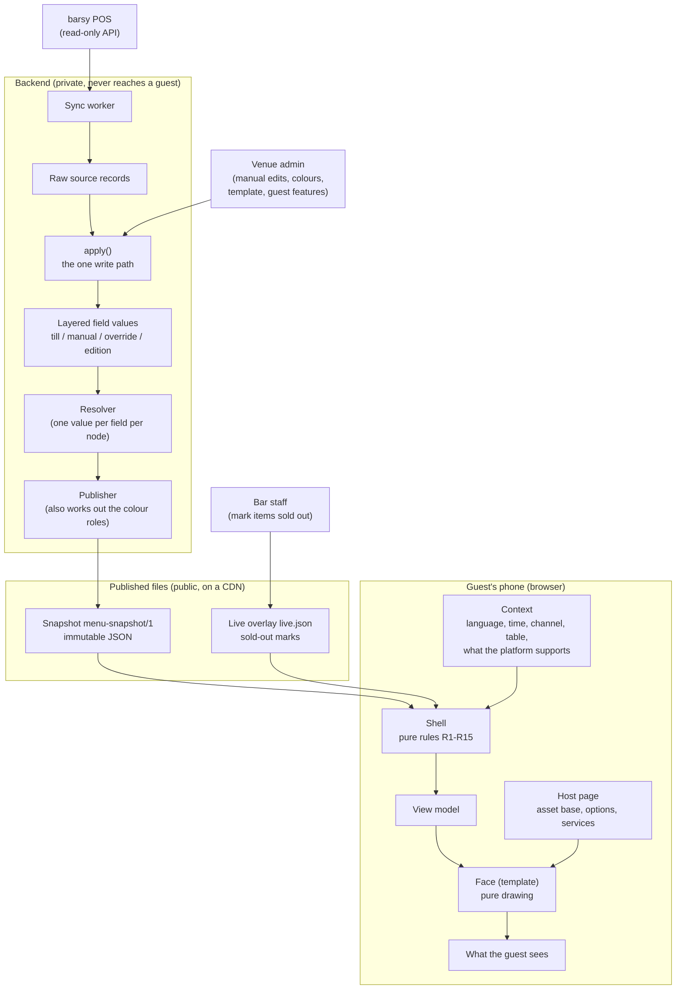
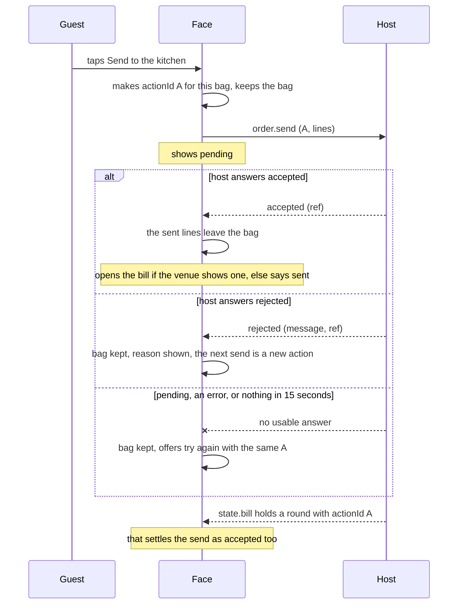
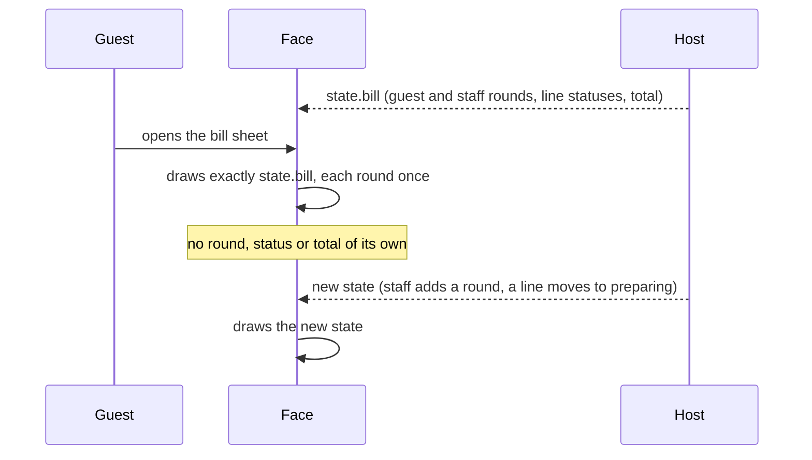
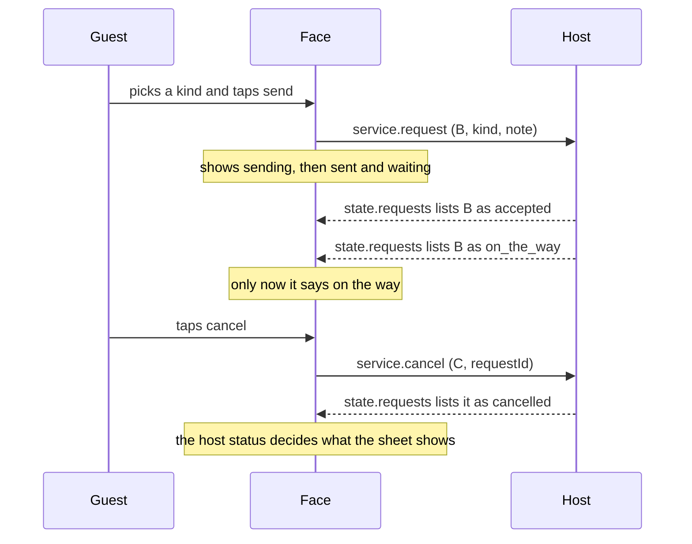
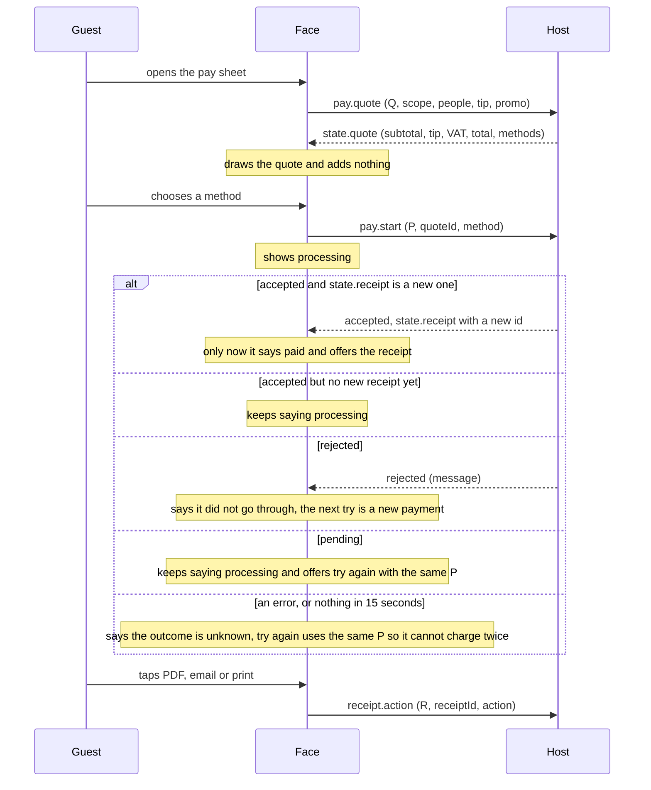

# Restro visualization shell: guide for template designers (v2)

v2, written 2026-10-11 against the Restro code of that date. v1 was written on 2026-10-10. Where this guide and the code differ, the code wins (the differences I found are listed in Appendix C).

**What is new since v1**

| What changed | Where to read it |
|---|---|
| A face is now a **template** in a gallery; Editorial Market is the default and the first one (D69) | §0 |
| The venue sets three colours; the eight colour roles for light and dark are derived, with presets, overrides and six fonts (D70) | §5.4 |
| New rule **R15 Features**: the guest controls a face may draw, fail-closed (D71) | §5.5 |
| The manifest gained `features` and `options`; faces get `options` and `services` as host props | §7.1, §7.6 |
| The **services** (bag, bill, call a waiter, pay, receipt) and the "no local success" rule (D72) | §10 |
| What a template must pass, the visual audit, and the preview marker | §7.7, §10.4 |
| How to deliver an update to a template, and how to add a new one | §11, §12 |
| The sample view models in `shell-handoff/` were made before R15 and `theme.scheme` | §6.2 |

---

## 0. Read this first

**Restro** is a QR-to-phone menu for nightclubs and bars. A guest scans a code at the table and sees the venue's menu on their phone. The menu data comes from the venue's point-of-sale system (barsy), plus whatever the venue adds by hand (photos, descriptions, tags).

**The gallery (D69).** A venue chooses how its menu looks from a gallery of **templates** in the Design tab of its admin. In code a template is called a **face**; this guide uses both words for the same thing. The first template is **Editorial Market** (`packages/faces/editorial-market`), Martin's first Lovable delivery. It is the default for every venue. `qr-phone` is the plain reference face from the first stages: venues are never offered it, and the tests keep it to prove the host works with more than one face.

**Your job:** design and build new **templates**. A template is the visual design of the guest menu: layout, typography, spacing, icons, motion, and the screens for the guest's services (the bag, the table bill, calling a waiter, paying, the receipt). You do not build the data side. Everything the guest sees has already been decided before your code runs. Your component receives a finished object (the **view model**), the host's state for the services, and a few host props, and draws them.

If you have built digital product passport (DPP) viewers, you already know the shape of this:

| DPP world | Restro |
|---|---|
| Template (schema tree of node types and typed fields) | Menu template: Menu, Section, Item, Modifier group, Option, each with typed fields. (Not to be confused with a gallery template, which is a face.) |
| Passport (one document filled from the template) | Menu document: one venue's menu |
| Public passport page | Published **snapshot**: one immutable JSON file per published menu |
| View engine that walks the template and draws each field with a component per type | Two parts: the **shell** (decides what is shown) and the **face** (draws it) |
| Design tokens (palette, rounding, shadow, logo, font) | `theme`, the same idea; since v2 the venue chooses three colours and the shell hands you eight derived colour roles for light and dark (§5.4) |

The one real difference: in your DPP viewers the view engine decided *and* drew. Restro splits those jobs. The shell decides everything that could differ between designs (language, order, prices, state, which image file, which services may show). The face only draws. That is why a new face can never show a different menu than the old one.

**Words used in this guide**

| Word | Meaning |
|---|---|
| Face, template | The code package that draws the menu. "Template" is the venue-facing name in the gallery. |
| Shell | The pure rules (R1 to R15) that turn the published data into a view model. |
| Host | The page that runs the face: the guest page, or the admin's preview. It loads the files, builds the view model, passes the host props and (later) binds the services. |
| View model | The finished, plain-JSON description of what to draw. |
| Feature | A guest control the venue can switch on and off: filters, call a waiter, the bill, ordering, pay (R15). |
| Service | A feature that talks to the platform: call a waiter, the bill, ordering, pay. The face draws the host's state and sends commands (§10). |

**What you will receive from Martin (the product owner):**

1. This file.
2. `barsy-demo-snapshot.json`: a real published snapshot, made from barsy's demo installation. It shows what the data looks like before the shell touches it.
3. `barsy-demo-view-model.bg.json` and `barsy-demo-view-model.en.json`: the view models the shell produced from that snapshot, in Bulgarian and in English, for one time of day (20:30 Sofia time), the `qr` channel and a table code. **This is the input your face draws.** Another language or time of day gives a different view model from the same snapshot. They were made on 2026-10-10, before R15 and the scheme policy existed, so they have no `features` and no `theme.scheme`; add them by hand to your copy (§6.2).
4. `shell-handoff-images.zip` (if supplied): the photo files the snapshot points to (`a/<asset id>/w320|w640|w1280.webp`), so your preview can show real pictures. Serve the folder so the paths resolve, or use placeholders of the same aspect ratio.
5. For an update or a second template: the source of the current template (`docs/design/faces/editorial-market/<date>/`), so your work has the same file structure (§11).

**The one rule:** a face never sees barsy data, a database, or anything internal. It sees the view model, the host's service state, and the host props, and nothing else.

---

## 1. The big picture



| Box | What it is, in one sentence |
|---|---|
| barsy POS | The venue's till system; Restro only reads from it and never writes back. |
| Sync worker | A background job that pulls articles, categories and modifiers from barsy on a schedule. |
| Raw source records | Each barsy object stored exactly as received, so any later step can be re-run. |
| Venue admin | Where a manager adds photos, descriptions, tags and layout by hand, picks the template and its colours (Design tab) and switches guest features on and off (composer). |
| `apply()` | The single function every change from every source goes through; nothing else writes menu data. |
| Layered field values | Every value is stored per layer (till, manual, override, edition) with who said it and when. |
| Resolver | A pure function that picks one value per field per node from the layers, following fixed ownership rules. |
| Publisher | Validates the resolved menu, strips everything private, works out the venue's colour roles, and writes a snapshot plus a pointer to the current one. |
| Snapshot | One immutable JSON file holding the whole published menu for a venue; the only thing guests ever read. |
| Live overlay | A tiny JSON file with the items currently marked sold out; read next to the snapshot and refreshed about every 15 seconds. |
| Context | The facts about this particular viewing: the guest's language, the venue's clock, the channel, the table token, and which services the platform supports. |
| Shell | The runtime that applies the population rules R1 to R15 to (snapshot, overlay, context) and returns the view model. |
| View model | A plain-JSON, fully decided description of what to draw: texts already in the right language, prices already formatted, states already computed, colours already derived, features already allowed or not. |
| Host page | The page around the face. It builds the context, loads the face the venue chose, passes the host props and the services binding (§7.6, §10). |
| Face | A React component that draws the view model; it owns look and feel and nothing else. |

**A face never sees barsy data, the database, the snapshot, the overlay or any internal field.** The only things that reach it are the view model, the face's own manifest, the host props (asset base URL, table label, language list, options, scheme, the services binding; see §7.6) and the host's service state.

The shell and the face run in the guest's browser (or are rendered on the server for tests). Nothing in the guest path calls the database or barsy.

**What a guest can do in a menu** is listed in one place, `docs/guides/menu-template-functionality.md`: each entry with its status and a pointer to the section here that holds the how. Read it before designing a template.

---

## 2. Why it is built this way

| Principle | What it means | The DPP parallel |
|---|---|---|
| **One write path** | Every change from every source (barsy sync, manual edit, the venue's look) goes through `apply(changeSet)` or a writer in `core/apply`. It validates, records the change and who made it, and is the only code allowed to write. | Like a passport API where every edit, whether from a form or a bulk import, runs through the same validation and audit trail. |
| **Layers and provenance** | A price from barsy and a description typed by hand live in different layers; each stored value remembers its layer, source and job. A resolver decides which layer wins per field. Rules are asymmetric: our layers may only make the menu *more cautious* than the till (hide an item, mark it sold out), never un-hide it or change the price of something orderable. | Like a passport field that records who supplied it (manufacturer, supplier, auditor) and refuses edits from the wrong party. |
| **The snapshot is the only thing guests read** | Publishing freezes the resolved menu into one immutable JSON file on a CDN. Fast, cacheable for a year, and by construction free of private data, because the publisher's output schema has no place to put it. | Like the published passport JSON that a QR code resolves to, as opposed to querying the live database per scan. |
| **All decisions live in the shell** | Language fallback, money formatting, item state, schedules, ordering, image variant, readable colours, which services may show: all computed once, by tested pure code. Every face therefore shows the same truth. | Like moving "which fields are visible to which audience" out of every viewer and into one place. |
| **Faces change only the look** | A face may choose layout, type, icons and motion. It may not reorder, regroup, hide, recompute or reformat. | Like swapping the CSS and components of your passport viewer without touching what it displays. |
| **Faces stay pure when they offer services (D72)** | A face draws the state the host gives it and sends commands. It never succeeds on its own: no bill round, no "waiter on the way", no "paid" that the host did not say. | Like a passport viewer that shows a verified badge only when the registry says so. |

Consequence for you: if the data looks wrong (a wrong price, a missing translation, a strange order, a colour that does not read), the fix is never in a face. Tell Martin; do not patch around it.

---

## 3. The snapshot (`menu-snapshot/1`)

You do not read the snapshot in a face, but you should understand it, because the view model mirrors it and `barsy-demo-snapshot.json` is the easiest way to see the real data.

### 3.1 Conventions

- **Normalised by id.** Sections, items, modifier groups, options, tags and assets are stored once, in objects keyed by id. Other things refer to them by id.
- **Order is carried by arrays.** `menu.sections`, `section.sections`, `section.items`, `item.modifier_groups` and `group.options` are arrays of ids; their order is the display order.
- **Ids are opaque and prefixed:** `nd_` (menu, section, item, modifier group, option), `as_` (asset/image), `tg_` (tag), `sn_` (snapshot), `vn_` (venue). Each is the prefix plus 22 base62 characters. Never parse or show them.
- **Text is localised:** `{ "bg_BG": "Негрони", "en_US": "Negroni" }`. Optional text may be `{}`. Supported locales: `bg_BG en_US de_DE es_ES fr_FR it_IT ro_RO ru_RU sr_RS el_GR tr_TR`.
- **Money is integer minor units:** `{ "amount_minor": 1250, "currency": "EUR" }` is 12,50 EUR. Only EUR exists today.
- **The schema is a strict allowlist.** Every object rejects unknown keys, and a final check proves that every id refers to something present, every node is reachable from the menu, sections form a tree, each modifier group belongs to one item and each option to one group, all money is in the snapshot currency, and every custom field value matches its declared type.
- **New fields are optional forever.** A field added to `menu-snapshot/1` after it first shipped (the look and guest-feature fields of v2) is optional, so older snapshots still parse. A snapshot never changes after it is published.

### 3.2 Shape

| Key | Holds |
|---|---|
| `schema` | The literal `"menu-snapshot/1"`. |
| `snapshot` | Header: `id` (`sn_`), `version` (integer), `hash` (SHA-256), `published_at` (ISO 8601 with offset), `menu_id`, `venue_id`, `edition` (list of `master`, `venue:<vn_ id>`, `service:<date>`). |
| `locales` | `{ default, available[] }`. The default is always in `available`. |
| `currency` | `"EUR"`. |
| `theme` | `palette` (1 to 16 lower-case `#rrggbb` colours; the shell expands them to 11 steps), `font` (a family name), `radius` (0 to 32 px), `shadow` (0 to 5), `logo` (an `as_` id or null). New in v2, optional: `roles` (`{ light, dark }`, each the eight colour roles, lower-case `#rrggbb`) and `scheme` (`auto`, `light` or `dark`). |
| `assets` | `as_` id to `{ w, h, focal {x,y} or null, alt (localised), variants { thumb, card, full } }`. A variant is a path like `/a/as_…/w640.webp`. A small original may use the same file for several variants. |
| `field_types` | Declarations of the venue's custom fields, in template order: key to `{ type, label (localised), unit or null }`. Types: `short_text long_text localized_text number boolean date datetime money measurement range tags enum enum_set availability`. |
| `menu` | `{ id, title, intro, availability (weekly schedule or null), sections[] }`. |
| `sections` | `nd_` id to `{ title, description, image (as_ or null), hints { color or null, icon or null }, sections[] (sub-sections), items[] }`. |
| `items` | `nd_` id to the item record (below). |
| `modifier_groups` | `nd_` id to `{ name, min, max, options[] }`. |
| `options` | `nd_` id to `{ name, price_delta (money or null) }`. |
| `tags` | `tg_` id to `{ label (localised), color (optional) }`. The view model does not pass a tag colour on yet. |
| `presentation` | New in v2, optional: `{ face, options }`, the template the venue chose and its options. The host reads it; the shell and the face never see the template name. |
| `features` | New in v2, optional: the guest services the venue switched on (`filters`, `call_waiter` with its `kinds`, `bill`, `ordering`, `pay`). The shell turns it into `view.features` (§5.5). |

An item record:

```json
{
  "name": { "bg_BG": "Негрони", "en_US": "Negroni" },
  "description": { "en_US": "Gin, Campari, vermouth" },
  "price": { "amount_minor": 1250, "currency": "EUR" },
  "price_from": null,
  "image": "as_9f2…",
  "allergens": ["sulphites"],
  "dietary": ["vegan"],
  "tags": ["tg_…"],
  "portion": { "value": 90, "unit": "ml" },
  "badges": ["new"],
  "availability": { "state": "available", "schedule": null },
  "order_mode": "orderable",
  "orderable": true,
  "modifier_groups": ["nd_…"],
  "fields": { "abv": 24 }
}
```

- `availability.state` is `available` or `sold_out`. Scheduled and live sold-out states are derived later by the shell.
- `availability.schedule` is a weekly window, for example `{ "timezone": "Europe/Sofia", "rules": [{ "days": [5, 6], "from": "22:00", "to": "04:00" }] }` (days are ISO weekdays, 1 = Monday; a window may run past midnight).
- `order_mode` is `orderable` or `ask_waiter`.
- `badges` holds `"new"`, a dietary label, or a `tg_` id.
- `fields` holds custom field values, keyed by the keys in `field_types`.
- Hidden items are not in the snapshot at all.

### 3.3 What a snapshot never contains

barsy ids (article, category, place ids), barsy internal names, cost or delivery prices, `internal_note` and any other internal field, override bases, review state, provenance, anything a guest should not see. There is nowhere in the schema to put them. This is why a face can be given the data without any further filtering.

### 3.4 Files on the CDN

| File | Contents | Cache |
|---|---|---|
| `/snap/<snapshot_id>.json` | The snapshot. Never changes. | Immutable, one year |
| `/m/<menu>/<venue>/current.json` | Pointer: `{ snapshot_id, version, hash }`. | 30 s |
| `/m/<menu>/<venue>/live.json` | The live overlay (section 4). | 15 s |
| `/a/<asset_id>/w<width>.webp` | Image files. | Immutable |

A new publish writes a new snapshot and moves the pointer; rolling back moves the pointer back. The guest page loads the pointer, then the snapshot it names, then the overlay.

---

## 4. The live overlay (`live.json`)

Bar staff mark items sold out ten times a night. Publishing a snapshot for each would be wasteful, so sold-out marks travel in a separate tiny file:

```json
{ "version": 128, "items": { "nd_…": { "sold_out": true } } }
```

- It can only ever say `sold_out: true`. It can never put an item back on sale; an item absent from the overlay is simply "no statement".
- The host page refreshes it about every 15 seconds while the page is visible (and the pointer every 30 seconds). It is never a new snapshot.
- The shell merges it in (rule R5). The face never fetches it and never sees it: a sold-out item just arrives with `state.code === "sold_out"`.

**What this means for a face:** the `view` prop will change object identity about every 15 seconds, and an item's `state` can flip while the guest is reading. Therefore:

- Key lists by `item.id` and `section.id`, never by index.
- Keep UI state (open sheet, active filters, scroll position, expanded descriptions, **the guest's bag**) across updates. Do not reset on a new `view`.
- Do not animate state flips in a way that moves the layout under the guest's thumb.
- A bag line whose item has become sold out is not removed behind the guest's back: it is marked unavailable and sending stays blocked until the guest removes it (§10.2).

---

## 5. The shell and the rules R1 to R15

### 5.1 What the shell does

`buildViewModel(snapshot, overlay, context)` is a pure function: the same three inputs always give the same view model. It reads nothing else (no clock, no network, no globals).

The **context** is built by the host page:

| Field | Meaning |
|---|---|
| `locale` | The language asked for. The host picks it from the URL, then the browser, then the menu default. |
| `now` | The current instant (ISO 8601 with offset). Passed in so schedules are testable. |
| `timeZone` | The venue's time zone (Europe/Sofia unless the venue says otherwise). |
| `channel` | `qr`, `kiosk`, `print` or `tv`. **Only `qr` is built right now.** |
| `tableToken` | Opaque token from the table's QR code, or null. The host passes it only after the table is confirmed. |
| `orderingEnabled` | Whether ordering is switched on for the venue. **False on the guest page for now.** |
| `soldOutDisplay` | Menu setting `show` or `hide` for sold-out items. |
| `capabilities` | Which services the platform supports for this page: `callWaiter`, `bill`, `ordering`, `pay`. **Every flag is false until a service exists** (Stage 4: waiter, bill, ordering; Stage 5: pay). |
| `images` | The face's declared image slots: for `item`, `section` and `logo`, a variant (`thumb`, `card`, `full`) and the screen's pixel density. |

### 5.2 The rules

| Rule | Plain meaning | What you get in the view model |
|---|---|---|
| **R1 Visibility** | Only nodes that are in the snapshot exist. An item (or the whole menu) outside its schedule is marked "scheduled" with the opening time on `qr` and `kiosk`, and left out entirely on `print` and `tv`. A section with nothing left to show is dropped. | `state.code === "scheduled"` with `state.schedule`; `menu.schedule` while the whole menu is closed. |
| **R2 Order** | Sections, items, groups and options appear in snapshot array order. A face may flow them into columns but may never reorder or regroup. | Arrays are already in final order. Draw them in that order. |
| **R3 Language** | Each text: requested language, then the menu default, then any available one. Never empty; a node with no readable name in any language is dropped. A fallback text says which language it is really in. | Every text is `{ text, lang }`. Set the HTML `lang` attribute when `lang` differs from `view.locale`. |
| **R4 Money** | Prices are formatted from minor units for the language and currency. "From" prices read "from 12,50 €". Option deltas read "+3,00 €". A zero delta shows nothing. | `price.text`, `price.from`, `option.delta.text`. Print these strings; never compute with `minor`. |
| **R5 State** | Each item is `available`, `sold_out` (snapshot or overlay), `scheduled` or `unavailable`. Precedence, most cautious first: unavailable, sold out, scheduled, available. The menu setting `show` or `hide` for sold-out items is applied by the shell. | `state.code` and a ready-made `state.label` (null when available). |
| **R6 Allergens** | Every food item's allergens must be reachable on every face, in a way the face declares (see `allergen_mode`). No face may omit them; EU food law requires it. Allergen information is not a feature: no venue setting switches it off. | `item.allergens[]` with legend numbers and labels, and `allergenLegend` for the menu. |
| **R7 Required slots** | Name, price (when priced), allergen access and state must be drawn. A face that cannot render one cannot be installed. | `item.name`, `item.price`, `item.allergens`, `item.state`. |
| **R8 Empty optional slots** | An empty optional slot collapses. No placeholder text such as "No value set". | `null` or an empty array means "draw nothing". |
| **R9 Text length** | Names are never truncated. A description may be cut only where the reader can expand it (`qr`, `kiosk`). | `description.truncatable`. |
| **R10 Images** | The shell picks the file variant from the face's declared slot size and the pixel density, and passes the focal point. With no image, the face uses its declared no-image layout. | `image.src`, `image.variants`, `image.objectPosition`; `item.noImage`. |
| **R11 Ordering controls** | Ordering controls appear only if the item is orderable and available, ordering is on for the venue, the channel supports it and a table token is present. An "ask the waiter" item shows its price and a note instead. | `order.controls` (false on the guest page until the platform supports ordering) and `order.askWaiter`. |
| **R12 Custom fields** | Custom fields are formatted per type by the shell, in template order, into one list. | `item.extraFields[]`, each with a label and ready text. |
| **R13 Theme** | Faces use theme tokens only. The venue's three colours become eight colour roles for a light and a dark screen; the shell re-checks them so every text-on-colour pair reads (§5.4). | `theme.colors`, `theme.colorsDark`, `theme.scheme`, `theme.palette`, `section.hints.onColor`. |
| **R14 Determinism** | No rule reads anything but the snapshot, the overlay and the context. | The same inputs always give the same view model. |
| **R15 Features** | A guest control is allowed only when the venue switched it on, the platform supports it, the channel is interactive and a confirmed table is present. Fail-closed: anything missing means off (§5.5). | `view.features`. |

### 5.3 What the shell already does, so a face must not redo it

- **Language fallback and the `lang` of each text.** Do not look up translations or fall back yourself.
- **Money formatting.** Do not use `Intl.NumberFormat`, `toFixed`, currency symbols, or any arithmetic on prices. (The one sum a face may show, the bag estimate, comes from the shell too: §10.5.)
- **Item state,** including sold-out merging and schedules. Do not compare times or read the clock. "from 18:00" is already text.
- **Image variant choice** by slot size and screen density. You may still use `srcset` over `image.variants` (section 6); you must not construct image URLs.
- **Readable colour pairs and the dark scheme.** Do not compute contrast or lighten and darken colours; use the semantic colours.
- **Which guest controls may show** (R15). Do not decide that a service is available; read `view.features`.
- **Allergen numbering and labels,** custom-field formatting, dietary and tag labels, "New" badges, "Ask your waiter".
- **Dropping things:** hidden items, items without a readable name, empty sections, closed items on print/tv.
- **Order of everything.**

What is still yours: layout, typography, spacing, shape, iconography, motion, how details are revealed (inline, accordion, sheet), the filter and jump-to-section interfaces, the loading/empty states, and the look of the service screens (§10).

### 5.4 The theme (R13)

**The venue chooses three colours** in the Design tab (D70). The names follow the 60-30-10 rule of colour theory:

| Colour | Share of the screen | Used for |
|---|---|---|
| **Primary** | about 60% | The page: the background of the whole menu. |
| **Secondary** | about 30% | The panels: behind photos, the header. |
| **Tertiary** | about 10% | The highlights: badges, buttons, small accents. |

**The eight roles.** From the three colours the publisher works out eight colour roles for a light screen and eight for a dark screen, in OKLCH (a colour space where changing lightness keeps the hue). They are published in the snapshot (`theme.roles`) and arrive in the view model as `theme.colors` (light) and `theme.colorsDark` (dark). Nothing is stored derived, so a better derivation reaches every venue with its next publish.

| Role (view model / manifest token) | Light screen | Dark screen |
|---|---|---|
| `background` / `color.background` | The primary | The primary's hue, very dark (lightness 0.18), less colourful |
| `surface` / `color.surface` | The secondary | The secondary's hue, a step lighter than the dark page (0.24) |
| `accent` / `color.accent` | The tertiary | The tertiary, lightened until it stands out (3:1) on the dark page |
| `onAccent` / `color.on_accent` | The first of page colour, ink, white, black that reads on the accent | Same rule |
| `text` / `color.text` | A deep, low-colour ink in the primary's hue, darkened until it reads on page and panels | A light ink in the primary's hue |
| `muted` / `color.muted` | The softest blend of the ink toward the page that still reads | Same rule |
| `accentText` / `color.accent_text` | The accent, its lightness moved until it reads on page and panels | Same rule |
| `border` / `color.border` | 15% of the ink in the page: a quiet line | Same rule |

- **The dark screen is a transform, not an inversion.** The hues stay the venue's; the page gets dark and the ink gets light.
- **They read for any three colours.** Every pair in the next table reads at 4.5:1 or better (WCAG AA), whatever the venue picked. Where colour theory cannot reach it, the ink falls back to black, white or the grey between them. If the page and the panels sit on opposite sides of mid-grey, no single colour reads on both; only then the panels are moved in lightness, keeping hue and colour.
- **Overrides.** Any role of either screen can be set by hand and is kept exactly as set; the other roles are derived around it. A set of roles with a pair that does not read cannot be saved in the admin, and the shell re-checks what it receives. If a published pair still failed, the shell replaces that text colour with the nearest palette step, black or white that reads; if a screen still cannot read, it uses the colours derived from the palette. The R13 promise therefore holds for any snapshot.
- **Presets.** The Design tab starts from four presets, exactly as the designer of Editorial Market delivered them: Botanical, Midnight, Nordic and Terracotta (each with its own corner radius), or from "my brand colour", or from custom colours. It can also suggest three colours from one by a colour-theory rule (complementary, analogous, triadic, split-complementary, monochrome). These are starting points; the snapshot carries only the resulting roles.
- **`theme.scheme`** is the venue's light/dark policy: `auto` follows the guest's phone, `light` and `dark` force a screen. It only chooses between the two role sets; it never generates one. The host passes it to the face as the `scheme` prop (§7.6).
- **Six fonts.** The venue picks one of six families, all with Cyrillic letters: Inter (the default), Manrope, Montserrat, Playfair Display, Lora and Unbounded. The web app serves them from its own origin, so a guest's phone never calls a font host. `theme.font` carries the family name; the host's `fontStacks` prop maps it to the font stack to put in `font-family` (§7.6). You cannot ask for another font.
- **Corners, shadow, logo.** `theme.radius` (0 to 32 px), `theme.shadow` (0 to 5) and `theme.logo` (an image or null).
- **Older venues.** A venue that never chose three colours publishes as before: its roles come from its palette, with the same pair checks.

**Pairs, as named.** The roles read only in these combinations. A face must pair them as named:

| Text or icon | Sits on | Guaranteed |
|---|---|---|
| `text` | `background` or `surface` | 4.5:1 |
| `muted` | `background` or `surface` | 4.5:1 |
| `accentText` | `background` or `surface` | 4.5:1 |
| `onAccent` | `accent` | 4.5:1 |
| `section.hints.onColor` | `section.hints.color` | 4.5:1 |

Nothing else is promised. In particular `muted` on `accent`, `text` on `accent` and `accentText` on `border` are not pairs.

**Inverse bands.** A band that reverses the page (the header, the footer, the bag bar, a dark button) is filled with `text` and its writing uses `background`. `text` reads on `background`, so that pair reads the other way round too. A softer second line on a band cannot use `muted` (it is for the normal page); mix `background` toward the band colour with `color-mix` and make sure the rendered result still reads at 4.5:1. Dark mode swaps the bands automatically, because both roles change. The audit (§7.7) measures rendered bands for every preset.

**Faces still read only `theme.colors` and `theme.colorsDark`** (and `theme.palette` if they like; Editorial Market does not). They never compute a colour from the venue's three colours, which they do not see.

### 5.5 Guest features (R15)

`view.features` says which guest controls the face may draw. Everything is **fail-closed**: a missing, unreadable or unknown input switches the control off.

```ts
interface ViewFeatures {
  filters: boolean                              // the filter control
  callWaiter: { kinds: ServiceKind[] } | null   // call a waiter, with the request kinds the venue allows
  bill: boolean                                 // the table's bill
  ordering: boolean                             // the bag and the ordering controls
  pay: boolean                                  // paying
}
type ServiceKind = 'waiter' | 'bill' | 'water' | 'cutlery' | 'terminal' | 'other'
```

| Feature | `view.features` | Allowed when |
|---|---|---|
| Filters | `filters` | The venue left filters on (the default) **and** the menu has at least one tag or dietary chip (`view.filters`). No table is needed. |
| Call a waiter | `callWaiter` | The service conditions below hold **and** the venue allowed at least one request kind. |
| The bill | `bill` | The service conditions hold. |
| Ordering | `ordering` | The service conditions hold **and** R11's `ordering.enabled` is true. |
| Pay | `pay` | The service conditions hold. |

**The service conditions (D71)** are all four of: the venue switched the service on (composer: Guest features); the platform supports it (the context's `capabilities`); the channel is interactive (`qr`, `kiosk`); a confirmed table token is present. In Stage 3 no platform capability exists, so a guest sees none of the services; the admin's preview can pretend (§10.4).

What a face must do about it:

- **Draw a control only when its feature is on.** A control whose feature is off must not be in the page at all (no hidden element, no `display: none`). The contract tests check this in both directions.
- **Mark each control with its menu-level slot** (`data-slot`), so the tests and the audit can find it:

| Manifest `features` entry | `view.features` field | Slot of the control |
|---|---|---|
| `filters` | `filters` | `menu.filters` |
| `call_waiter` | `callWaiter` | `menu.call_waiter` |
| `bill` | `bill` | `menu.bill` |
| `ordering` | `ordering` | `menu.bag` |
| `pay` | `pay` | `menu.pay` |

Two features have more markers than their slot, for the audits (§7.3): ordering also marks the control that puts a dish in the bag (`item.add`, on each orderable dish), and pay marks the controls inside the pay sheet (`pay.method`, `pay.receipt_open`, `pay.receipt`, §10.2). The language switch is not a feature: it follows the host's `languages` (`menu.language`, §7.6).

- **List in the manifest the features you have controls for** (§7.1). A feature a face does not list is never offered by that face, even when the venue switched it on. If the venue has it on and the face lists it, the slot must exist.
- **Never make allergen information depend on a feature.** It has no switch.
- **Template features** (a switch the venue sets for something only your template has, such as Editorial Market's layout switch for guests) are not in `view.features`. They are manifest `options` with `group: 'feature'` (§7.1) and arrive as the `options` prop.

**What the venue sees.** The composer's Guest features panel (owners and admins) switches the filters, call a waiter (with its request kinds), the bill, ordering and pay on and off, and lists the template's `feature` options; each service says that it needs Stage 4 or 5 on the platform. The allergen line is shown there as fixed. A change reaches guests with the next publish.

---

## 6. The view model

This is what your face draws. It is plain JSON: no `Date`, no `Map`, no functions. Condensed from `packages/shell/src/view-model.ts`, `images.ts`, `money.ts`, `schedule.ts`, `features.ts` and `palette.ts`:

```ts
type Locale = 'bg_BG' | 'en_US' | 'de_DE' | 'es_ES' | 'fr_FR' | 'it_IT'
            | 'ro_RO' | 'ru_RU' | 'sr_RS' | 'el_GR' | 'tr_TR'
type Channel = 'qr' | 'kiosk' | 'print' | 'tv'

type Allergen = 'gluten' | 'crustaceans' | 'eggs' | 'fish' | 'peanuts' | 'soybeans' | 'milk'
              | 'nuts' | 'celery' | 'mustard' | 'sesame' | 'sulphites' | 'lupin' | 'molluscs'
type DietaryLabel = 'vegan' | 'vegetarian' | 'gluten_free' | 'lactose_free' | 'halal' | 'kosher'

/** A text and the language it is really in (R3). */
interface ViewText { text: string; lang: Locale }

interface ViewModel {
  locale: Locale                      // the interface language in use (requested, else menu default)
  currency: 'EUR'
  channel: Channel
  menu: {
    id: string                        // nd_
    title: ViewText | null
    intro: ViewText | null
    schedule: ViewSchedule | null     // set while the whole menu is outside its schedule
  }
  sections: ViewSection[]             // top level, in order
  allergenLegend: ViewAllergen[]      // allergens that occur on THIS menu, numbered, legend order
  filters: { tags: ViewTag[]; dietary: ViewDietary[] }   // chips worth offering, reading order
  ordering: { enabled: boolean }      // R11: false on the guest page for now
  features: ViewFeatures              // R15: which guest controls may be drawn (section 5.5)
  theme: ViewTheme
}

interface ViewSection {
  id: string                          // nd_
  title: ViewText
  description: ViewText | null
  image: ViewImage | null
  hints: {
    color: string | null              // optional venue colour for the section
    onColor: string | null            // a text colour guaranteed to read on `color`
    icon: string | null               // an icon name, free-form; draw it only if you know it
  }
  sections: ViewSection[]             // sub-sections
  items: ViewItem[]
}

interface ViewItem {
  id: string                          // nd_ (one id per placement; the same item can appear in two sections)
  name: ViewText                      // R7 required, never truncated
  price: ViewPrice | null             // R7 required when not null
  state: ViewState                    // R7 required
  allergens: ViewAllergen[]           // R6/R7 required when non-empty
  description: (ViewText & { truncatable: boolean }) | null
  image: ViewImage | null
  noImage: boolean                    // true when image is null: use the declared no-image layout
  badges: ViewBadge[]                 // dietary labels and tags already shown elsewhere are not repeated here
  portion: { value: number; unit: 'g'|'kg'|'ml'|'l'|'cl'|'pcs'; text: string } | null   // text is "90 ml"
  dietary: ViewDietary[]
  tags: ViewTag[]
  extraFields: ViewExtraField[]       // custom fields, formatted, in template order
  modifierGroups: ViewModifierGroup[]
  order: { controls: boolean; askWaiter: ViewText | null }
}

interface ViewPrice {
  minor: number; currency: 'EUR'      // for the machines; never compute with these
  amount: string                      // "12,50 €"
  from: boolean                       // true when it is a "from" price
  text: string                        // what to print: "12,50 €" or "from 12,50 €" (already localised)
}

interface ViewState {
  code: 'available' | 'sold_out' | 'scheduled' | 'unavailable'
  label: ViewText | null              // "Sold out", "from 18:00"; null for available
  schedule: ViewSchedule | null       // set when code is 'scheduled'
}
interface ViewSchedule {
  opensAt: string                     // "18:00" (24 h)
  weekday: number | null              // ISO weekday it opens on (1 = Mon); null = later today
  text: ViewText                      // ready words, e.g. "from 18:00", "tomorrow from 18:00"
}

interface ViewAllergen { code: Allergen; number: number; label: ViewText }   // number 1-14 (Appendix A)
interface ViewDietary  { code: DietaryLabel; label: ViewText }
interface ViewTag      { id: string /* tg_ */; label: ViewText }
type ViewBadge =
  | { kind: 'new';     label: ViewText }
  | { kind: 'dietary'; code: DietaryLabel; label: ViewText }
  | { kind: 'tag';     id: string;   label: ViewText }
interface ViewExtraField { key: string; type: string; label: ViewText; text: string; lang: Locale | null }
//   `text` is final ("24 %", "Yes"); `lang` is set only when `text` is words in a known language.

interface ViewModifierGroup {
  id: string; name: ViewText
  min: number; max: number            // how many options a guest picks
  required: boolean                   // min >= 1
  options: { id: string; name: ViewText; delta: { minor: number; currency: 'EUR'; text: string } | null }[]
}                                     // delta.text is "+3,00 €"; null when the option costs nothing extra

interface ViewImage {
  id: string                          // as_
  src: string                         // the shell's pick for this slot and density: "/a/as_…/w640.webp"
  variant: 'thumb' | 'card' | 'full'
  width: number                       // pixel width of `src`
  variants: { src: string; width: number }[]   // every distinct file, narrowest first, for srcset
  sourceWidth: number; sourceHeight: number    // original proportions: reserve space, avoid layout shift
  focal: { x: number; y: number } | null       // 0 to 1 on each axis
  objectPosition: string              // focal point as CSS object-position: "50% 40%"
  alt: ViewText | null
}

interface ViewFeatures {              // R15 (section 5.5)
  filters: boolean
  callWaiter: { kinds: ServiceKind[] } | null
  bill: boolean
  ordering: boolean
  pay: boolean
}

interface ViewTheme {
  palette: Record<'50' | '100' | '200' | '300' | '400' | '500'
                 | '600' | '700' | '800' | '900' | '950', string>   // 11 steps, light to dark
  colors: SemanticColours             // light scheme
  colorsDark: SemanticColours         // dark scheme
  scheme: 'auto' | 'light' | 'dark'   // the venue's light/dark policy; `auto` when it set none
  font: string                        // a font family name, e.g. "Inter"
  radius: number                      // px, 0 to 32
  shadow: number                      // level 0 to 5
  logo: ViewImage | null
}
interface SemanticColours {
  background: string                  // the page
  surface: string                     // cards and sheets
  accent: string                      // brand colour for fills (buttons, chips, markers)
  onAccent: string                    // text and icons on `accent`
  text: string                        // body text; reads on background and surface
  muted: string                       // secondary text; reads on background and surface
  accentText: string                  // brand colour as text or outline; reads on background and surface
  border: string                      // dividers and card outlines
}
```

### 6.1 How to read it

- **`null` or `[]` means draw nothing.** Do not leave a heading, a label or an empty box behind.
- **Image paths are relative** (`/a/as_…/w640.webp`). The host tells the face where the files live (an `assetBase` prop); join the two. Never hard-code a host.
- **`image.variants` lets the browser choose.** Use `srcset` with width descriptors (`${base}${file.src} ${file.width}w`) and a `sizes` that matches your layout; keep `src` as the fallback. Use `sourceWidth` and `sourceHeight` (or your own aspect ratio) to reserve space, and `objectPosition` when you crop with `object-fit: cover`.
- **Colour names differ between the view model and the manifest.** The view model says `onAccent`, `accentText`; the manifest token list says `color.on_accent`, `color.accent_text`; the snapshot says `on_accent`, `accent_text`.
- **`theme.colors` and `theme.colorsDark` are complete sets.** To follow the guest's screen, define both as CSS variables and switch on `prefers-color-scheme`. The host passes the venue's policy as the `scheme` prop (`auto | light | dark`); `auto` follows the phone, the others force one set.
- **`state` is the whole truth about availability.** `sold_out` and `unavailable` are visibly muted (not hidden; the shell already hid what should be hidden). `scheduled` shows `state.label` ("from 18:00"). `available` has no label.
- **An empty `allergens` list means the item lists none.** Do not print "no allergens", "allergen-free" or any claim of your own.
- **`view.features` is the only switch for a guest control** (§5.5). Do not read `order.controls` or `ordering.enabled` to decide whether to show the bag; they are inputs to the shell's R15, not to you. (`order.controls` still tells you whether one item can be added to the bag.)
- **Filters.** `view.filters` lists only tags and dietary labels that occur on this menu. Filtering is UI state inside the face, and it must never reorder (R2). Keep the reference face's semantics: dietary chips combine with AND (an item must carry every chosen label), tag chips with OR (any chosen tag), a section emptied by filtering is hidden, and a "clear filters" action is always reachable. A chosen chip must not stay switched on once the filter control is gone.

### 6.2 The sample

`barsy-demo-view-model.bg.json` (and its `.en.json` twin) is one such object, built from `barsy-demo-snapshot.json`. Open both side by side once: the snapshot has ids, multi-language text objects and minor-unit money; the view model has the same menu with one language chosen, text already formatted, and states computed.

**The samples are older than R15 and the scheme policy.** They have no `features` and no `theme.scheme`. In your preview harness add them to your copy by hand: `theme.scheme: "auto"` and a `features` object. To see your service controls, set the ones you draw (`filters` needs chips on the menu):

```json
"features": {
  "filters": true,
  "callWaiter": { "kinds": ["waiter", "bill", "water", "cutlery", "terminal", "other"] },
  "bill": true,
  "ordering": true,
  "pay": true
}
```

and set `"features": { "filters": true, "callWaiter": null, "bill": false, "ordering": false, "pay": false }` for the browsing page. In the sample, `order.controls` is false for every item; set it to `true` on the items you want to be orderable. The Restro team can also give you a fresh sample on request.

---

## 7. The face contract

### 7.1 The manifest

Every face ships a manifest that declares what it draws and how. Installing a face validates it, and the contract tests run against it. The manifest of Editorial Market, the default template:

```json
{
  "face": "editorial-market",
  "version": "1.0.0",
  "channels": ["qr"],
  "slots": {
    "item.name": "required",
    "item.price": "required",
    "item.allergens": "required",
    "item.state": "required",
    "item.description": { "optional": true, "lines": 3, "overflow": "expand" },
    "item.image": { "optional": true, "variant": "card", "aspect": "4:3" },
    "item.badges": "optional",
    "item.portion": "optional",
    "item.dietary": "optional",
    "item.tags": "optional",
    "item.extra_fields": "optional",
    "item.modifiers": "optional"
  },
  "allergen_mode": "inline_codes",
  "no_image_layout": "text_only",
  "ordering": true,
  "paging": null,
  "features": ["filters", "call_waiter", "bill", "ordering", "pay"],
  "options": {
    "layout": {
      "type": "enum",
      "values": ["list", "one", "two"],
      "default": "two",
      "group": "look",
      "label": { "bg": "Подредба на менюто", "en": "Menu layout" }
    },
    "featureFirstSection": {
      "type": "boolean",
      "default": true,
      "group": "look",
      "label": { "bg": "Първата секция като лента със снимки", "en": "Photo strip for the first section" }
    },
    "layoutSwitch": {
      "type": "boolean",
      "default": true,
      "group": "feature",
      "label": { "bg": "Гостите могат да сменят подредбата", "en": "Guests can change the layout" }
    }
  },
  "tokens": [
    "color.background", "color.surface", "color.accent", "color.on_accent",
    "color.text", "color.muted", "color.accent_text", "color.border",
    "font", "radius", "shadow", "logo"
  ]
}
```

| Field | Allowed values and meaning |
|---|---|
| `face` | kebab-case name, for example `editorial-market`. It is the template's id: the snapshot's `presentation.face`, the package folder, the picture's file name. |
| `version` | `x.y.z`. Raise it with every delivery. |
| `channels` | One or more of `qr`, `kiosk`, `print`, `tv`, no repeats. **Declare `["qr"]`**; only the QR phone channel is built now. |
| `slots` | Map from slot name to `"required"`, `"optional"`, or an options object (below). The four required slots must be exactly `"required"`. |
| `allergen_mode` | How the face makes allergens reachable (R6): `inline_icons`, `inline_codes`, `numbered_legend`, `info_link`, `info_qr`. For a phone face the sensible choices are `inline_icons` or `inline_codes`; either way, explain the codes somewhere reachable (a tap sheet and/or a legend, as Editorial Market does). |
| `no_image_layout` | What an item without an image looks like: `text_only` (no image box at all), `placeholder`, `section_hint` (R10). |
| `ordering` | `true` only if the face has the ordering screens (the bag) and a channel that can order. Declare `true` if you list the `ordering` feature, `false` otherwise. |
| `paging` | `null` for a scrolling face (all `qr` and `kiosk` faces). Fixed or rotating pages are for print and TV only. |
| `tokens` | The theme tokens the CSS reads. Allowed names: `palette.50` to `palette.950`, `color.background`, `color.surface`, `color.accent`, `color.on_accent`, `color.text`, `color.muted`, `color.accent_text`, `color.border`, `font`, `radius`, `shadow`, `logo`. No repeats. |
| `features` | The guest features this face has controls for, from `filters`, `call_waiter`, `bill`, `ordering`, `pay`; no repeats. Default: none. See §5.5. |
| `options` | The settings the venue may change for this template (below). Default: none. |

**`features`.** List only what you really draw. A face that lists `ordering` must declare `ordering: true`. A feature that is not listed is never offered with this face.

**`options`.** Each key is camelCase (a lower-case letter, then up to 31 letters or digits); a face has at most 16.

| Option field | Meaning |
|---|---|
| `type` | `"enum"` (one of a few values) or `"boolean"` (a switch). |
| `values` | Enum only: 1 to 8 distinct short lower-case tokens (`a-z`, `0-9`, `_`, `-`, at most 32 characters), for example `["list", "one", "two"]`. |
| `default` | The value used until the venue chooses; for an enum, one of `values`. The face keeps no default of its own. |
| `group` | `"look"`: shown in the Design tab with the template's look. `"feature"`: shown in the composer's Guest features panel beside the service switches. |
| `label` | `{ bg, en }`, the option's name in both languages (1 to 80 characters each). The admin builds its form from the manifest. |

Rules about options:

- **Read them through the shell.** `resolveOptions(MANIFEST, props.options)` returns every option with a value: what the venue published where it fits the declaration, the `default` otherwise (a key the manifest does not declare is dropped; a value of the wrong type, or an enum value not in `values`, is replaced by the default). The prop is unvalidated input from a published file; never trust it directly.
- **Words for an enum's values** are not in the manifest. The admin keeps them in its own message files (`design.lookOptions.values.*`), so a new enum value needs its words added there (§12.1). Prefer a boolean where one will do.
- **Two panels, one set of options.** The Design tab saves only the `look` options and the composer panel only the `feature` options; each keeps the other group's saved values.

`slot` options object for a slot: `{ "optional": true, "lines"?: n, "overflow"?: "expand" | "reflow", "variant"?: "thumb" | "card" | "full", "aspect"?: "W:H" }`.

- `overflow: "expand"` means the text may be cut and the guest can expand it (allowed only when every channel is `qr` or `kiosk`); `"reflow"` means never cut.
- `variant` on `item.image` tells the shell which file size the slot is designed for; the shell steps up one size on 2x or denser screens. `aspect` documents the crop your face applies.

The manifest is strict: an unknown key or an unknown slot name fails validation. The validator also rejects, among others: a missing required slot, a required slot declared optional or with options, `ordering: true` without `qr` or `kiosk`, `paging` set on a scrolling face, duplicate channels, tokens or features, the `ordering` feature without `ordering: true`, and an enum default that is not one of its values. If you need a slot or token that does not exist, ask; do not invent one.

### 7.2 Slots

A **slot** is a named piece of an item card. Required slots (R6, R7) must be drawn whenever they have content:

| Slot | Required? | Draw when | Data |
|---|---|---|---|
| `item.name` | Required | Always | `item.name` |
| `item.price` | Required | `item.price !== null` | `item.price.text` |
| `item.allergens` | Required | `item.allergens.length > 0` | `item.allergens`, `view.allergenLegend` |
| `item.state` | Required | Always, even for `available` (it may be visually empty) | `item.state` |
| `item.description` | Optional | `item.description !== null` | `item.description` |
| `item.image` | Optional | `item.image !== null` | `item.image` |
| `item.badges` | Optional | `item.badges.length > 0` | `item.badges` |
| `item.portion` | Optional | `item.portion !== null` | `item.portion.text` |
| `item.dietary` | Optional | `item.dietary.length > 0` | `item.dietary` |
| `item.tags` | Optional | `item.tags.length > 0` | `item.tags` |
| `item.extra_fields` | Optional | `item.extraFields.length > 0` | `item.extraFields` |
| `item.modifiers` | Optional | `item.modifierGroups.length > 0` | `item.modifierGroups` |

**Menu-level slots** the contract tests know:

| Slot | Meaning |
|---|---|
| `menu.allergen_legend` | A numbered legend; required for `numbered_legend` faces whenever the menu has allergens. |
| `menu.allergen_info` | An info link or QR code, for `info_link` and `info_qr` faces. |
| `menu.filters`, `menu.call_waiter`, `menu.bill`, `menu.bag`, `menu.pay` | The controls of the five guest features (§5.5). Each exists exactly when its feature is on. |
| `menu.language` | The language switch (§7.6). Exists exactly when the host gives two or more languages. |

The reference faces also mark `menu.title`, `menu.intro`, `menu.table` and `menu.allergen_sheet`; these are free to use but not checked.

The rest of the view model (section titles, section images, the jump bar, filters, the language switch, the logo) is drawn freely, but obeys the same rules: nothing truncated except descriptions with an expand control, `null` collapses, language attributes set.

### 7.3 The markers the tests read

The contract tests read your markup. Three attributes are mandatory:

| Attribute | Where | Value |
|---|---|---|
| `data-item` | On the element that wraps one item placement | The item's `id` (`nd_…`). One per placement, drawn once, in view-model order. |
| `data-slot` | On the element for each slot inside the item (and the menu-level slots above) | The slot name, for example `item.name`. |
| `data-state` | On the `item.state` slot element | The state code: `available`, `sold_out`, `scheduled`, `unavailable`. |

The reference faces also put `data-state` on the item wrapper, which is handy for styling (`.card[data-state="sold_out"]`).

**The controls the audits drive.** The screenshot matrix and the accessibility audit (§7.7) reach a template's controls through these markers, never through its class names. A marker sits on the control itself (a `button`) unless it says otherwise; a template that draws no such control draws no marker, and the audit skips that picture.

| `data-slot` | Marks | Present |
|---|---|---|
| `item.add` | The control inside an item that puts one of that dish in the bag. | On an item exactly when `view.features.ordering` is on and the item's `order.controls` is true; when the manifest lists `ordering` it must be there. The tests render with an empty bag; a face may swap the control for a stepper once the dish is in it. Checked by the contract tests (§7.4). |
| `item.open` | The control inside an item that opens that item's own page (the dish page). | When the template has a dish page; a template without one draws none, which is allowed. Not checked. |
| `menu.language` | The language switch: the group that holds one button (or radio) per language, each with the `lang` of its language (`bg-BG`). | Exactly when the host gives two or more languages (`languages`, §7.6) on an interactive channel; never with fewer. Checked by the contract tests (§7.4). |
| `pay.method` | Each payment method in the pay sheet; tapping it starts the payment. Carries `data-method` with the method (`apple`, `google`, `card` or `waiter`). | Inside the pay sheet (`#pay`), once the host's quote offers the method. Checked by the face's own tests and the e2e specs, not by the contract suite (the sheet opens on a tap). |
| `pay.receipt_open` | The control on the paid screen that opens the receipt. | Inside the pay sheet, only once the payment is accepted and the host's state holds the receipt (§10.3). Checked by the face's own tests and the e2e specs, not by the contract suite. |
| `pay.receipt` | The receipt itself, as the host issued it. | On the receipt screen (`#receipt`). Checked by the face's own tests and the e2e specs, not by the contract suite. |

Markers are additions: they change nothing of what the other attributes mean.

Reading order that the tests expect: for each section, its **own items first, then its sub-sections** (each in the same way), depth first, sections in view-model order. Section titles, images and descriptions can sit around that however you like.

### 7.4 The contract tests

The tests live in `packages/shell/testing/contract.ts` and are bundled in `faceContractSuite` (§7.7). They render your face (to a static HTML string) for every fixture on every channel your manifest declares, and report each failure with the rule it breaks. The render function is `(view, host?) => string`: the optional `host` carries the host's `languages` for the language-switch check, and a face that ignores it keeps working for every other check.

**Fixtures** (every face must survive all seventeen):

| Fixture | The hard case |
|---|---|
| `long-names` | Item names of exactly 60 characters, in Bulgarian and English, with and without a price. |
| `six-languages` | Six languages with gaps; the guest asks for French and some texts lack it, so fallback texts arrive with a different `lang`. |
| `no-images` | No assets at all. |
| `with-images` | A photo, a photo with a focal point, an item without one, on a 2x screen. |
| `sold-out` | One item sold out in the snapshot, two more by the live overlay. |
| `scheduled` | A late-night item closed on a Wednesday evening, an open evening item, a plain one. |
| `big-menu` | 300 items in 10 sections. |
| `deep-modifiers` | One item with four modifier groups of six options each, with price deltas and a "from" price. |
| `ask-waiter` | An item guests cannot order by phone beside an orderable one. |
| `tags-dietary` | Tags, dietary labels, a "New" badge, a portion and three custom fields. |
| `custom-roles` | A venue with its own eight colour roles and a forced dark scheme. |
| `features-on` | Every guest feature switched on, supported by the platform, at a confirmed table with ordering on, on a menu that has filter chips. |
| `features-off` | The same menu with the venue's switches all off: no control may be drawn. |
| `horizontal-sections` | A horizontal section that is not the first, between a vertical one and one published without a layout, with photos in the row; the menu starts in two columns and lets the guest switch (D92). |
| `one-column` | The first section horizontal, the rest vertical; the menu starts in one column and the guest may not switch (D92). |
| `hostile-names` | ALL-CAPS Cyrillic with Й, Ѝ, Ц and Щ (one of 60 characters); a name starting with an emoji and names holding a zero-width joiner; two items with the identical name; a name with doubled spaces; a name that is only spaces, once with an English name to fall back to and once alone (the shell leaves that item out, R3). |
| `crowded` | Twelve tags on one item, one of 40 characters with no space; a price text of 16 characters; a section with exactly one item; a section with no item (the shell leaves it out). |

**Checks:**

| Rule | What is asserted |
|---|---|
| R2, R7 | Every item placement is drawn exactly once as `data-item`, in view-model order. |
| R7 | Each item has `item.name` and `item.state`; `item.price` when it has a price; `item.allergens` when it lists allergens. |
| R9 | The full name text is inside the `item.name` slot. |
| R3 | If a name arrives in a different language than the page, a `lang` attribute with the BCP 47 tag (`bg-BG`, not `bg_BG`) must be on the slot element, inside it, or on its nearest ancestor that has a `lang` (a `lang` on the page root alone is not enough, because it says the page language). |
| R5 | `item.state` carries `data-state` equal to the state code. |
| R8 | An empty optional slot is not drawn (the image slot may be drawn without an image unless the manifest says `text_only`); an optional slot declared in the manifest and having content is drawn. |
| R6 | Allergens reachable in the manifest's mode. For `numbered_legend`, the slot shows the allergen's number. For `inline_icons`/`inline_codes`, the allergen's label or its code appears in the slot's text or in an `aria-label`, `title`, `alt` or `data-allergen` attribute inside it. For `info_link`/`info_qr`, the menu-level `menu.allergen_info` slot must exist. |
| R15 | A feature slot (`menu.filters`, `menu.call_waiter`, `menu.bill`, `menu.bag`, `menu.pay`) is **absent** whenever its feature is off, whatever the manifest says; and **present** when the feature is on and the manifest lists it. |
| R15 | `item.add` is **absent** on every item without ordering controls (so on every item while ordering is off), and **present** on every item with them when the manifest lists `ordering`. |
| §7.6 | `menu.language` is **present** when the host gives two languages (interactive channels) and **absent** when it gives one. The harness renders the `six-languages` fixture again with each; the render function receives the languages as an optional second argument, `render(view, host)`, and a face passes `host.languages` on as its `languages` prop. |
| Rule 3 | No id-shaped string of any kind other than `nd_`, `as_` and `tg_` appears in the markup. |

Consequences that are easy to miss:

- **The face must render to static markup.** Do not read `window`, `document`, `localStorage` or `matchMedia` while rendering; do it in effects or event handlers. All content must be in the first render, not added after a `useEffect`.
- **Do not virtualise or paginate the item list.** All 300 items must be in the markup in order. If performance on long menus worries you, use plain CSS such as `content-visibility: auto`.
- **Do not truncate names with `text-overflow: ellipsis` or line clamps.** Wrap them (`overflow-wrap: anywhere`). The 60-character fixture exists to catch this.
- **The face is rendered with the empty services binding** (`stubServices()`: no bill, no request, no quote, no receipt; every command answered `pending`). It must draw its service controls when `view.features` has them on, and nothing it has not been told: no bill, no "on the way", no "paid".

The harness checks markup. The visual and accessibility rules in 7.5 are checked by the audit in 7.7 and by review of your screenshots and CSS.

### 7.5 Visual and accessibility rules

- **Theme tokens only.** Every colour comes from `theme.colors`/`theme.colorsDark` (or `theme.palette`) through CSS variables. No hex, `rgb()`, `hsl()` or named colours in the face's CSS (CSS system colours such as `Canvas` and `GrayText`, `transparent`, `currentColor` and `color-mix()` of variables are fine). Same for `font`, `radius` and `shadow`. Treat any literal colour as a defect; the test `assertThemeOnlyCss` fails on it.
- **The page around the face is the host's.** A face's CSS never selects `html`, `body` or `:root`; it styles its own root element only. (The guest page sets scrolling and background itself, and the admin shows the same face inside a phone frame.) The test `assertFaceScopedCss` fails on it.
- **Light and dark.** Support both with the two colour sets. Text-on-colour pairs are already contrast-checked (WCAG AA, at least 4.5:1) as long as you pair them as the names say (§5.4): `text`/`muted`/`accentText` on `background` or `surface`; `onAccent` on `accent`; `section.hints.onColor` on `section.hints.color`. Do not put `muted` text on an `accent` fill. Inverse bands use `text` as the fill and `background` for their writing.
- **Controls the guest must find** (inputs, choice boxes, the edge of a button on the page) need a boundary of at least 3:1 against what they sit on, or a fill that gives it. `border` is a quiet divider and is not enough on its own.
- **Tap targets of at least 44 by 44 px** for everything tappable (chips, buttons, language switch, layout switch, allergen codes, close buttons). The visible control may be smaller if its hit area (padding or an invisible extension) reaches 44 by 44.
- **Focus.** Every focusable control shows a visible focus indicator of at least 3:1 against its background (an outline in `accentText` does), never removed. Dialogs have `role="dialog"` and a name, move focus in on open, keep Tab inside, close on Escape and return focus to the control that opened them.
- **`prefers-reduced-motion`.** Any animation or smooth scroll must switch off for guests who ask for less motion.
- **Inputs at 16 px or more.** Every `input`, `textarea` and `select` has a font size of 16 px or more, so a phone does not zoom on focus; never set `maximum-scale`.
- **Text a guest must read at 12 px or more** (names, prices, descriptions, allergen codes, labels, badges). Sizes may stay in px.
- **Allergens are always reachable** (EU food law). Every item that lists allergens shows them, or a visible control that opens them, in the mode the manifest declares. Never drop them in a compact layout or on a small screen, and never make them depend on hover or on a feature switch.
- **Never truncate a name.** Descriptions may be cut only with a visible way to read the rest (`description.truncatable` is true on `qr`).
- **Set `lang`** on any text whose `lang` differs from `view.locale`, and put `lang` on your root element as BCP 47 (`bg-BG`). The host sets the page's own `lang`.
- **Cyrillic first.** Bulgarian is the default language. Check every screen with long Cyrillic words, and use the `font` token with the host's `fontStacks`. Do not load fonts or scripts from anywhere: the venue chooses from six fonts the web app serves itself.
- **No layout shift.** Reserve image space from `sourceWidth`/`sourceHeight` or a fixed aspect ratio. No horizontal scroll at 320 px.
- **Semantics.** One `h1` (menu title), `h2` for sections, `h3` for items (`h4` in sub-sections), real `button`s and `nav` for controls, valid markup (no heading, `div` or other block content inside a `button`; no control inside another control).

### 7.6 Host props

Every face receives the same props from its host. They are the type `FaceHostProps` in `@restro/shell`:

```ts
interface FaceHostProps {
  view: ViewModel
  assetBase?: string                        // where /a/... files live; the face's default is "/cdn"
  languages?: readonly Locale[]             // the menu's languages for the switch; fewer than two hides it
  onLanguageChange?: (locale: Locale) => void
  tableLabel?: string | null                // the confirmed table's label, "12", or null
  fontStacks?: Readonly<Record<string, string>>   // theme font name -> self-hosted font stack
  scheme?: 'auto' | 'light' | 'dark'        // the venue's policy; `auto` follows the guest's screen
  options?: Readonly<Record<string, string | boolean>>   // the venue's values for the manifest's options
  services?: ServiceBinding                 // the bag, bill, waiter, pay and receipt: section 10
}
```

| Prop | Notes |
|---|---|
| `view` | The only required prop. |
| `assetBase` | Join it with the relative image paths. Never hard-code a host. |
| `languages`, `onLanguageChange` | The face draws the switch (only when there are two or more languages) and calls back; the host re-runs the shell. |
| `tableLabel` | Show it as "Table 12" using the shell's `GuestStrings.table`. |
| `fontStacks` | Look up `view.theme.font` in it for the `font-family` value. |
| `scheme` | The host passes the venue's `theme.scheme`; the admin's preview also uses it to show light and dark. |
| `options` | As published and unvalidated: pass it to `resolveOptions` and use the result. Missing is fine. |
| `services` | Absent in Stage 3: the face is the browsing page and draws no service control. When bound, a control is still drawn only if `view.features` has it on. |

### 7.7 Tests a template must pass

A template is listed in the gallery only when all of these pass. The first three come from one call, `faceContractSuite`, in `@restro/shell/testing`:

| Test | What it proves | Where |
|---|---|---|
| **`faceContractSuite`** | The manifest passes `validateManifest`; the contract (§7.4) holds on all seventeen fixtures on every channel the manifest declares; the two CSS checks below pass. | The face's own `contract.test.tsx`, and `apps/web/src/faces/registry.test.ts` for every registered template (rendered the way the guest page draws it, with every host prop and `stubServices()`). |
| **The CSS theme-only check** | `assertThemeOnlyCss(css)` finds no hex colour, no named colour and no colour function with a literal number; `color-mix()` and relative colours of variables are fine. And `assertFaceScopedCss(css)` finds no `html`, `body` or `:root` selector. | `faceContractSuite`; export the whole stylesheet as one string. |
| **The feature-slot checks** | Each of `menu.filters`, `menu.call_waiter`, `menu.bill`, `menu.bag`, `menu.pay` is absent when its feature is off and present when it is on and listed in the manifest; `item.add` is on each orderable item and nowhere else; `menu.language` is drawn with two languages and not with one. | `runFaceContract`, inside `faceContractSuite`; the fixtures `features-on`, `features-off` and `six-languages` exist for it. |
| **The registry test** | The template has an entry with a loader, a picture (a PNG of a phone screen, 320 to 480 px wide, at most 150 KB), both names, and its stylesheet is named in the test. | `apps/web/src/faces/registry.test.ts`, `manifests.test.ts` (§12.1). |
| **The visual audit** | Screenshots of the template in the four presets and one custom theme, in light and dark, Bulgarian and English, at 320, 360, 390, 430 and 820 px, for the menu, the layouts, a 60-character name, sold-out and scheduled items, the dish page, the filter sheet, the allergen sheet and (in the preview) the service sheets. Automated checks of touch targets, dialogs and focus, horizontal scroll, uncut names, reduced motion and rendered contrast (inverse bands, `color-mix`). | `apps/web/e2e/faces-visual.spec.ts`. The pictures are saved only with `FACES_VISUAL=1`, for one template per run named by `FACES_VISUAL_FACE` (default `editorial-market`): `FACES_VISUAL=1 FACES_VISUAL_FACE=<id> pnpm --filter @restro/web run test:e2e e2e/faces-visual.spec.ts`. They go to `apps/web/test-results/faces-visual/<id>/`, with `skipped.txt` naming each step the template cannot take (the spec finds everything through the markers of §5.5, §7.3 and §10.2, so a template without a control skips that picture); the automated checks run in the normal Playwright run. |

Run only your own: `pnpm vitest run --project packages/faces/<id> --reporter=dot`.

---

## 8. The reference templates

Two faces exist in the code. **Editorial Market** is the first gallery template and the example of a complete one, with the service screens. **`qr-phone`** is the smallest face that satisfies the contract, kept hidden for tests. **Both are examples of how to satisfy the contract, not designs to copy.** Your template should look different.

### 8.1 Editorial Market: `packages/faces/editorial-market`

Files:

| File | What it does |
|---|---|
| `src/manifest.ts` | The manifest of §7.1, validated when the module loads, so an invalid face cannot even be imported. Also the package's `./manifest` subpath, which pulls in nothing else. |
| `src/index.ts` | Exports `EditorialMarketFace`, `EDITORIAL_CSS`, `SERVICES_CSS` and `EDITORIAL_MARKET_MANIFEST`. |
| `src/face.tsx` | `EditorialMarketFace`: the page. Reads the options with `resolveOptions`, holds the filters, the open sheets and the keyboard handling. |
| `src/header.tsx`, `category-rail.tsx`, `section.tsx`, `item.tsx`, `detail.tsx`, `overlay.tsx`, `filters.tsx`, `allergen-sheet.tsx`, `layout-switch.tsx`, `icons.tsx`, `parts.tsx` | The parts of the page, one component per concern. |
| `src/css.ts` | `EDITORIAL_CSS`: the stylesheet of the menu as one string, injected in a `<style>` element. |
| `src/model.ts` | Small pure helpers: `bcp47()`, `langOf()`, `imageAttributes()`, the filter functions, `faceOptions()` and `themeVariables()`. |
| `src/use-dish-route.ts`, `src/use-layout.ts` | The dish page and the service sheets as addresses (`#item-<id>`, `#bag`, …), and the layout the guest chose (kept for the visit in `sessionStorage`, key `rm-layout`). |
| `src/services/` | The service screens: `provider.tsx` (the bag, the sheets' addresses and the way a command is sent), `bag-bar.tsx`, `bag-sheet.tsx`, `bill-sheet.tsx`, `call-sheet.tsx`, `pay-sheet.tsx`, `receipt-page.tsx`, `quick-add.tsx`, `dish-order.tsx`, `header-tools.tsx`, `command.ts` (`runCommand`, `newActionId`), `bill.ts`, and `services-css.ts` (`SERVICES_CSS`, added only when a service is drawn). |
| `src/preview/` | The demo host for the admin's preview (§10.4). Exported as the `./preview` subpath. |
| `src/*.test.ts(x)` | The face's tests, beside the code (§7.7). |

**Layout, top to bottom (a phone column; wider screens centre it):**

1. A compact venue bar: the logo (or a fallback wordmark), the table label, the language switch, and, when their features are on, the bill, the pay entry and the filter button.
2. The menu title, intro and schedule note.
3. A sticky category rail with the section being read highlighted (shown when there is more than one section).
4. The first section as a photo-led strip (option `featureFirstSection`), then the other sections in the layout the guest has: list, one column or two columns (option `layout`, default two), with a three-button layout switch under a section title (option `layoutSwitch`).
5. Item cards: the photo on a "stage" panel, the name (never cut), price, description (cut with a way to read the rest), portion, dietary and tag chips, the allergen numbers (each a button), extra fields, a summary of choices, the "ask your waiter" note, and sold-out and scheduled states. An item without a photo is a clean text row.
6. The dish page: a full-screen page at `#item-<id>`; the link can be shared and the phone's Back button closes it.
7. The filter sheet (dietary AND, tags OR, a reset), the allergen sheet of one dish, and the allergen legend in the footer.
8. With services bound and their features on: a bar at the bottom (the waiter and the bag) and the sheets `#bag`, `#tab`, `#call`, `#pay` and `#receipt` (§10).

**How it follows the contract:** the stylesheet contains no colours of its own, only variables. `themeVariables(view.theme, fontStacks)` writes the light and dark colours, the font, the radius and the shadow onto the face's root element as CSS variables; the CSS picks one set by `prefers-color-scheme` or by the `scheme` prop. Every motion sits behind `prefers-reduced-motion`. The root element carries `lang`, `data-face`, `data-layout` and `data-scheme`. It styles nothing outside itself.

### 8.2 The smallest face: `packages/faces/qr-phone`

| File | What it does |
|---|---|
| `src/manifest.ts` | Its manifest (`qr-phone` 1.0.0, `inline_codes`, `ordering: false`, the `filters` feature only, no options), validated at load. |
| `src/face.tsx`, `item-card.tsx`, `allergen-sheet.tsx` | A single scrolling page: header, sticky jump bar, filter chips, sections, item cards, an allergen sheet and a footer legend. |
| `src/css.ts` | `FACE_CSS`: the entire stylesheet as one string. |
| `src/model.ts` | `bcp47()`, `langOf()`, `assetUrl()`, filter functions, `themeVariables()`. |
| `src/notices.tsx` | A loading skeleton and a notice (unknown venue, not published, load failed). The host page uses them while the chosen template loads or when the menu cannot. |

Take from both: the structure of a root component that only reads `view`, the `data-*` markers, the `Text` helper that applies `lang` only when it differs, `srcset` from `image.variants`, the dark/light variable pattern, the dialog behaviour. Do not take: the visual design.

**What was taken from the DPP-style view engine:** sections in order, content in definition order, empty things skipped. **What changed:** no per-field-type `switch` (the shell formats every field before the face sees it), no hard-coded colours, and order and empty-slot rules come from the shell instead of being redone in the component.

---

## 9. How to deliver a template

### 9.1 What to build

- **React 19 function components.** The root takes the view model and the host props of §7.6 (`assetBase`, `languages`, `onLanguageChange`, `tableLabel`, `fontStacks`, `scheme`, `options`, `services`). Export it as a named component, and export the manifest as a constant and the stylesheet as a string.
- **Dependencies: React and nothing else.** The host does not provide Tailwind, shadcn/ui, icon packs, animation libraries or fonts. Use plain CSS and inline SVG. If you truly need something more, list it as a request in your notes; do not add it. (In Restro the dependency rules allow a face to import only its own files, `react`, `react-dom` and `@restro/shell`.)
- **CSS from variables.** Ship the stylesheet as one string exported from `css.ts` (as both reference faces do) or a single plain `.css` file. Every colour, font, radius and shadow is a CSS variable derived from `view.theme`; write a small `themeVariables(theme)` function like the references' and apply it on the root element. Prefix your variables and classes with a short face-specific prefix, to avoid collisions with other faces (Editorial Market uses `rm-` for the menu and `ro-` for the services, `qr-phone` uses `rq-`). Never style `html`, `body` or `:root`.
- **No data fetching.** No `fetch`, no database, no URLs of your own, no reading of the snapshot, overlay or barsy.
- **No state beyond UI state.** Open sheets, active filters, expanded descriptions, active section in the jump bar, the guest's layout choice, and the guest's bag (a draft, §10.2); nothing else.
- **No date, money, language or colour logic.** Section 5.3 is the full list. If you find yourself writing `new Date`, `Intl`, `toFixed`, a sort, a translation table (other than for interface strings below), a colour function, or arithmetic on an amount, stop. The one sum you show comes from the shell (§10.5).
- **Every slot carries its `data-slot`,** every item placement its `data-item`, and the state slot its `data-state` (section 7.3). Every guest control carries its `menu.*` slot (§5.5).
- **Options in the manifest.** A setting the venue should be able to change is an option (§7.1), read through `resolveOptions`; never a prop of your own, a constant for one venue, or a CSS rule of one theme.
- **Services only through the host.** Draw a service control only when `view.features` has it on, and draw only the state `services` gives you (§10). Without `services` the face is the browsing page: no service control, no service stylesheet, no empty band under the menu.
- **Mobile first for the `qr` channel.** Design for 360, 390 and 430 px wide phones, test 320 px as a stress case, and let a wider screen centre a column (do not stretch cards across a desktop).
- **Interface strings.** The words around the menu ("More", "Close", "Allergens", "All", "Menu sections", "Table 12", …) come from a fixed set called `GuestStrings`, and the words of the service screens from `ServiceStrings`; both are owned by the shell (Appendix B, Bulgarian and English). Put yours in one file, `guest-strings.ts` (and `ordering/strings.ts` for the services), with exactly those keys, so the Restro team can replace them with the shell's own. If your design needs a new word, list it in your notes with the Bulgarian and English text; do not scatter hard-coded strings through components. Menu text always comes from the view model, never from these files.
- **Keep `view`-derived state stable.** Section 4: stable keys, no resets on refresh.

### 9.2 Handling edge cases while you design

You will not be able to run the shell. To test the cases the contract tests cover, copy `barsy-demo-view-model.bg.json` or `.en.json` into your preview harness and edit the copy by hand (preview only; never ship edited data):

- a 60-character name with no spaces in both languages;
- an item with `image: null` and `noImage: true`, and one with a very tall and a very wide image;
- `state.code` set to `sold_out`, `scheduled` (with `state.label` and `state.schedule`) and `unavailable`;
- `badges`, `tags`, `dietary`, `extraFields`, `portion` all empty, and all full;
- an item with all 14 allergens;
- an item with four modifier groups of six options;
- 300 items in one section;
- `order.askWaiter` set; `menu.schedule` set; `theme.logo` null and not null;
- a `ViewText` whose `lang` differs from `view.locale`;
- a section with `hints.color` set, and nested sub-sections;
- ALL-CAPS Cyrillic names with Й, Ѝ, Ц and Щ, in a card whose name box is clipped or has a tight line height (the marks must not be cut);
- two items with the identical name; a name that starts with an emoji or holds a zero-width joiner; a name with doubled spaces (shown as given, not collapsed); a name that is only spaces (the shell reads the next language, or leaves the item out);
- an item with twelve `tags`, one of 40 characters with no space; a `price.text` of 16 characters;
- a section with exactly one item, and one with none (the shell leaves an empty section out);
- a filter combination that matches nothing (`strings.noMatches` with `strings.clearFilters`);
- a `theme.logo` that is transparent, white and black, on the light and the dark scheme;
- text at 200 % at 320 px wide, and a landscape phone at 844 × 390 with a sheet open;
- `features` all on (§6.2) and all off, with `services` absent, with an empty state, and with a state that holds a bill (a staff round and a guest round), a waiter request on the way, a quote with VAT and a receipt;
- `options` missing, with an unknown key, and with a value that is not in `values`;
- each of the four presets' roles, in `scheme` `light`, `dark` and `auto`, and a theme whose page and panels are very close (a pale page and pale panels) or very far apart in lightness.

Both languages are supplied: take the BG screenshots from the `.bg.json` view model and the EN ones from the `.en.json` one. Do not translate or edit menu text, prices or allergens.

### 9.3 What to hand back

A template designed by an agent inside the repo (D105) writes the package `packages/faces/<id>` directly and records its design as the note and screenshots of `template-design` step 6; this section applies to deliveries from outside the repo.

1. The components, the stylesheet, the manifest, `guest-strings.ts` and (with services) the `ordering/` folder, as a self-contained source folder that compiles with React 19 and TypeScript strict. Keep the folder structure of the previous delivery (§11).
2. A type file that copies the interfaces from section 6 and the services contract (§10.2), so your code compiles without access to Restro. The Restro team will replace it with the shell's real types, so keep the names exactly.
3. **Screenshots** of the same screens in **Bulgarian and English**, in **light and dark**: four sets in total. Each set shows: the top of the page (header, jump bar, filters), a section with image and no-image cards, sold-out and scheduled items, an item with many allergens, the allergen view open, and, if you draw services, the bag, the bill, call a waiter, pay and the receipt. Name them so the language and scheme are obvious, for example `bg-dark-allergens.png`. Shot at 390 px wide, plus 320 px for the longest-name case. Add at least one other preset.
4. A short note: design intent in three lines; any new interface string, slot, token, feature or option you want; anything in the contract you could not satisfy and why.
5. A handover (`handover.md`) saying what the face draws itself, what must come from the platform, and what is demo-only, as in the Editorial Market delivery.

### 9.4 What the Restro team does next

They validate your manifest with `validateManifest`, port the source into a face package, run `faceContractSuite` (the seventeen fixtures, the feature slots, the two CSS checks), run the registry test, take the screenshot matrix of the visual audit (`FACES_VISUAL=1 FACES_VISUAL_FACE=<id>`, §7.7), review your CSS and screenshots against section 7.5, and then list the template in the gallery (§12). Anything that fails goes back to you with the rule number.

### 9.5 Checklist

- [ ] Root component takes `view` and the host props; no fetching, no globals read during render.
- [ ] Manifest valid: four required slots exactly `"required"`, `channels: ["qr"]`, `paging: null`; `ordering: true` only if the `ordering` feature is listed; `features` lists only what is drawn; `options` have a default, a group and both labels.
- [ ] `data-item`, `data-slot`, `data-state` everywhere they belong; each feature control has its `menu.*` slot and is not in the page when its feature is off.
- [ ] The audit markers of §7.3 on the controls the template draws: `item.add` on the control that puts a dish in the bag, `item.open` on the one that opens the dish page, `menu.language` on the language switch (only with two or more languages), and in the pay sheet `pay.method` (with `data-method`), `pay.receipt_open` and `pay.receipt`. A control the template does not draw has no marker.
- [ ] Items in view-model order; all 300 in the markup; none drawn twice or skipped.
- [ ] Names whole (wrapped, never ellipsised); `lang` set on every differing text.
- [ ] Price printed from `price.text` only; no arithmetic or formatting.
- [ ] Allergens reachable per `allergen_mode`; the codes explained; no feature switches them off.
- [ ] Every empty optional slot collapses; no placeholder text.
- [ ] No literal colours; no `html`, `body` or `:root` rules; both colour sets used; text-on-colour pairs as named; inverse bands as in §5.4.
- [ ] Tap targets 44 px or more; focus visible; dialog behaviour correct; a second boundary for controls the guest must find.
- [ ] Every tappable shows a pressed state (`:active`), a colour change under reduced motion; no `:hover` rule outside `@media (hover: hover) and (pointer: fine)`.
- [ ] `prefers-reduced-motion` honoured.
- [ ] Looks right at 320, 360, 390 and 430 px, in Bulgarian and English, light and dark, in the four presets.
- [ ] Images by `srcset` over `image.variants`; space reserved; focal point via `objectPosition`.
- [ ] State survives a refreshed `view` (open sheet, filters, expanded text, the bag).
- [ ] Services: shown only when on and bound; pending, then accepted or rejected; nothing succeeds locally; the "Preview" marker on every service sheet when `state.preview`; no amount computed except the bag estimate.
- [ ] Options read through `resolveOptions`; an unknown or wrong value falls back to the default.
- [ ] Screenshots and notes included.

---

## 10. Services: the bag, the bill, the waiter, paying (D71, D72)

### 10.1 What a service is

A template can draw five screens for the guest at a table: the **bag** (the guest's draft order and sending it), the **bill** (the table's tab), **call a waiter**, **pay** and the **receipt**. They belong to four of the five guest features (§5.5): ordering (the bag), the bill, call a waiter, and pay (pay and the receipt). The features are venue settings, but the services behind them are the platform's, and the platform does not exist yet (ordering, waiter and bill in Stage 4, pay in Stage 5). The template draws them now so that the platform can be built against a fixed contract and so that the venue can see them in the admin's preview.

The face's part is exactly this: **draw the host's state, send commands, and show what the host answers.** The face has no authority of its own (D72). Both halves are in `@restro/shell` (`packages/shell/src/services.ts`); the platform half is designed in `docs/reviews/connector-architecture/A5-guest-outbound.md` section 5.1.

### 10.2 The contract: state, commands, results

The host binds the services as one prop:

```ts
interface ServiceBinding {
  state: ServiceState                                      // the host's record: draw it, add nothing
  dispatch: (command: GuestCommand) => Promise<CommandResult>   // send one guest action
}
```

**State (host to face).** `ServiceState` holds the host's own record. Every amount is a `ViewMoney` (`{ minor, currency, text }`; print `text`).

| Field | Holds |
|---|---|
| `revision` | The host's revision number of this state. |
| `preview` | `true` only in the admin's preview with demo data (§10.4). |
| `bill` | The table's bill, or `null`: `{ revision, rounds, total, updatedAt }`. Each round is `{ id, origin ('guest' or 'staff'), time (text, "19:42"), actionId (of the `order.send` it answers, or null), lines }`; each line is `{ id, name, qty, total, status (received, preparing, served or cancelled), options }`. |
| `requests` | The waiter requests: `{ id, actionId, kind, status, note }`. `status` is `sent`, `accepted`, `on_the_way`, `done`, `cancelled` or `rejected`. |
| `quote` | The host's payment quote, or `null`: `{ id, scope, people, subtotal, tipOptions [{ percent, amount }], tip, vat [{ rate, amount }], total, methods, promo }`. `methods` are the only ones the guest may choose (`apple`, `google`, `card`, `waiter`). `promo` is `{ code, accepted, message }` when the host takes promo codes. |
| `receipt` | The paid receipt as the host issued it, or `null`: `{ id, reference, fiscalReference, venueName, tableLabel, issuedAt, lines, vat, tip, total, method, actions { pdf, email, print } }`. The receipt buttons appear only for the actions the receipt says it supports. |

**Commands (face to host).** `GuestCommand` is one guest action. Each command has a `kind` and an `actionId`: a uuid made **once per user action** and **reused when the same action is tried again**, so the host can answer a repeat with the answer it gave the first time (idempotency). A command carries our own ids (`nd_`), quantities and notes, and **never a price, a barsy id or a table token**.

| `kind` | When | Fields besides `actionId` |
|---|---|---|
| `order.send` | The guest sends the bag | `lines`: 1 to 50 of `{ itemId, optionIds, qty, note }` (quantity 1 to 50, at most 32 options, note at most 200 characters) |
| `service.request` | The guest calls for something | `request` (`waiter`, `bill`, `water`, `cutlery`, `terminal` or `other`), `note` (at most 200 characters) |
| `service.cancel` | The guest withdraws a request | `requestId` (the host's id from `state.requests`) |
| `pay.quote` | The guest chooses how much to pay, the tip or a promo code | `scope` (`full`, `split`, `mine`), `people` (2 to 20, set exactly when the scope is `split`), `tipPercent` (0 to 30) or `tipMinor` (never both), `promo` (at most 32 characters) |
| `pay.start` | The guest pays | `quoteId` (the host's), `method` |
| `receipt.action` | The guest asks for the receipt | `receiptId`, `action` (`pdf`, `email` or `print`) |

The host parses a command with `GuestCommandSchema`, which refuses unknown keys and values over these limits (`SERVICE_LIMITS`).

**Results (host to face).** `dispatch` returns a `CommandResult`: `{ actionId, status, message, ref }`. `status` is `accepted`, `rejected` or `pending` (received, outcome not known yet). `message` is a text for the guest (a reason), `ref` a short reference the guest can quote to staff.

**The face waits 15 seconds** for an answer. An error, a timeout or an answer to a different command is an *unknown outcome*: the command may have worked, so the retry uses the same `actionId`. A late answer is ignored; the host's state is the truth.

**The bag.** The bag is the guest's draft, kept by the face in its own memory (it does not survive a reload). A bag line holds only what the guest chose: the item id, the option ids, the quantity and a note. It holds no name and no price: those are looked up in the current view model whenever the bag is drawn, so a price change or a sold-out item shows at once. A line whose item or option has left the menu, or whose item has no ordering controls any more (R11), is marked unavailable, and sending stays blocked until the guest removes it. The same item with the same options and note is one line. The shell has the bag's logic (`bagReducer`, `resolveBag`, `orderLines`), so every face has the same bag; use it.

**The pay markers.** The audits pay the demo bill in the pay sheet and open the receipt through three markers (§7.3): `pay.method` on each method control, with `data-method` set to the method (tapping it sends `pay.start`; a template that asks the guest to confirm first would need one more marker, to be added to the contract then), `pay.receipt_open` on the paid screen's control that opens the receipt, and `pay.receipt` on the receipt itself. They add nothing to the commands and the state above.

**Where the screens live.** The dish page is at `#item-<id>`; the service sheets are at `#bag`, `#tab`, `#call`, `#pay` and `#receipt`. They are addresses, so the phone's Back button closes them and a link can reopen them. A sheet whose feature is off has no page at all.

### 10.3 No local success (D72)

The face never succeeds on its own. After sending a command it shows *pending*, and only the host's answer or the host's state changes what the guest sees.

- **An order is "sent" only when the host says `accepted`, or when `state.bill` holds a round carrying that `actionId`.** Only then do the sent lines leave the bag (what the guest added meanwhile stays). A rejected order **keeps the bag**.
- **The bill is `state.bill`.** The face adds no round, no line status and no total. A guest round that the host lists twice (its own record and the echo of the `order.send`) is drawn once.
- **A waiter is "on the way" only when a request in `state.requests` says `on_the_way`.** Until then the sheet says the request was sent and is waiting.
- **A payment is "paid" only after the host accepted it and its state holds a receipt that was not there before.** A rejection, an error or a timeout never says paid.
- **A retry is the same action** (same `actionId`); a different bag, request or payment is a new one. Two quick taps are one send.
- **Wording comes from the shell.** Reasons are the host's `message`; every other word is in `ServiceStrings`.

The four flows, as sequences. `A`, `B`, `C`, `Q`, `P` and `R` stand for the `actionId` of each action.

**Send the bag**



**The bill**



**Call a waiter**



A rejected request shows the host's reason with "new request"; an unknown outcome offers a retry with the same `B`. The kind `other` needs a note.

**Pay**



Every change to the scope, the people, the tip or the promo code sends a new `pay.quote`; the same question keeps its `actionId`. A tip the guest is typing waits for a short pause before it is sent.

### 10.4 The "Preview" marker and the admin's preview

`ServiceState.preview` is `true` only when the state is demo data. **A template must then show a small "Preview" marker on every service sheet** (`ServiceStrings.preview`: "Preview", "Преглед"), so nobody mistakes a demo for a real bill. Editorial Market draws it as an element with `data-preview="true"` on each service sheet.

The marker is for the **Design tab's live preview**, which has a **"Preview guest services"** switch (off when the tab opens):

- It shows the services the venue switched on in the composer. The venue's own switches still decide what shows (R15); only the platform's part is pretended: the capabilities are all on, ordering is on, and the phone sits at a demo table (never a real token).
- It binds a **demo host**, `useDemoServices`, from the face's `./preview` subpath (`@restro/editorial-market/preview`), which keeps a make-believe table in its own state. It behaves like a host would, slowly enough to see every state: an `order.send` is accepted after about a second and becomes a guest round of the bill whose lines go from received to preparing to served; one staff round is on the bill from the start; a waiter request is answered, then "on the way" a moment later; `pay.quote` quotes the bill with a tip, 20 % VAT (a demo constant) and the promo code `DEMO10`; `pay.start` is accepted after a moment and issues a receipt. Its state has `preview: true`.
- Nothing leaves the browser. **The guest page never imports the demo host** (a dependency rule forbids it): in production a real host binds its own services, or none.
- Today there is one demo host. It reads only the view model, so the preview binds it to whichever template is chosen.

### 10.5 What a face may compute

Almost nothing. Every number you print comes from somewhere, and it is never your own sum:

| What | Where it comes from |
|---|---|
| An item's price, an option's extra | The view model (`price.text`, `delta.text`). |
| The bag's lines and **the estimate** | The shell: `resolveBag(view, bag)` gives the lines, `total` and whether it `canSend`; `draftPrice` gives a dish page's live price. |
| The bill: lines, rounds, statuses, total | `state.bill`. |
| Tip options, the tip, VAT, the total to pay, the methods | `state.quote`. |
| An equal share, "only mine", a promo's effect | The host: the face sends the `scope`, `people` and `promo`; the quote comes back computed. |
| The receipt | `state.receipt`. |
| Times ("19:42") | The host, as text. |

**The one sum a face shows is the bag estimate:** the unit price plus the chosen options, times the quantity, added up in integer minor units with the shell's money helpers (half-up, never a float). Label it as an estimate ("approx.", `ServiceStrings.approx`) until the host's quote exists: totals, tips, VAT and splits are the platform's. A "from" price is not counted twice; the shell takes care of it.

**What a face may not do:** add up a bill, compute a tip or VAT, split an amount, apply a promo, round, parse `minor`, or use `Intl` for money. The dependency rule that backs this: only a face's `preview/` folder may import `@restro/shell/money`.

---

## 11. Delivering an update to a template

Martin sends updates to a template as a new delivery, the way the first one came. Keep the work cheap to review: a new delivery must differ from the previous one only where the design changed.

**The designer keeps the same file structure.**

- Keep the folder, the file names and the order of the previous delivery (`face.tsx`, `styles.ts`, `model.ts`, `manifest.ts`, `guest-strings.ts`, `types.ts`, `ordering/{ui.tsx,logic.ts,strings.ts,demo.ts}`, `fixtures/`, `_tests/`). Do not rename, move or reformat files you did not change.
- Keep the manifest's `face` id forever (venues have it saved), the class prefixes and the CSS variable names. Raise the manifest's `version`.
- Add a short "what changed" note: the files you changed, and every new interface string, slot, token, feature or option. Say what is demo-only.

**Restro stores each delivery and ports the differences.**

1. **Store it** in `docs/design/faces/<id>/<date>/`, next to the earlier ones, with the delivery's `README.md`, `handover.md`, plans and `source/`. A stored delivery is never edited.
2. **Diff `source/`** against the previous delivery's `source/` (for example `git diff --no-index docs/design/faces/<id>/<old>/source docs/design/faces/<id>/<new>/source`).
3. **Port only the differences** into `packages/faces/<id>` (table below), keeping the package's readable structure. Do not paste the delivery over the package.
4. **Run the tests** of §7.7 and the visual audit (`FACES_VISUAL=1 FACES_VISUAL_FACE=<id>`, §7.7), and compare the screenshots with the earlier matrix.
5. **If the update changes the contract** (a new slot, token, feature, option, string or service command, or a change to what the face needs from the host), stop and ask first: that is a decision for the lead and Martin, and may need a change in the shell, the manifest rules, the admin or this guide. A new option that fits the manifest's types needs no change in the admin: the Design tab and the composer panel build their forms from the manifest (an enum option's value words are the exception, §7.1).
6. **Record it** in the tracker, and fix the guide's Appendix C if the code ends up differing from the plan.

**Where a delivered file lands in the package:**

| In the delivery (`source/`) | In `packages/faces/<id>/` |
|---|---|
| `face.tsx` (one large file) | `src/face.tsx`, `header.tsx`, `category-rail.tsx`, `section.tsx`, `item.tsx`, `detail.tsx`, `overlay.tsx`, `filters.tsx`, `allergen-sheet.tsx`, `layout-switch.tsx`, `icons.tsx`, `parts.tsx` |
| `styles.ts` | `src/css.ts` |
| `model.ts` | `src/model.ts` |
| `manifest.ts` | `src/manifest.ts` (validated at load) |
| `types.ts` (a copy of the view-model types) | Not copied. The face uses the types of `@restro/shell`. |
| `guest-strings.ts` | Not copied. The words are the shell's `GuestStrings` (`stringsFor(locale).guest`). |
| `ordering/ui.tsx` (the screens and `ORDER_CSS`) | `src/services/*.tsx` and `src/services/services-css.ts` (`SERVICES_CSS`) |
| `ordering/logic.ts` (bag reducer, money maths) | The shell's `bag.ts`. Totals, split, tip and VAT are not ported: they are the platform's quote (D72). |
| `ordering/strings.ts` | The shell's `ServiceStrings` (`stringsFor(locale).services`). |
| `ordering/demo.ts` | Replaced by the demo host in `src/preview/`. |
| The `ordering` prop and its callbacks (`onSend`, `onCallServer`, `onPay`) | The `services` prop: state plus `dispatch` of typed commands with results (§10). |
| `fixtures/` (sample menus, theme presets) | Not ported. The shell's fixtures replace the menus; the four presets are in the core package (`THEME_PRESETS`). |
| `_tests/` | The package's own tests (§7.7). |
| `_preview/menu.tsx`, the review page | Never ported. |

---

## 12. A new template

### 12.1 The checklist, from first sketch to gallery

| # | Step | Who | Done when |
|---|---|---|---|
| 1 | **Sketch and name.** Choose the template's id (kebab-case, unique; it never changes), its name and one-line description in Bulgarian and English, which of the five guest features it draws and which options it offers. Start from `docs/guides/menu-template-functionality.md`: the template draws every entry of status `supported` or `drawn, platform parked` unless the brief exempts one. List anything the contract does not have (a slot, token, feature, string). | Martin and the design session | Martin has answered the contract requests. |
| 2 | **Build and deliver** (§9): source in the structure of §11, types, screenshots, notes, handover. A delivery from outside the repo; an agent-designed template skips to step 4 (D105). | Designer outside the repo | The delivery is in Martin's hands. |
| 3 | **Store the delivery** in `docs/design/faces/<id>/<date>/`. For an agent-designed template this folder holds the design-intent note and the screenshots instead, open to the review fixes until the template is merged. | Lead | It is committed and never edited again (an agent-designed one: from its merge). |
| 4 | **Create the package** `packages/faces/<id>`: `package.json` (`"name": "@restro/<id>"`, `private`, `"type": "module"`, a `typecheck` script, `exports` for `.` and `./manifest`, and `./preview` only if the template ships a demo host; dependencies `@restro/shell` (`workspace:*`), `react` and `react-dom`; dev dependencies for the tests), `tsconfig.json` like its neighbours, `src/index.ts`, `src/manifest.ts` (validated at load), the face and its stylesheet. Run `pnpm install` once. The workspace guard and Vitest find the folder by themselves. | Design session | `pnpm typecheck` passes for the package. |
| 5 | **Pass the contract.** A `contract.test.tsx` that calls `faceContractSuite` (render with `stubServices()`), a manifest test, a test for the CSS rules (§7.7). The dependency rules hold (`pnpm deps:check`): react, react-dom and `@restro/shell` only. | Design session | The suite is green on all seventeen fixtures. |
| 6 | **Wire it into the web app.** (a) `apps/web/package.json`: the dependency `"@restro/<id>": "workspace:*"`. (b) `apps/web/next.config.ts`: add the package to `transpilePackages`. (c) `apps/web/src/faces/manifests.ts`: import the manifest from `@restro/<id>/manifest` and add an entry to `MANIFESTS` (`id` equal to the manifest's `face`, `hidden: false`, `name` and `description` in `bg` and `en`, `thumbnail: '/faces/<id>.png'`). (d) `apps/web/src/faces/registry.ts`: add a loader for the id in `LOADERS` (a dynamic import of the face component); without one, the registry throws as soon as it is loaded. **Server code reads `manifests.ts`; only client code imports `registry.ts`** (a server module that imports the registry makes the build follow `load()` into the face's client components and fail). | Reviewer | `pnpm build` passes. |
| 7 | **The picture.** A phone-width PNG of the template at `apps/web/public/faces/<id>.png`: 320 to 480 px wide, at most 150 KB. | Reviewer | The registry test is green. |
| 8 | **The tests that name templates.** In `apps/web/src/faces/registry.test.ts` add the template's whole stylesheet to `STYLESHEETS` and its id to the expected lists; update `manifests.test.ts` and any test that lists the visible templates. | Reviewer | `pnpm vitest run --project apps/web src/faces` passes. |
| 9 | **The words.** An enum option's values need their words in both `apps/web/messages/bg.json` and `en.json`, under `design.lookOptions.values.<value>` (a test fails if the two files differ). A boolean option needs none. | Reviewer | The Design tab shows the option in both languages. |
| 10 | **Screenshots.** Run `FACES_VISUAL=1 FACES_VISUAL_FACE=<id> pnpm --filter @restro/web run test:e2e e2e/faces-visual.spec.ts` and review `apps/web/test-results/faces-visual/<id>/` against §7.5; fix what the audit finds in the template's CSS and markup. | Design session; the reviewer and the lead check | The lead has no open findings, and Martin has accepted the template on a local preview (`template.md` step 3). |
| 11 | **Gate.** `pnpm lint && pnpm typecheck && pnpm deps:check && pnpm test && pnpm build`, and the Playwright specs of the Design tab and the guest page. | Reviewer | All green. |
| 12 | **It is in the gallery.** The Design tab lists every template that is not hidden; a venue that picks it keeps its colours, font, corners and the options it saves. Nothing else to switch on. | Lead | A venue can choose it on staging. |
| 13 | **Record it.** The tracker (full text) and `docs/decisions.md` (one line) in the same commit; Appendix C of this guide if the code differs from the plan. | Lead | Committed. |

A template that must not be offered yet is added with `hidden: true`: venues are not offered it, and tests still run it.

### 12.2 A brief for the porting agent: ready to copy

Fill in the angle brackets. Keep it to one page; follow `docs/agent-briefs/_template.md`.

````markdown
# Brief <ID>: port the <Name> template

- **Model:** Sonnet 5.5.
- **Branch:** create `<stage>/<id>-face` from `<foundation branch>` yourself; your worktree may start on another branch.
- **Task:** T<n>. **Decisions:** D63, D69–D72.
- **Runs in parallel with:** <none | brief>.

## Read first

1. `CLAUDE.md`, then `docs/decisions.md`. Look up `T<n>.` in `docs/tracker.md` by number; do not read the tracker whole.
2. The designer guide `docs/guides/shell-handoff/visualization-shell.md`: §5 (rules R1–R15), §7 (the contract and its tests), §10 (services), §11 and §12 (this checklist).
3. The delivery `docs/design/faces/<id>/<date>/`: `README.md`, `handover.md` sections <list>, and `source/` (reference only: read it, never import it, never edit it).
4. The references: `packages/faces/editorial-market/` (a complete template) and `packages/faces/qr-phone/` (the smallest). Copy their patterns: the manifest validated at load, the CSS as one string, `themeVariables`, the `Text` helper that sets `lang` only when it differs, `srcset` from `image.variants`, `faceContractSuite` in the face's test.
5. `apps/web/src/faces/manifests.ts` and `registry.ts`, and `.dependency-cruiser.cjs` (the rules `faces-only-react-and-shell`, `guest-never-imports-face-preview`, `faces-money-math-only-in-preview`).

## Why

<Who the template is for and what makes it different, in two sentences.> It must become a face package that passes our contract on every fixture, so a venue can pick it in the Design tab.

## What to build

1. **The package** `packages/faces/<id>` (checklist step 4): name `@restro/<id>`, exports `.` and `./manifest` <and `./preview`>, dependencies `@restro/shell`, `react` and `react-dom` only; devDependencies <list>.
2. **The port.** Rewrite the delivered code into readable, Biome-formatted, strict TypeScript with a short header comment per file. Keep the design (class names, CSS, motion, reduced-motion handling). Use the shell's types (delete the copied `types.ts`), `GuestStrings` and `ServiceStrings` (delete the copied strings), the shell's bag (`resolveBag`, `bagReducer`) and the `services` prop in place of `ordering` callbacks. Draw no number of your own (D72).
3. **The manifest.** `features`: <list>. `options`: <list with group, default and labels in bg and en>. `ordering: <true|false>`.
4. **Wiring** (checklist steps 6 to 9): `apps/web/package.json`, `next.config.ts`, `manifests.ts`, `registry.ts`, the picture, the tests that name templates, the words of any enum option.
5. **Tests**: `contract.test.tsx` with `faceContractSuite`, a manifest test, CSS tests, tests of the pure helpers.
6. **Screenshots**: `FACES_VISUAL=1 FACES_VISUAL_FACE=<id> pnpm --filter @restro/web run test:e2e e2e/faces-visual.spec.ts`; report the folder and the ten most telling pictures.

## Done when

- **Gate:** `pnpm lint && pnpm typecheck && pnpm deps:check && pnpm test && pnpm build`, and the Playwright specs of the Design tab and the guest page.
- **Check:** every code name you write exists in the merged code (grep each one).
- **Report:** in the CLAUDE.md format; say what was ported from the delivery and what changed, and list every difference between the code and the plan.

## Never / scope

- **Edit only:** the new package, the web wiring of step 4, and docs. No change to core, the shell or the admin: if the template needs one (a new slot, token, feature, string or command), stop and ask.
- **Guardrails only tighten (D67).** Never weaken a test, a dependency rule or a baseline to pass.
- **No new dependency** beyond the brief.
- **A stored delivery is never edited.**
- **Never** read `.env.local`. Files are LF.
- **Git:** commit as you go (`Co-Authored-By: Claude Sonnet 5.5 <noreply@anthropic.com>`); never push.
````

---

## 13. FAQ

**Can I add a field?**
No. Fields come from the venue's template, and the shell hands over whatever is public in `item.extraFields`, already formatted. If a design needs a field that does not exist (for example ABV as a visual gauge), ask Martin; the field must be added to the template by the Restro team.

**Can I reorder or group items differently (for example by price, or alphabetically)?**
No. Order is rule R2, decided once for all faces. A face may flow items into columns or a grid, but reading order must stay the view-model order.

**Can I hide an empty field?**
You do not need to: the shell has already collapsed it, so it arrives as `null` or `[]`. Just do not draw anything for it.

**Can I hide an item, or a section?**
Not on your own initiative. The shell already drops what should not be shown. The only legitimate hiding is the guest's own filters.

**Where do prices come from? Can I change or round them?**
From barsy, through the till. They arrive as final text in `price.text`. Never edit, round, sum or reformat them, and never derive one from `minor`.

**Can I translate a missing text?**
No. The shell falls back to another language and tells you which (`lang`). Show it with the right `lang` attribute.

**Can I use my own colours for the brand?**
No. The venue chooses three colours in the Design tab and the shell derives eight roles for light and dark from them (§5.4). Use those semantic colours. Do not put a brand colour, a theme preset or a dark-mode palette in the face; presets belong to the admin.

**Can I use another font?**
No. The venue chooses one of six fonts that Restro serves itself, and your CSS uses the `font` token through `fontStacks`. If you think a seventh is needed, ask Martin.

**Can I build a "safe for me" allergen filter?**
Not without asking. Allergens are shown, not interpreted; a filter would be a safety claim Restro has not decided to make.

**Can I let the venue change something in my template?**
Yes: declare it as an option in the manifest (§7.1) with a default and a label in both languages. The admin builds the control. Do not read venue settings any other way.

**Can I show a service control (the bag, the waiter, the bill, pay) when I think it is useful?**
Only when `view.features` has it on and the host bound `services`. If the venue switched it off, the platform does not support it yet, or there is no confirmed table, it is not in the page at all.

**What about ordering, carts and "add" buttons?**
They are services (§10). Draw the bag and the add buttons through `view.features.ordering` and `services`, send `order.send` and show what the host answers. In Stage 3 no host binds services, so a guest sees the browsing page only; the admin's preview shows your screens with demo data. Do draw the "Ask your waiter" note when `order.askWaiter` is set, whatever the features say.

**May I show "Sent!" or "Paid" as soon as the guest taps?**
No (D72). Show *pending*, then what the host says. An order is sent when the host accepts it, a waiter is on the way when the host says so, and a payment is paid when the host accepted it and issued a receipt.

**May I add up the bill, compute a tip or split a bill?**
No. Those come from the platform's quote. You may show the bag estimate that the shell computes, labelled as an estimate.

**What about kiosk, print and TV?**
They are planned (different channels, paging, QR codes for allergens) but not built. Design for `qr` only.

**Can I change the page structure, such as paging between sections?**
A face may use any navigation pattern that keeps every item in the markup, in order, with allergens reachable: a sticky bar, tabs that only hide sections with CSS, an accordion. It may not remove items from the markup (no virtualised or lazily mounted lists).

**What if the sample data cannot show a case I need?**
Edit a copy in your preview harness (section 9.2), and never ship edited data. If a case is genuinely unreachable from real data, tell Martin.

**How does my template get into the gallery?**
Through the checklist in §12.1. Once it is wired in and not hidden, every venue sees it in the Design tab with the venue's own colours, font and options.

---

## Appendix A: allergen numbers

The shell numbers the 14 EU allergens in the order of EU Regulation 1169/2011, Annex II. `ViewAllergen.number` is that number, so a legend is stable across menus.

| No. | Code | English | Bulgarian |
|---|---|---|---|
| 1 | `gluten` | Gluten | Глутен |
| 2 | `crustaceans` | Crustaceans | Ракообразни |
| 3 | `eggs` | Eggs | Яйца |
| 4 | `fish` | Fish | Риба |
| 5 | `peanuts` | Peanuts | Фъстъци |
| 6 | `soybeans` | Soybeans | Соя |
| 7 | `milk` | Milk | Мляко |
| 8 | `nuts` | Nuts | Ядки |
| 9 | `celery` | Celery | Целина |
| 10 | `mustard` | Mustard | Синап |
| 11 | `sesame` | Sesame | Сусам |
| 12 | `sulphites` | Sulphites | Сулфити |
| 13 | `lupin` | Lupin | Лупина |
| 14 | `molluscs` | Molluscs | Мекотели |

Dietary labels: `vegan` (Vegan, Веган), `vegetarian` (Vegetarian, Вегетарианско), `gluten_free` (Gluten-free, Без глутен), `lactose_free` (Lactose-free, Без лактоза), `halal` (Halal, Халал), `kosher` (Kosher, Кашер). Their labels already arrive in the view model.

## Appendix B: interface strings (`GuestStrings`)

These are the words around the menu. Menu text never comes from here. Every locale other than Bulgarian reads the English column. Use exactly these keys in `guest-strings.ts`. (`GuestStrings` is the type in `@restro/shell`; the face reads it with `stringsFor(view.locale).guest`.)

| Key | English | Bulgarian |
|---|---|---|
| `table(label)` | "Table 12" (a label that is not a plain number such as `12` or `12A` is shown as it is) | "Маса 12" (same rule) |
| `menu` | Menu | Меню |
| `language` | Language | Език |
| `sections` | Menu sections | Раздели на менюто |
| `filters` | Filter the menu | Филтриране на менюто |
| `filterIntro` | Choose one or more labels. | Изберете един или повече етикети. |
| `filterAll` | All | Всички |
| `filterDiet` | Diet | Диета |
| `filterTags` | Tags | Етикети |
| `noMatches` | Nothing on the menu matches these filters. | Нищо от менюто не отговаря на тези филтри. |
| `clearFilters` | Clear filters | Изчисти филтрите |
| `more` | More | Още |
| `less` | Less | По-малко |
| `allergens` | Allergens | Алергени |
| `allergensTitle` | Allergens | Алергени |
| `allergensHint` | Tap a code to see what it stands for. | Докоснете код, за да видите какво означава. |
| `footerTitle` | Allergen information | Информация за алергените |
| `footerText` | The codes on each item stand for the allergens it contains. Ask the staff if you have an allergy or any doubt. | Кодовете при всяка позиция обозначават алергените в нея. Попитайте персонала, ако имате алергия или съмнение. |
| `close` | Close | Затвори |
| `back` | Back to menu | Обратно към менюто |
| `layout` | Menu layout | Изглед на менюто |
| `layoutList` | List | Списък |
| `layoutOne` | 1 column | 1 колона |
| `layoutTwo` | 2 columns | 2 колони |
| `loading` | Loading the menu | Менюто се зарежда |
| `menuSchedule(when)` | "Menu {when}" (for example "Menu from 18:00") | "Менюто е {when}" ("Менюто е от 18:00") |
| `notFoundTitle` | Menu not found | Менюто не е намерено |
| `notFoundText` | Check the link, or ask the staff for the right code. | Проверете връзката или попитайте персонала за правилния код. |
| `notPublishedTitle` | This menu is not published yet | Менюто още не е публикувано |
| `notPublishedText` | Please come back in a little while. | Моля, върнете се след малко. |
| `loadFailedTitle` | The menu could not be loaded | Менюто не можа да се зареди |
| `loadFailedText` | Check your connection and try again. | Проверете връзката си и опитайте отново. |
| `retry` | Try again | Опитайте отново |

Words that belong to the menu itself ("Sold out", "Ask your waiter", "New", "from 12,50 €", "from 18:00") are produced by the shell and arrive inside the view model.

**The service screens** have their own set, `ServiceStrings` (`stringsFor(view.locale).services`): the words of the dish page's choices, the bag, the bill, calling a waiter (with the six request kinds and the six request states), paying (with the scopes, tips, promo and methods) and the receipt, plus two small markers, `preview` ("Preview", "Преглед") and `approx` ("approx.", "прибл."). The full list is in `packages/shell/src/strings.ts`. If your screens need a word that is not there, list it in your notes with the Bulgarian and English text; the delivery's `ordering/strings.ts` is where you keep your working set.

## Appendix C: where this guide's sources and the code differ

This guide was checked against both the architecture document and the code, and it describes the code. Differences you may notice if you ever read the architecture document, the designer's own handover or older notes:

1. **Manifest example.** The architecture document's old example was illustrative (`qr-mobile` 1.3.0, `inline_icons`, `palette.*` tokens, ordering true, no `features` or `options`). The real manifests are `editorial-market` 1.0.0 and `qr-phone` 1.0.0 (`inline_codes`, `color.*` tokens). The code accepts four slots the old example omitted (`item.portion`, `item.dietary`, `item.tags`, `item.modifiers`) and the allergen modes `inline_codes`, `info_link` and `info_qr`. The updated document shows the Editorial Market manifest.
2. **Image variant paths.** The document says `/a/<asset_id>/<variant>.webp`. The code uses `/a/<as_ id>/w<width>.webp` and requires all three variants `thumb`, `card` and `full` on every asset.
3. **Contract tests and screenshots.** The old document says the tests also compare screenshots. The harness checks markup only (seventeen fixtures, including the feature slots and the two CSS checks). The screenshot matrix (`FACES_VISUAL=1`) saves pictures for people to review; it compares nothing. It accepts `nd_`, `as_` and `tg_` ids (the document says only `nd_`).
4. **R9 preview warning.** The document says text that does not fit is "a preview warning". The shell produces no warnings; nothing like that is in the view model.
5. **R5 `unavailable`.** The state exists in the view model, but the current snapshot schema can only carry `available` and `sold_out`, so real data does not produce `unavailable` yet. Draw it anyway; it is muted like sold out.
6. **R10 crop.** The shell chooses the file and passes the focal point as data (`focal`, `objectPosition`). The crop itself is applied by the face with CSS. The manifest's `aspect` documents the face's crop; only `variant` is read by the shell.
7. **R11 "ask waiter".** The document says the item shows an "Ask your waiter" action. In the code it is a text note (`order.askWaiter`), present when the item is available, the channel is interactive and the item is `ask_waiter`, whether or not ordering is switched on.
8. **R13 theme.** The old document says the shell derives readable pairs from the palette. Since D70 the publisher derives eight roles per scheme from the venue's three colours and writes them as `theme.roles`; the shell re-checks them and falls back to the palette-derived colours for a snapshot without roles or a scheme that cannot be repaired. `theme.palette` is still published and still expanded to 11 steps (if the list is not exactly 11 valid colours, the shell takes the colour nearest mid-lightness as the base and derives the steps), but Editorial Market does not read it.
9. **R3 "never empty".** In the code a node with no readable name in any language is dropped (item, section, modifier group, option), and a modifier group left with no options is dropped.
10. **Language choice.** The document lists "language from URL, then browser, then default" among the shell's steps. In the code that choice is made by the host page; the shell receives `locale` and falls back to the menu default if the menu lacks it.
11. **Languages for the switch.** The view model carries only the active `locale`. The list of available languages for a language switch is a host prop (`languages`), not part of the view model.
12. **R15 and the feature slots are new.** The slot names `menu.filters`, `menu.call_waiter`, `menu.bill`, `menu.bag` and `menu.pay` appear nowhere before v2. The bag's feature is `ordering` but its slot is `menu.bag`.
13. **Services shape.** The designer's handover describes an optional `ordering` prop with callbacks (`onSend`, `onCallServer`, `onPay`, a boolean pay result, and totals, split and VAT computed in the face). Restro's host prop is `services`: the host's state plus a `dispatch` of typed commands that answer `accepted`, `rejected` or `pending` (D72). Totals, tips, VAT and splits are the platform's. The designer's `onPay`/`PayRequest` also lacked the people and the promo code; `pay.quote` carries them.
14. **Layers.** Older documents list an `import` layer. D65 dropped it: the layers are `till`, `manual`, `override` and `edition:<id>`. This guide's diagram uses the real ones.
15. **Tag colour.** A snapshot tag may carry an optional `color`; the view model does not pass it to faces yet.
16. **The samples.** `barsy-demo-view-model.*.json` predate R15 and the scheme policy (§6.2). `barsy-demo-snapshot.json` is also the frozen corpus that proves an older snapshot still parses, so it stays as it is.
17. **Who writes the look.** The venue's colours, font, corners, shadow, logo, scheme, template and guest features are venue settings written by their own writers in `core/apply` and published by the publisher; they are not menu-document fields and have no layers.
18. **The visual audit.** The spec `apps/web/e2e/faces-visual.spec.ts` is planned in brief SH-07, which ran at the same time as this rewrite. §7.7 describes what the brief asks of it; check the spec itself for the exact matrix.
19. **Layout and the feature strip.** §5.5, §7.1 and §8.1 describe the layout (`layout`), the guests' layout switch (`layoutSwitch`) and the photo-led first section (`featureFirstSection`) as manifest options. Since D92 they are menu settings in the composer: `view.layout` (`default`, `guestSwitch`) and a section's `hints.layout` (`horizontal` or `vertical`), and Editorial Market's manifest declares no options. A template draws them from the view model; the functionality file lists them.
20. **The reference faces predate D109.** Editorial Market and qr-phone break rules this guide and the template skills now set: loops (`packages/faces/editorial-market/src/services/services-css.ts` `ro-spin` and `ro-pulse`, `packages/faces/qr-phone/src/css.ts` `rq-skel`), an image fade on load and an ease-in exit (`editorial-market/src/css.ts`, `.rm img` and `.rm-overlay.is-leaving .rm-overlay-panel`), a dish-page exit ended by a timer (`EXIT_MS` in `use-dish-route.ts`), `min-height: 100vh` on the root, `:hover` gated by `(hover: hover)` alone, no `:active` rule in qr-phone, and text at 9 to 11 px in Editorial Market (badges, labels, the table code). A new template copies their contract wiring, not these (`template-design` override row 13).
