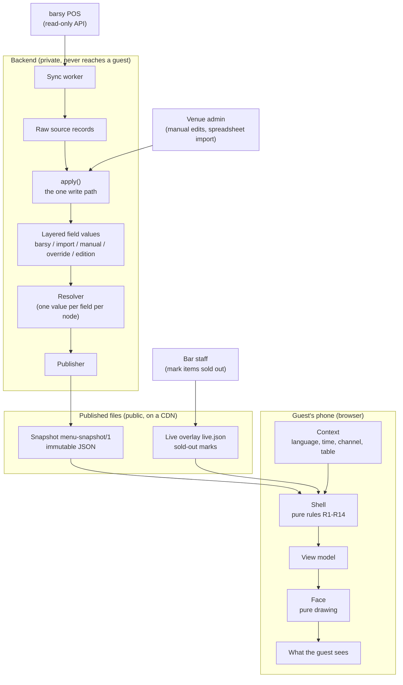

# Restro visualization shell: guide for face designers

Written 2026-10-10 against the Restro code of that date. Where this guide and the code differ, the code wins (the differences I found are listed in Appendix C).

## 0. Read this first

**Restro** is a QR-to-phone menu for nightclubs and bars. A guest scans a code at the table and sees the venue's menu on their phone. The menu data comes from the venue's point-of-sale system (barsy), plus whatever the venue adds by hand (photos, descriptions, tags).

**Your job:** design and build new **faces**. A face is the visual design of the guest menu: layout, typography, spacing, icons, motion. You do not build the data side. Everything the guest sees has already been decided before your code runs. Your component receives a finished object (the **view model**) and draws it.

If you have built digital product passport (DPP) viewers, you already know the shape of this:

| DPP world | Restro |
|---|---|
| Template (schema tree of node types and typed fields) | Menu template: Menu, Section, Item, Modifier group, Option, each with typed fields |
| Passport (one document filled from the template) | Menu document: one venue's menu |
| Public passport page | Published **snapshot**: one immutable JSON file per published menu |
| View engine that walks the template and draws each field with a component per type | Two parts: the **shell** (decides what is shown) and the **face** (draws it) |
| Design tokens (palette, rounding, shadow, logo, font) | `theme`, the same idea |

The one real difference: in your DPP viewers the view engine decided *and* drew. Restro splits those jobs. The shell decides everything that could differ between designs (language, order, prices, state, which image file). The face only draws. That is why a new face can never show a different menu than the old one.

**What you will receive from Martin (the product owner):**

1. This file.
2. `barsy-demo-snapshot.json`: a real published snapshot, made from barsy's demo installation. It shows what the data looks like before the shell touches it.
3. `barsy-demo-view-model.bg.json` and `barsy-demo-view-model.en.json`: the view models the shell produced from that snapshot, in Bulgarian and in English, for one time of day (20:30 Sofia time), the `qr` channel and a table code. **This is the input your face draws.** Another language or time of day gives a different view model from the same snapshot.
4. `shell-handoff-images.zip` (if supplied): the photo files the snapshot points to (`a/<asset id>/w320|w640|w1280.webp`), so your preview can show real pictures. Serve the folder so the paths resolve, or use placeholders of the same aspect ratio.

**The one rule:** a face never sees barsy data, a database, or anything internal. It sees the view model and nothing else.

---

## 1. The big picture



| Box | What it is, in one sentence |
|---|---|
| barsy POS | The venue's till system; Restro only reads from it and never writes back. |
| Sync worker | A background job that pulls articles, categories and modifiers from barsy on a schedule. |
| Raw source records | Each barsy object stored exactly as received, so any later step can be re-run. |
| Venue admin | Where a manager adds photos, descriptions, tags and layout by hand, or imports a spreadsheet. |
| `apply()` | The single function every change from every source goes through; nothing else writes menu data. |
| Layered field values | Every value is stored per layer (barsy, import, manual, override, edition) with who said it and when. |
| Resolver | A pure function that picks one value per field per node from the layers, following fixed ownership rules. |
| Publisher | Validates the resolved menu, strips everything private, and writes a snapshot plus a pointer to the current one. |
| Snapshot | One immutable JSON file holding the whole published menu for a venue; the only thing guests ever read. |
| Live overlay | A tiny JSON file with the items currently marked sold out; read next to the snapshot and refreshed about every 15 seconds. |
| Context | The facts about this particular viewing: the guest's language, the venue's clock, the channel, the table token. |
| Shell | The runtime that applies the population rules R1 to R14 to (snapshot, overlay, context) and returns the view model. |
| View model | A plain-JSON, fully decided description of what to draw: texts already in the right language, prices already formatted, states already computed. |
| Face | A React component that draws the view model; it owns look and feel and nothing else. |

**A face never sees barsy data, the database, the snapshot, the overlay or any internal field.** The only things that reach it are the view model, the face's own manifest, and a few host props (asset base URL, table label, language list; see section 8).

The shell and the face run in the guest's browser (or are rendered on the server for tests). Nothing in the guest path calls the database or barsy.

---

## 2. Why it is built this way

| Principle | What it means | The DPP parallel |
|---|---|---|
| **One write path** | Every change from every source (barsy sync, manual edit, spreadsheet) goes through `apply(changeSet)`. It validates, records the change and who made it, and is the only code allowed to write. | Like a passport API where every edit, whether from a form or a bulk import, runs through the same validation and audit trail. |
| **Layers and provenance** | A price from barsy and a description typed by hand live in different layers; each stored value remembers its layer, source and job. A resolver decides which layer wins per field. Rules are asymmetric: our layers may only make the menu *more cautious* than the till (hide an item, mark it sold out), never un-hide it or change the price of something orderable. | Like a passport field that records who supplied it (manufacturer, supplier, auditor) and refuses edits from the wrong party. |
| **The snapshot is the only thing guests read** | Publishing freezes the resolved menu into one immutable JSON file on a CDN. Fast, cacheable for a year, and by construction free of private data, because the publisher's output schema has no place to put it. | Like the published passport JSON that a QR code resolves to, as opposed to querying the live database per scan. |
| **All decisions live in the shell** | Language fallback, money formatting, item state, schedules, ordering, image variant, readable colours: all computed once, by tested pure code. Every face therefore shows the same truth. | Like moving "which fields are visible to which audience" out of every viewer and into one place. |
| **Faces change only the look** | A face may choose layout, type, icons and motion. It may not reorder, regroup, hide, recompute or reformat. | Like swapping the CSS and components of your passport viewer without touching what it displays. |

Consequence for you: if the data looks wrong (a wrong price, a missing translation, a strange order), the fix is never in a face. Tell Martin; do not patch around it.

---

## 3. The snapshot (`menu-snapshot/1`)

You do not read the snapshot in a face, but you should understand it, because the view model mirrors it and `barsy-demo-snapshot.json` is the easiest way to see the real data.

### 3.1 Conventions

- **Normalised by id.** Sections, items, modifier groups, options, tags and assets are stored once, in objects keyed by id. Other things refer to them by id.
- **Order is carried by arrays.** `menu.sections`, `section.sections`, `section.items`, `item.modifier_groups` and `group.options` are arrays of ids; their order is the display order.
- **Ids are opaque and prefixed:** `nd_` (menu, section, item, modifier group, option), `as_` (asset/image), `tg_` (tag), `sn_` (snapshot), `vn_` (venue). Each is the prefix plus 22 base62 characters. Never parse or show them.
- **Text is localised:** `{ "bg_BG": "Негрони", "en_US": "Negroni" }`. Optional text may be `{}`. Supported locales: `bg_BG en_US de_DE es_ES fr_FR it_IT ro_RO ru_RU sr_RS el_GR tr_TR`.
- **Money is integer minor units:** `{ "amount_minor": 1250, "currency": "EUR" }` is 12,50 EUR. Only EUR exists today.
- **The schema is a strict allowlist.** Every object rejects unknown keys, and a final check proves that every id refers to something present, every node is reachable from the menu, sections form a tree, each modifier group belongs to one item and each option to one group, all money is in the snapshot currency, and every custom field value matches its declared type.

### 3.2 Shape

| Key | Holds |
|---|---|
| `schema` | The literal `"menu-snapshot/1"`. |
| `snapshot` | Header: `id` (`sn_`), `version` (integer), `hash` (SHA-256), `published_at` (ISO 8601 with offset), `menu_id`, `venue_id`, `edition` (list of `master`, `venue:<vn_ id>`, `service:<date>`). |
| `locales` | `{ default, available[] }`. The default is always in `available`. |
| `currency` | `"EUR"`. |
| `theme` | `palette` (1 to 16 lower-case `#rrggbb` colours; the shell expands them to 11 steps), `font` (a family name), `radius` (0 to 32 px), `shadow` (0 to 5), `logo` (an `as_` id or null). |
| `assets` | `as_` id to `{ w, h, focal {x,y} or null, alt (localised), variants { thumb, card, full } }`. A variant is a path like `/a/as_…/w640.webp`. A small original may use the same file for several variants. |
| `field_types` | Declarations of the venue's custom fields, in template order: key to `{ type, label (localised), unit or null }`. Types: `short_text long_text localized_text number boolean date datetime money measurement range tags enum enum_set availability`. |
| `menu` | `{ id, title, intro, availability (weekly schedule or null), sections[] }`. |
| `sections` | `nd_` id to `{ title, description, image (as_ or null), hints { color or null, icon or null }, sections[] (sub-sections), items[] }`. |
| `items` | `nd_` id to the item record (below). |
| `modifier_groups` | `nd_` id to `{ name, min, max, options[] }`. |
| `options` | `nd_` id to `{ name, price_delta (money or null) }`. |
| `tags` | `tg_` id to `{ label (localised) }`. |

An item record:

```json
{
  "name": { "bg_BG": "Негрони", "en_US": "Negroni" },
  "description": { "en_US": "Gin, Campari, vermouth" },
  "price": { "amount_minor": 1250, "currency": "EUR" },
  "price_from": null,
  "image": "as_9f2…",
  "allergens": ["sulphites"],
  "dietary": ["vegan"],
  "tags": ["tg_…"],
  "portion": { "value": 90, "unit": "ml" },
  "badges": ["new"],
  "availability": { "state": "available", "schedule": null },
  "order_mode": "orderable",
  "orderable": true,
  "modifier_groups": ["nd_…"],
  "fields": { "abv": 24 }
}
```

- `availability.state` is `available` or `sold_out`. Scheduled and live sold-out states are derived later by the shell.
- `availability.schedule` is a weekly window, for example `{ "timezone": "Europe/Sofia", "rules": [{ "days": [5, 6], "from": "22:00", "to": "04:00" }] }` (days are ISO weekdays, 1 = Monday; a window may run past midnight).
- `order_mode` is `orderable` or `ask_waiter`.
- `badges` holds `"new"`, a dietary label, or a `tg_` id.
- `fields` holds custom field values, keyed by the keys in `field_types`.
- Hidden items are not in the snapshot at all.

### 3.3 What a snapshot never contains

barsy ids (article, category, place ids), barsy internal names, cost or delivery prices, `internal_note` and any other internal field, override bases, review state, provenance, anything a guest should not see. There is nowhere in the schema to put them. This is why a face can be given the data without any further filtering.

### 3.4 Files on the CDN

| File | Contents | Cache |
|---|---|---|
| `/snap/<snapshot_id>.json` | The snapshot. Never changes. | Immutable, one year |
| `/m/<menu>/<venue>/current.json` | Pointer: `{ snapshot_id, version, hash }`. | 30 s |
| `/m/<menu>/<venue>/live.json` | The live overlay (section 4). | 15 s |
| `/a/<asset_id>/w<width>.webp` | Image files. | Immutable |

A new publish writes a new snapshot and moves the pointer; rolling back moves the pointer back. The guest page loads the pointer, then the snapshot it names, then the overlay.

---

## 4. The live overlay (`live.json`)

Bar staff mark items sold out ten times a night. Publishing a snapshot for each would be wasteful, so sold-out marks travel in a separate tiny file:

```json
{ "version": 128, "items": { "nd_…": { "sold_out": true } } }
```

- It can only ever say `sold_out: true`. It can never put an item back on sale; an item absent from the overlay is simply "no statement".
- The host page refreshes it about every 15 seconds while the page is visible (and the pointer every 30 seconds). It is never a new snapshot.
- The shell merges it in (rule R5). The face never fetches it and never sees it: a sold-out item just arrives with `state.code === "sold_out"`.

**What this means for a face:** the `view` prop will change object identity about every 15 seconds, and an item's `state` can flip while the guest is reading. Therefore:

- Key lists by `item.id` and `section.id`, never by index.
- Keep UI state (open sheet, active filters, scroll position, expanded descriptions) across updates. Do not reset on a new `view`.
- Do not animate state flips in a way that moves the layout under the guest's thumb.

---

## 5. The shell and the rules R1 to R14

### 5.1 What the shell does

`buildViewModel(snapshot, overlay, context)` is a pure function: the same three inputs always give the same view model. It reads nothing else (no clock, no network, no globals).

The **context** is built by the host page:

| Field | Meaning |
|---|---|
| `locale` | The language asked for. The host picks it from the URL, then the browser, then the menu default. |
| `now` | The current instant (ISO 8601 with offset). Passed in so schedules are testable. |
| `timeZone` | The venue's time zone (Europe/Sofia unless the venue says otherwise). |
| `channel` | `qr`, `kiosk`, `print` or `tv`. **Only `qr` is built right now.** |
| `tableToken` | Opaque token from the table's QR code, or null. |
| `orderingEnabled` | Whether ordering is switched on for the venue. **False for now.** |
| `soldOutDisplay` | Menu setting `show` or `hide` for sold-out items. |
| `images` | The face's declared image slots: for `item`, `section` and `logo`, a variant (`thumb`, `card`, `full`) and the screen's pixel density. |

### 5.2 The rules

| Rule | Plain meaning | What you get in the view model |
|---|---|---|
| **R1 Visibility** | Only nodes that are in the snapshot exist. An item (or the whole menu) outside its schedule is marked "scheduled" with the opening time on `qr` and `kiosk`, and left out entirely on `print` and `tv`. A section with nothing left to show is dropped. | `state.code === "scheduled"` with `state.schedule`; `menu.schedule` while the whole menu is closed. |
| **R2 Order** | Sections, items, groups and options appear in snapshot array order. A face may flow them into columns but may never reorder or regroup. | Arrays are already in final order. Draw them in that order. |
| **R3 Language** | Each text: requested language, then the menu default, then any available one. Never empty; a node with no readable name in any language is dropped. A fallback text says which language it is really in. | Every text is `{ text, lang }`. Set the HTML `lang` attribute when `lang` differs from `view.locale`. |
| **R4 Money** | Prices are formatted from minor units for the language and currency. "From" prices read "from 12,50 €". Option deltas read "+3,00 €". A zero delta shows nothing. | `price.text`, `price.from`, `option.delta.text`. Print these strings; never compute with `minor`. |
| **R5 State** | Each item is `available`, `sold_out` (snapshot or overlay), `scheduled` or `unavailable`. Precedence, most cautious first: unavailable, sold out, scheduled, available. The menu setting `show` or `hide` for sold-out items is applied by the shell. | `state.code` and a ready-made `state.label` (null when available). |
| **R6 Allergens** | Every food item's allergens must be reachable on every face, in a way the face declares (see `allergen_mode`). No face may omit them; EU food law requires it. | `item.allergens[]` with legend numbers and labels, and `allergenLegend` for the menu. |
| **R7 Required slots** | Name, price (when priced), allergen access and state must be drawn. A face that cannot render one cannot be installed. | `item.name`, `item.price`, `item.allergens`, `item.state`. |
| **R8 Empty optional slots** | An empty optional slot collapses. No placeholder text such as "No value set". | `null` or an empty array means "draw nothing". |
| **R9 Text length** | Names are never truncated. A description may be cut only where the reader can expand it (`qr`, `kiosk`). | `description.truncatable`. |
| **R10 Images** | The shell picks the file variant from the face's declared slot size and the pixel density, and passes the focal point. With no image, the face uses its declared no-image layout. | `image.src`, `image.variants`, `image.objectPosition`; `item.noImage`. |
| **R11 Ordering controls** | Ordering controls appear only if the item is orderable and available, ordering is on for the venue, the channel supports it and a table token is present. An "ask the waiter" item shows its price and a note instead. | `order.controls` (always false today) and `order.askWaiter`. |
| **R12 Custom fields** | Custom fields are formatted per type by the shell, in template order, into one list. | `item.extraFields[]`, each with a label and ready text. |
| **R13 Theme** | Faces use theme tokens only. The shell derives readable text-on-colour pairs because any brand colour can arrive. | `theme.palette`, `theme.colors`, `theme.colorsDark`, `section.hints.onColor`. |
| **R14 Determinism** | No rule reads anything but the snapshot, the overlay and the context. | The same inputs always give the same view model. |

### 5.3 What the shell already does, so a face must not redo it

- **Language fallback and the `lang` of each text.** Do not look up translations or fall back yourself.
- **Money formatting.** Do not use `Intl.NumberFormat`, `toFixed`, currency symbols, or any arithmetic on prices.
- **Item state,** including sold-out merging and schedules. Do not compare times or read the clock. "from 18:00" is already text.
- **Image variant choice** by slot size and screen density. You may still use `srcset` over `image.variants` (section 6); you must not construct image URLs.
- **Readable colour pairs.** Do not compute contrast or lighten and darken colours; use the semantic colours.
- **Allergen numbering and labels,** custom-field formatting, dietary and tag labels, "New" badges, "Ask your waiter".
- **Dropping things:** hidden items, items without a readable name, empty sections, closed items on print/tv.
- **Order of everything.**

What is still yours: layout, typography, spacing, shape, iconography, motion, how details are revealed (inline, accordion, sheet), the filter and jump-to-section interfaces, and the loading/empty states.

---

## 6. The view model

This is what your face draws. It is plain JSON: no `Date`, no `Map`, no functions. Condensed from `packages/shell/src/view-model.ts`, `images.ts`, `money.ts`, `schedule.ts` and `palette.ts`:

```ts
type Locale = 'bg_BG' | 'en_US' | 'de_DE' | 'es_ES' | 'fr_FR' | 'it_IT'
            | 'ro_RO' | 'ru_RU' | 'sr_RS' | 'el_GR' | 'tr_TR'
type Channel = 'qr' | 'kiosk' | 'print' | 'tv'

type Allergen = 'gluten' | 'crustaceans' | 'eggs' | 'fish' | 'peanuts' | 'soybeans' | 'milk'
              | 'nuts' | 'celery' | 'mustard' | 'sesame' | 'sulphites' | 'lupin' | 'molluscs'
type DietaryLabel = 'vegan' | 'vegetarian' | 'gluten_free' | 'lactose_free' | 'halal' | 'kosher'

/** A text and the language it is really in (R3). */
interface ViewText { text: string; lang: Locale }

interface ViewModel {
  locale: Locale                      // the interface language in use (requested, else menu default)
  currency: 'EUR'
  channel: Channel
  menu: {
    id: string                        // nd_
    title: ViewText | null
    intro: ViewText | null
    schedule: ViewSchedule | null     // set while the whole menu is outside its schedule
  }
  sections: ViewSection[]             // top level, in order
  allergenLegend: ViewAllergen[]      // allergens that occur on THIS menu, numbered, legend order
  filters: { tags: ViewTag[]; dietary: ViewDietary[] }   // chips worth offering, reading order
  ordering: { enabled: boolean }      // false for now
  theme: ViewTheme
}

interface ViewSection {
  id: string                          // nd_
  title: ViewText
  description: ViewText | null
  image: ViewImage | null
  hints: {
    color: string | null              // optional venue colour for the section
    onColor: string | null            // a text colour guaranteed to read on `color`
    icon: string | null               // an icon name, free-form; draw it only if you know it
  }
  sections: ViewSection[]             // sub-sections
  items: ViewItem[]
}

interface ViewItem {
  id: string                          // nd_ (one id per placement; the same item can appear in two sections)
  name: ViewText                      // R7 required, never truncated
  price: ViewPrice | null             // R7 required when not null
  state: ViewState                    // R7 required
  allergens: ViewAllergen[]           // R6/R7 required when non-empty
  description: (ViewText & { truncatable: boolean }) | null
  image: ViewImage | null
  noImage: boolean                    // true when image is null: use the declared no-image layout
  badges: ViewBadge[]                 // dietary labels and tags already shown elsewhere are not repeated here
  portion: { value: number; unit: 'g'|'kg'|'ml'|'l'|'cl'|'pcs'; text: string } | null   // text is "90 ml"
  dietary: ViewDietary[]
  tags: ViewTag[]
  extraFields: ViewExtraField[]       // custom fields, formatted, in template order
  modifierGroups: ViewModifierGroup[]
  order: { controls: boolean; askWaiter: ViewText | null }
}

interface ViewPrice {
  minor: number; currency: 'EUR'      // for the machines; never compute with these
  amount: string                      // "12,50 €"
  from: boolean                       // true when it is a "from" price
  text: string                        // what to print: "12,50 €" or "from 12,50 €" (already localised)
}

interface ViewState {
  code: 'available' | 'sold_out' | 'scheduled' | 'unavailable'
  label: ViewText | null              // "Sold out", "from 18:00"; null for available
  schedule: ViewSchedule | null       // set when code is 'scheduled'
}
interface ViewSchedule {
  opensAt: string                     // "18:00" (24 h)
  weekday: number | null              // ISO weekday it opens on (1 = Mon); null = later today
  text: ViewText                      // ready words, e.g. "from 18:00", "tomorrow from 18:00"
}

interface ViewAllergen { code: Allergen; number: number; label: ViewText }   // number 1-14 (Appendix A)
interface ViewDietary  { code: DietaryLabel; label: ViewText }
interface ViewTag      { id: string /* tg_ */; label: ViewText }
type ViewBadge =
  | { kind: 'new';     label: ViewText }
  | { kind: 'dietary'; code: DietaryLabel; label: ViewText }
  | { kind: 'tag';     id: string;   label: ViewText }
interface ViewExtraField { key: string; type: string; label: ViewText; text: string; lang: Locale | null }
//   `text` is final ("24 %", "Yes"); `lang` is set only when `text` is words in a known language.

interface ViewModifierGroup {
  id: string; name: ViewText
  min: number; max: number            // how many options a guest picks
  required: boolean                   // min >= 1
  options: { id: string; name: ViewText; delta: { minor: number; currency: 'EUR'; text: string } | null }[]
}                                     // delta.text is "+3,00 €"; null when the option costs nothing extra

interface ViewImage {
  id: string                          // as_
  src: string                         // the shell's pick for this slot and density: "/a/as_…/w640.webp"
  variant: 'thumb' | 'card' | 'full'
  width: number                       // pixel width of `src`
  variants: { src: string; width: number }[]   // every distinct file, narrowest first, for srcset
  sourceWidth: number; sourceHeight: number    // original proportions: reserve space, avoid layout shift
  focal: { x: number; y: number } | null       // 0 to 1 on each axis
  objectPosition: string              // focal point as CSS object-position: "50% 40%"
  alt: ViewText | null
}

interface ViewTheme {
  palette: Record<'50' | '100' | '200' | '300' | '400' | '500'
                 | '600' | '700' | '800' | '900' | '950', string>   // 11 steps, light to dark
  colors: SemanticColours             // light scheme
  colorsDark: SemanticColours         // dark scheme
  font: string                        // a font family name, e.g. "Inter"
  radius: number                      // px, 0 to 32
  shadow: number                      // level 0 to 5
  logo: ViewImage | null
}
interface SemanticColours {
  background: string                  // the page
  surface: string                     // cards and sheets
  accent: string                      // brand colour for fills (buttons, chips, markers)
  onAccent: string                    // text and icons on `accent`
  text: string                        // body text; reads on background and surface
  muted: string                       // secondary text; reads on background and surface
  accentText: string                  // brand colour as text or outline; reads on background and surface
  border: string                      // dividers and card outlines
}
```

### 6.1 How to read it

- **`null` or `[]` means draw nothing.** Do not leave a heading, a label or an empty box behind.
- **Image paths are relative** (`/a/as_…/w640.webp`). The host tells the face where the files live (an `assetBase` prop); join the two. Never hard-code a host.
- **`image.variants` lets the browser choose.** Use `srcset` with width descriptors (`${base}${file.src} ${file.width}w`) and a `sizes` that matches your layout; keep `src` as the fallback. Use `sourceWidth` and `sourceHeight` (or your own aspect ratio) to reserve space, and `objectPosition` when you crop with `object-fit: cover`.
- **Colour names differ between the view model and the manifest.** The view model says `onAccent`, `accentText`; the manifest token list says `color.on_accent`, `color.accent_text`.
- **`theme.colors` and `theme.colorsDark` are complete sets.** To follow the guest's screen, define both as CSS variables and switch on `prefers-color-scheme`. Offer a `scheme` prop (`auto | light | dark`) to force one, for previews and screenshots.
- **`state` is the whole truth about availability.** `sold_out` and `unavailable` are visibly muted (not hidden; the shell already hid what should be hidden). `scheduled` shows `state.label` ("from 18:00"). `available` has no label.
- **An empty `allergens` list means the item lists none.** Do not print "no allergens", "allergen-free" or any claim of your own.
- **Filters.** `view.filters` lists only tags and dietary labels that occur on this menu. Filtering is UI state inside the face, and it must never reorder (R2). Keep the reference face's semantics: dietary chips combine with AND (an item must carry every chosen label), tag chips with OR (any chosen tag), a section emptied by filtering is hidden, and a "clear filters" action is always reachable.

### 6.2 The sample

`barsy-demo-view-model.bg.json` (and its `.en.json` twin) is one such object, built from `barsy-demo-snapshot.json`. Open both side by side once: the snapshot has ids, multi-language text objects and minor-unit money; the view model has the same menu with one language chosen, text already formatted, and states computed.

---

## 7. The face contract

### 7.1 The manifest

Every face ships a manifest that declares what it draws and how. Installing a face validates it, and the contract tests run against it. The manifest of the reference face:

```json
{
  "face": "qr-phone",
  "version": "1.0.0",
  "channels": ["qr"],
  "slots": {
    "item.name": "required",
    "item.price": "required",
    "item.allergens": "required",
    "item.state": "required",
    "item.description": { "optional": true, "lines": 3, "overflow": "expand" },
    "item.image": { "optional": true, "variant": "card", "aspect": "4:3" },
    "item.badges": "optional",
    "item.portion": "optional",
    "item.dietary": "optional",
    "item.tags": "optional",
    "item.extra_fields": "optional",
    "item.modifiers": "optional"
  },
  "allergen_mode": "inline_codes",
  "no_image_layout": "text_only",
  "ordering": false,
  "paging": null,
  "tokens": [
    "color.background", "color.surface", "color.accent", "color.on_accent",
    "color.text", "color.muted", "color.accent_text", "color.border",
    "font", "radius", "shadow", "logo"
  ]
}
```

| Field | Allowed values and meaning |
|---|---|
| `face` | kebab-case name, for example `qr-neon`. |
| `version` | `x.y.z`. |
| `channels` | One or more of `qr`, `kiosk`, `print`, `tv`, no repeats. **Declare `["qr"]`**; only the QR phone channel is built now. |
| `slots` | Map from slot name to `"required"`, `"optional"`, or an options object (below). The four required slots must be exactly `"required"`. |
| `allergen_mode` | How the face makes allergens reachable (R6): `inline_icons`, `inline_codes`, `numbered_legend`, `info_link`, `info_qr`. For a phone face the sensible choices are `inline_icons` or `inline_codes`; either way, explain the codes somewhere reachable (a tap sheet and/or a legend, as the reference does). |
| `no_image_layout` | What an item without an image looks like: `text_only` (no image box at all), `placeholder`, `section_hint` (R10). |
| `ordering` | `true` only if the face has ordering controls and a channel that can order. **Declare `false`** for now. |
| `paging` | `null` for a scrolling face (all `qr` and `kiosk` faces). Fixed or rotating pages are for print and TV only. |
| `tokens` | The theme tokens the CSS reads. Allowed names: `palette.50` to `palette.950`, `color.background`, `color.surface`, `color.accent`, `color.on_accent`, `color.text`, `color.muted`, `color.accent_text`, `color.border`, `font`, `radius`, `shadow`, `logo`. No repeats. |

An options object for a slot is `{ "optional": true, "lines"?: n, "overflow"?: "expand" | "reflow", "variant"?: "thumb" | "card" | "full", "aspect"?: "W:H" }`.

- `overflow: "expand"` means the text may be cut and the guest can expand it (allowed only when every channel is `qr` or `kiosk`); `"reflow"` means never cut.
- `variant` on `item.image` tells the shell which file size the slot is designed for; the shell steps up one size on 2x or denser screens. `aspect` documents the crop your face applies.

The manifest is strict: an unknown key or an unknown slot name fails validation. The validator also rejects, among others: a missing required slot, a required slot declared optional or with options, `ordering: true` without `qr` or `kiosk`, `paging` set on a scrolling face, and duplicate channels or tokens. If you need a slot or token that does not exist, ask; do not invent one.

### 7.2 Slots

A **slot** is a named piece of an item card. Required slots (R6, R7) must be drawn whenever they have content:

| Slot | Required? | Draw when | Data |
|---|---|---|---|
| `item.name` | Required | Always | `item.name` |
| `item.price` | Required | `item.price !== null` | `item.price.text` |
| `item.allergens` | Required | `item.allergens.length > 0` | `item.allergens`, `view.allergenLegend` |
| `item.state` | Required | Always, even for `available` (it may be visually empty) | `item.state` |
| `item.description` | Optional | `item.description !== null` | `item.description` |
| `item.image` | Optional | `item.image !== null` | `item.image` |
| `item.badges` | Optional | `item.badges.length > 0` | `item.badges` |
| `item.portion` | Optional | `item.portion !== null` | `item.portion.text` |
| `item.dietary` | Optional | `item.dietary.length > 0` | `item.dietary` |
| `item.tags` | Optional | `item.tags.length > 0` | `item.tags` |
| `item.extra_fields` | Optional | `item.extraFields.length > 0` | `item.extraFields` |
| `item.modifiers` | Optional | `item.modifierGroups.length > 0` | `item.modifierGroups` |

Menu-level slot names the contract tests know: `menu.allergen_legend` (a numbered legend; required for `numbered_legend` faces whenever the menu has allergens), `menu.allergen_info` (an info link or QR code, for `info_link` and `info_qr` faces). The reference face also marks `menu.title`, `menu.intro`, `menu.table` and `menu.allergen_sheet`; these are free to use but not checked.

The rest of the view model (section titles, section images, the jump bar, filters, the language switch, the logo) is drawn freely, but obeys the same rules: nothing truncated except descriptions with an expand control, `null` collapses, language attributes set.

### 7.3 The markers the tests read

The contract tests read your markup. Three attributes are mandatory:

| Attribute | Where | Value |
|---|---|---|
| `data-item` | On the element that wraps one item placement | The item's `id` (`nd_…`). One per placement, drawn once, in view-model order. |
| `data-slot` | On the element for each slot inside the item (and the menu-level slots above) | The slot name, for example `item.name`. |
| `data-state` | On the `item.state` slot element | The state code: `available`, `sold_out`, `scheduled`, `unavailable`. |

The reference face also puts `data-state` on the item wrapper, which is handy for styling (`.card[data-state="sold_out"]`).

Reading order that the tests expect: for each section, its **own items first, then its sub-sections** (each in the same way), depth first, sections in view-model order. Section titles, images and descriptions can sit around that however you like.

### 7.4 The contract tests

The tests live in `packages/shell/testing/contract.ts`. They render your face (to a static HTML string) for every fixture on every channel your manifest declares, and report each failure with the rule it breaks.

**Fixtures** (every face must survive all ten):

| Fixture | The hard case |
|---|---|
| `long-names` | Item names of exactly 60 characters, in Bulgarian and English, with and without a price. |
| `six-languages` | Six languages with gaps; the guest asks for French and some texts lack it, so fallback texts arrive with a different `lang`. |
| `no-images` | No assets at all. |
| `with-images` | A photo, a photo with a focal point, an item without one, on a 2x screen. |
| `sold-out` | One item sold out in the snapshot, two more by the live overlay. |
| `scheduled` | A late-night item closed on a Wednesday evening, an open evening item, a plain one. |
| `big-menu` | 300 items in 10 sections. |
| `deep-modifiers` | One item with four modifier groups of six options each, with price deltas and a "from" price. |
| `ask-waiter` | An item guests cannot order by phone beside an orderable one. |
| `tags-dietary` | Tags, dietary labels, a "New" badge, a portion and three custom fields. |

**Checks:**

| Rule | What is asserted |
|---|---|
| R2, R7 | Every item placement is drawn exactly once as `data-item`, in view-model order. |
| R7 | Each item has `item.name` and `item.state`; `item.price` when it has a price; `item.allergens` when it lists allergens. |
| R9 | The full name text is inside the `item.name` slot. |
| R3 | If a name arrives in a different language than the page, a `lang` attribute with the BCP 47 tag (`bg-BG`, not `bg_BG`) must be on the slot element, inside it, or on its nearest ancestor that has a `lang` (a `lang` on the page root alone is not enough, because it says the page language). |
| R5 | `item.state` carries `data-state` equal to the state code. |
| R8 | An empty optional slot is not drawn (the image slot may be drawn without an image unless the manifest says `text_only`); an optional slot declared in the manifest and having content is drawn. |
| R6 | Allergens reachable in the manifest's mode. For `numbered_legend`, the slot shows the allergen's number. For `inline_icons`/`inline_codes`, the allergen's label or its code appears in the slot's text or in an `aria-label`, `title`, `alt` or `data-allergen` attribute inside it. For `info_link`/`info_qr`, the menu-level `menu.allergen_info` slot must exist. |
| Rule 3 | No id-shaped string of any kind other than `nd_`, `as_` and `tg_` appears in the markup. |

Consequences that are easy to miss:

- **The face must render to static markup.** Do not read `window`, `document`, `localStorage` or `matchMedia` while rendering; do it in effects or event handlers. All content must be in the first render, not added after a `useEffect`.
- **Do not virtualise or paginate the item list.** All 300 items must be in the markup in order. If performance on long menus worries you, use plain CSS such as `content-visibility: auto`.
- **Do not truncate names with `text-overflow: ellipsis` or line clamps.** Wrap them (`overflow-wrap: anywhere`). The 60-character fixture exists to catch this.

The tests check markup. The visual rules in 7.5 are not machine-checked today (screenshot comparison is planned), so they are reviewed from your screenshots and your CSS.

### 7.5 Visual and accessibility rules

- **Theme tokens only.** Every colour comes from `theme.colors`/`theme.colorsDark` (or `theme.palette`) through CSS variables. No hex, `rgb()`, `hsl()` or named colours in the face's CSS. Same for `font`, `radius` and `shadow`. Treat any literal colour as a defect.
- **Light and dark.** Support both with the two colour sets. Text-on-colour pairs are already contrast-checked (WCAG AA, at least 4.5:1) as long as you pair them as the names say: `text`/`muted`/`accentText` on `background` or `surface`; `onAccent` on `accent`; `section.hints.onColor` on `section.hints.color`. Do not put `muted` text on an `accent` fill.
- **Tap targets of at least 44 by 44 px** for everything tappable (chips, buttons, language switch, allergen codes, close buttons).
- **`prefers-reduced-motion`.** Any animation or smooth scroll must switch off for guests who ask for less motion.
- **Allergens are always reachable** (EU food law). Every item that lists allergens shows them, or a visible control that opens them, in the mode the manifest declares. Never drop them in a compact layout or on a small screen, and never make them depend on hover.
- **Never truncate a name.** Descriptions may be cut only with a visible way to read the rest (`description.truncatable` is true on `qr`).
- **Set `lang`** on any text whose `lang` differs from `view.locale`; set the page root's `lang` to `view.locale` as BCP 47.
- **Cyrillic first.** Bulgarian is the default language. Check every screen with long Cyrillic words, and use the `font` token with a system-font fallback. Do not load fonts or scripts from third-party hosts.
- **No layout shift.** Reserve image space from `sourceWidth`/`sourceHeight` or a fixed aspect ratio.
- **Semantics.** One `h1` (menu title), `h2` for sections, `h3` for items (`h4` in sub-sections), real `button`s and `nav` for controls, visible focus styles, dialogs with `role="dialog"`, focus moved in and returned on close, Escape closes.

---

## 8. The reference face: `packages/faces/qr-phone`

The reference face is the only face today. **It is an example of how to satisfy the contract, not a design to copy.** Your face should look different.

Files:

| File | What it does |
|---|---|
| `src/manifest.ts` | The manifest above, validated when the module loads, so an invalid face cannot even be imported. |
| `src/face.tsx` | `QrPhoneFace`: the page. |
| `src/item-card.tsx` | `ItemCard`: one item placement, with all the slots; also the `Text` and `Photo` helpers. |
| `src/allergen-sheet.tsx` | `AllergenSheet`: the bottom sheet opened by an allergen code. |
| `src/css.ts` | `FACE_CSS`: the entire stylesheet as one string, injected in a `<style>` element. |
| `src/model.ts` | Small pure helpers: `bcp47()`, `langOf()`, `assetUrl()`, filter functions, `themeVariables()`. |
| `src/notices.tsx` | A loading skeleton and a notice (unknown venue, not published, load failed). |

**Props.** The face receives the view model and a few host props:

```ts
interface QrPhoneFaceProps {
  view: ViewModel
  assetBase?: string                       // where /a/... files live; default "/cdn"
  languages?: Locale[]                     // languages the menu has; fewer than two hides the switch
  onLanguageChange?: (locale: Locale) => void
  tableLabel?: string | null               // "12" from the table's QR code, or null
  fontStacks?: Record<string, string>      // theme font name -> self-hosted font stack
  scheme?: 'auto' | 'light' | 'dark'       // force a colour scheme (previews, screenshots)
}
```

**Layout, top to bottom (a 40 rem column, centred, 16 px gutters):**

1. Header: venue logo, `h1` menu title, a pill language switch (BG / EN), the intro, a table banner ("Table 12") when a table label exists, and a notice if the whole menu is outside its schedule.
2. A sticky jump bar: pill links to each top-level section, highlighting the section being read (shown only when there is more than one section).
3. Filter chips: one row for dietary labels, one for tags, each with an "All" chip (shown only when the menu has any).
4. Sections: `h2` title, optional description and image (a section colour hint becomes a left border), then a list of item cards, then sub-sections.
5. Item card: optional 4:3 photo (srcset over `image.variants`, `object-position` from the focal point), name and price on one row, the state pill (hidden when available, since it has no label), description clamped to three lines with a "More" button that appears only when something is actually cut, portion pill, dietary and tag pills, "New" badge, the allergen codes (numbered circles, each a 44 px button), custom fields as a definition list, modifier groups as a plain text list ("Group: option +3,00 €, …"), and the "Ask your waiter" note when present. Sold-out and unavailable items are greyed (photo in greyscale, muted name and price).
6. Footer: "Allergen information" with the numbered legend of everything on this menu.
7. Allergen sheet: tapping a code opens a bottom dialog naming that item's allergens, highlighted within the menu's full legend; focus is trapped on the close button, Escape or a tap outside closes, and focus returns to the code that opened it.

**How it follows the contract:** the stylesheet contains no colours of its own, only `var(--rq-…)`. `themeVariables(view.theme)` writes light variables (`--rq-l-*`) and dark variables (`--rq-d-*`) onto the root; CSS maps one set to the working names (`--rq-bg`, `--rq-text`, …) by `prefers-color-scheme` or by the `scheme` prop. Radius and shadow arrive as variables too. The only literal colours are CSS system-colour keywords (`Canvas`, `GrayText`, …) used as fallbacks in the loading and error states, before any theme exists. All tappable things are at least 44 px. Animation lives inside `@media (prefers-reduced-motion: no-preference)` and is force-disabled in a `reduce` block.

**What was taken from the DPP-style view engine:** sections in order, content in definition order, empty things skipped. **What changed:** no per-field-type `switch` (the shell formats every field before the face sees it), no hard-coded colours, and order and empty-slot rules come from the shell instead of being redone in the component.

Take from it: the structure of a root component that only reads `view`, the `data-*` markers, the `Text` helper that applies `lang` only when it differs, `srcset` from `image.variants`, the dark/light variable pattern, the dialog behaviour. Do not take: the visual design.

---

## 9. How to deliver a new face

### 9.1 What to build

- **React 19 function components.** The root takes the view model (and the manifest where useful) as props, plus the same host props as the reference face (`assetBase`, `languages`, `onLanguageChange`, `tableLabel`, `fontStacks`, `scheme`). Export it as a named component, and export the manifest as a constant.
- **Dependencies: React and nothing else.** The host does not provide Tailwind, shadcn/ui, icon packs, animation libraries or fonts. Use plain CSS and inline SVG. If you truly need something more, list it as a request in your notes; do not add it.
- **CSS from variables.** Ship the stylesheet as one string exported from `css.ts` (as the reference does) or a single plain `.css` file. Every colour, font, radius and shadow is a CSS variable derived from `view.theme`; write a small `themeVariables(theme)` function like the reference's and apply it on the root element. Prefix your variables and classes with a short face-specific prefix, to avoid collisions with other faces.
- **No data fetching.** No `fetch`, no database, no URLs of your own, no reading of the snapshot, overlay or barsy.
- **No state beyond UI state.** Open sheets, active filters, expanded descriptions, active section in the jump bar, and nothing else.
- **No date, money, language or colour logic.** Section 5.3 is the full list. If you find yourself writing `new Date`, `Intl`, `toFixed`, a sort, a translation table (other than for interface strings below), or a colour function, stop.
- **Every slot carries its `data-slot`,** every item placement its `data-item`, and the state slot its `data-state` (section 7.3).
- **Mobile first for the `qr` channel.** Design for 360, 390 and 430 px wide phones, test 320 px as a stress case, and let a wider screen centre a column (do not stretch cards across a desktop).
- **Interface strings.** The words around the menu ("More", "Close", "Allergens", "All", "Menu sections", "Table 12", …) come from a fixed set called `GuestStrings`, owned by the shell (Appendix B, Bulgarian and English). Put them in one file, `guest-strings.ts`, with exactly those keys, so the Restro team can replace it with the shell's own. If your design needs a new word, list it in your notes with the Bulgarian and English text; do not scatter hard-coded strings through components. Menu text always comes from the view model, never from this file.
- **Keep `view`-derived state stable.** Section 4: stable keys, no resets on refresh.

### 9.2 Handling edge cases while you design

You will not be able to run the shell. To test the cases the contract tests cover, copy `barsy-demo-view-model.bg.json` or `.en.json` into your preview harness and edit the copy by hand (preview only; never ship edited data):

- a 60-character name with no spaces in both languages;
- an item with `image: null` and `noImage: true`, and one with a very tall and a very wide image;
- `state.code` set to `sold_out`, `scheduled` (with `state.label` and `state.schedule`) and `unavailable`;
- `badges`, `tags`, `dietary`, `extraFields`, `portion` all empty, and all full;
- an item with all 14 allergens;
- an item with four modifier groups of six options;
- 300 items in one section;
- `order.askWaiter` set; `menu.schedule` set; `theme.logo` null and not null;
- a `ViewText` whose `lang` differs from `view.locale`;
- a section with `hints.color` set, and nested sub-sections.

Both languages are supplied: take the BG screenshots from the `.bg.json` view model and the EN ones from the `.en.json` one. Do not translate or edit menu text, prices or allergens.

### 9.3 What to hand back

1. The components, the stylesheet, the manifest and `guest-strings.ts`, as a self-contained source folder that compiles with React 19 and TypeScript strict.
2. A type file that copies the interfaces from section 6, so your code compiles without access to Restro. The Restro team will replace it with the shell's real types, so keep the names exactly.
3. **Screenshots** of the same screens in **Bulgarian and English**, in **light and dark**: four sets in total. Each set shows: the top of the page (header, jump bar, filters), a section with image and no-image cards, sold-out and scheduled items, an item with many allergens, and the allergen view open. Name them so the language and scheme are obvious, for example `bg-dark-allergens.png`. Shot at 390 px wide, plus 320 px for the longest-name case.
4. A short note: design intent in three lines; any new interface string, slot or token you want; anything in the contract you could not satisfy and why.

### 9.4 What the Restro team does next

They validate your manifest with `validateManifest`, run the contract tests (`assertFaceContract` over the ten fixtures) against your face, review your CSS and screenshots against section 7.5, and then wire the face into the guest page. Anything that fails goes back to you with the rule number.

### 9.5 Checklist

- [ ] Root component takes `view` and the host props; no fetching, no globals read during render.
- [ ] Manifest valid: four required slots exactly `"required"`, `channels: ["qr"]`, `paging: null`, `ordering: false`.
- [ ] `data-item`, `data-slot`, `data-state` everywhere they belong.
- [ ] Items in view-model order; all 300 in the markup; none drawn twice or skipped.
- [ ] Names whole (wrapped, never ellipsised); `lang` set on every differing text.
- [ ] Price printed from `price.text` only; no arithmetic or formatting.
- [ ] Allergens reachable per `allergen_mode`; the codes explained.
- [ ] Every empty optional slot collapses; no placeholder text.
- [ ] No literal colours; both colour sets used; text-on-colour pairs as named.
- [ ] Tap targets 44 px or more; focus visible; dialog behaviour correct.
- [ ] `prefers-reduced-motion` honoured.
- [ ] Looks right at 320, 360, 390 and 430 px, in Bulgarian and English, light and dark.
- [ ] Images by `srcset` over `image.variants`; space reserved; focal point via `objectPosition`.
- [ ] State survives a refreshed `view` (open sheet, filters, expanded text).
- [ ] Screenshots and notes included.

---

## 10. FAQ

**Can I add a field?**
No. Fields come from the venue's template, and the shell hands over whatever is public in `item.extraFields`, already formatted. If a design needs a field that does not exist (for example ABV as a visual gauge), ask Martin; the field must be added to the template by the Restro team.

**Can I reorder or group items differently (for example by price, or alphabetically)?**
No. Order is rule R2, decided once for all faces. A face may flow items into columns or a grid, but reading order must stay the view-model order.

**Can I hide an empty field?**
You do not need to: the shell has already collapsed it, so it arrives as `null` or `[]`. Just do not draw anything for it.

**Can I hide an item, or a section?**
Not on your own initiative. The shell already drops what should not be shown. The only legitimate hiding is the guest's own filters.

**Where do prices come from? Can I change or round them?**
From barsy, through the till. They arrive as final text in `price.text`. Never edit, round, sum or reformat them, and never derive one from `minor`.

**Can I translate a missing text?**
No. The shell falls back to another language and tells you which (`lang`). Show it with the right `lang` attribute.

**Can I use my own colours for the brand?**
No. The venue's brand colour is expanded into the theme by the shell. Use the semantic colours and the 11-step palette.

**Can I build a "safe for me" allergen filter?**
Not without asking. Allergens are shown, not interpreted; a filter would be a safety claim Restro has not decided to make.

**What about ordering, carts and "add" buttons?**
That is a later stage. The view model already carries `order.controls` (always false today) and `order.askWaiter`, and the manifest has an `ordering` flag, but there is no ordering slot yet. Declare `ordering: false` and build no cart. Do draw the "Ask your waiter" note when `order.askWaiter` is set.

**What about kiosk, print and TV?**
They are planned (different channels, paging, QR codes for allergens) but not built. Design for `qr` only.

**Can I change the page structure, such as paging between sections?**
A face may use any navigation pattern that keeps every item in the markup, in order, with allergens reachable: a sticky bar, tabs that only hide sections with CSS, an accordion. It may not remove items from the markup (no virtualised or lazily mounted lists).

**What if the sample data cannot show a case I need?**
Edit a copy in your preview harness (section 9.2), and never ship edited data. If a case is genuinely unreachable from real data, tell Martin.

---

## Appendix A: allergen numbers

The shell numbers the 14 EU allergens in the order of EU Regulation 1169/2011, Annex II. `ViewAllergen.number` is that number, so a legend is stable across menus.

| No. | Code | English | Bulgarian |
|---|---|---|---|
| 1 | `gluten` | Gluten | Глутен |
| 2 | `crustaceans` | Crustaceans | Ракообразни |
| 3 | `eggs` | Eggs | Яйца |
| 4 | `fish` | Fish | Риба |
| 5 | `peanuts` | Peanuts | Фъстъци |
| 6 | `soybeans` | Soybeans | Соя |
| 7 | `milk` | Milk | Мляко |
| 8 | `nuts` | Nuts | Ядки |
| 9 | `celery` | Celery | Целина |
| 10 | `mustard` | Mustard | Синап |
| 11 | `sesame` | Sesame | Сусам |
| 12 | `sulphites` | Sulphites | Сулфити |
| 13 | `lupin` | Lupin | Лупина |
| 14 | `molluscs` | Molluscs | Мекотели |

Dietary labels: `vegan` (Vegan, Веган), `vegetarian` (Vegetarian, Вегетарианско), `gluten_free` (Gluten-free, Без глутен), `lactose_free` (Lactose-free, Без лактоза), `halal` (Halal, Халал), `kosher` (Kosher, Кашер). Their labels already arrive in the view model.

## Appendix B: interface strings (`GuestStrings`)

These are the words around the menu. Menu text never comes from here. Every locale other than Bulgarian reads the English column. Use exactly these keys in `guest-strings.ts`.

| Key | English | Bulgarian |
|---|---|---|
| `table(label)` | "Table 12" (a label that is not a plain number such as `12` or `12A` is shown as it is) | "Маса 12" (same rule) |
| `menu` | Menu | Меню |
| `language` | Language | Език |
| `sections` | Menu sections | Раздели на менюто |
| `filters` | Filter the menu | Филтриране на менюто |
| `filterAll` | All | Всички |
| `filterDiet` | Diet | Диета |
| `filterTags` | Tags | Етикети |
| `noMatches` | Nothing on the menu matches these filters. | Нищо от менюто не отговаря на тези филтри. |
| `clearFilters` | Clear filters | Изчисти филтрите |
| `more` | More | Още |
| `less` | Less | По-малко |
| `allergens` | Allergens | Алергени |
| `allergensTitle` | Allergens | Алергени |
| `allergensHint` | Tap a code to see what it stands for. | Докоснете код, за да видите какво означава. |
| `footerTitle` | Allergen information | Информация за алергените |
| `footerText` | The codes on each item stand for the allergens it contains. Ask the staff if you have an allergy or any doubt. | Кодовете при всяка позиция обозначават алергените в нея. Попитайте персонала, ако имате алергия или съмнение. |
| `close` | Close | Затвори |
| `loading` | Loading the menu | Менюто се зарежда |
| `menuSchedule(when)` | "Menu {when}" (for example "Menu from 18:00") | "Менюто е {when}" ("Менюто е от 18:00") |
| `notFoundTitle` | Menu not found | Менюто не е намерено |
| `notFoundText` | Check the link, or ask the staff for the right code. | Проверете връзката или попитайте персонала за правилния код. |
| `notPublishedTitle` | This menu is not published yet | Менюто още не е публикувано |
| `notPublishedText` | Please come back in a little while. | Моля, върнете се след малко. |
| `loadFailedTitle` | The menu could not be loaded | Менюто не можа да се зареди |
| `loadFailedText` | Check your connection and try again. | Проверете връзката си и опитайте отново. |
| `retry` | Try again | Опитайте отново |

Words that belong to the menu itself ("Sold out", "Ask your waiter", "New", "from 12,50 €", "from 18:00") are produced by the shell and arrive inside the view model.

## Appendix C: where this guide's sources and the code differ

This guide was checked against both the architecture document and the code, and it describes the code. Differences you may notice if you ever read the architecture document:

1. **Manifest example.** The document's example is illustrative (`qr-mobile` 1.3.0, `inline_icons`, `palette.*` tokens, ordering true). The real reference face is `qr-phone` 1.0.0, `inline_codes`, `color.*` tokens, ordering false. The code also accepts four slots the document's example omits: `item.portion`, `item.dietary`, `item.tags`, `item.modifiers`, and the allergen modes `inline_codes`, `info_link` and `info_qr`.
2. **Image variant paths.** The document says `/a/<asset_id>/<variant>.webp`. The code uses `/a/<as_ id>/w<width>.webp` and requires all three variants `thumb`, `card` and `full` on every asset.
3. **Contract tests and screenshots.** The document says the tests also compare screenshots. The harness today checks markup only. It accepts `nd_`, `as_` and `tg_` ids (the document says only `nd_`).
4. **R9 preview warning.** The document says text that does not fit is "a preview warning". The shell produces no warnings; nothing like that is in the view model.
5. **R5 `unavailable`.** The state exists in the view model, but the current snapshot schema can only carry `available` and `sold_out`, so real data does not produce `unavailable` yet. Draw it anyway; it is muted like sold out.
6. **R10 crop.** The shell chooses the file and passes the focal point as data (`focal`, `objectPosition`). The crop itself is applied by the face with CSS. The manifest's `aspect` documents the face's crop; only `variant` is read by the shell.
7. **R11 "ask waiter".** The document says the item shows an "Ask your waiter" action. In the code it is a text note (`order.askWaiter`), present when the item is available, the channel is interactive and the item is `ask_waiter`, whether or not ordering is switched on.
8. **R13 theme.** The snapshot carries a palette list; the shell expands it to an 11-step palette (50 to 950; if the list is not exactly 11 valid colours, it takes the colour nearest mid-lightness as the brand colour and derives the steps) and adds the semantic colours for light and dark.
9. **R3 "never empty".** In the code a node with no readable name in any language is dropped (item, section, modifier group, option), and a modifier group left with no options is dropped.
10. **Language choice.** The document lists "language from URL, then browser, then default" among the shell's steps. In the code that choice is made by the host page; the shell receives `locale` and falls back to the menu default if the menu lacks it.
11. **Languages for the switch.** The view model carries only the active `locale`. The list of available languages for a language switch is a host prop (`languages`), not part of the view model.
