# State machines of `or/foundation` (A6, the state-machine auditor)

**Pinned commit:** 16b59a82 (read in `E:\Restro\.claude\worktrees\rr-pinned`, detached, read-only). **Made:** 2026-10-30, A6 (Fable), repair-review plan §4. **Method:** reconstructed from the code only (`packages/core/src/service/*.ts`, `apps/worker/src/jobs/*.ts`, `apps/web/src/server/tonight/*.ts`, `guest-api.ts`, the notice route and the migrations 0030–0032); the decisions were read afterwards and compared in §3. Tests were not read as evidence. Line numbers are the pinned commit's.

**How to read the tables.** *Writer* = the `applyService` command (or the worker function) that writes the transition; every service write goes through `applyService` in one short tenant transaction (`engine.ts:259-508`: `lock_timeout 2 s`, `statement_timeout 5 s`, the venue row `FOR SHARE`, then the handler's rows in the fixed order of `lock-order.ts:14-26`: sitting → table_order → sent_order → lease → bill_reading → waiter_call → pause → alert → staff → payment). *Lock* = the rows the handler locks, in that order. *Actor* = who may send the command (`origins` + permission; guests never carry a permission; the worker is `system` or `integration:<in_>`). *Crash* = what happens if the process dies right after the write commits (the POS or provider call that follows has not happened yet; a crash *during* a POS call is the next row's "unknown" branch).

Two things hold everywhere and are not repeated per row:
- A worker step is `by_state` (`definition.ts:29`): a repeated job re-reads the row under its lock and changes nothing when the state has moved on. A refused step throws `PaymentStepRetry`/returns null to the worker, which lets pg-boss retry or the next tick or poll queue it again.
- Every POS and provider write is recorded as a `payment.step` row `attempting` *before* the call (`payments.ts:299-324`, `writePos` 813-859) and with its outcome after; a close (`payAndClose`) and a pay-first entry (`addLines`) are refused a second `attempting` by `payment.step` itself (`pay.ts:1022-1037`, `ONCE_STEPS`).

---

## 1. The five machines

### A. A sent order (bag → Send → the POS → the bill → the sitting's end)

```mermaid
stateDiagram-v2
    direction LR
    [*] --> bag : guest edits (order.add/change/remove/undo/restore)
    bag --> waiting : order.send (guest)\nlines leave the order
    bag --> bag : refused Send (order_changed, item_unavailable,\nduplicate_order, guard_tripped, needs_first_item,\norder_from_waiter, ordering_paused/closed): lines stay
    waiting --> sending : sent_order.transition(sending) (worker)\nafter sent_order.start took the slot lease\nand the table was read (3 tries)
    waiting --> not_sent : sent_order.start: table_closed / ordering_paused\nor prepare failed (pos_table_missing, item_not_on_pos, pos_unreachable)\nor settleWaiting (a pause), or Unconfirmed ahead of it
    sending --> added : addLines done (approvalAtBar off)
    sending --> awaiting_approval : addLines done (approvalAtBar on)
    sending --> not_sent : addLines refused (POS code; item_unavailable flags lines)\nor no turn at the budget (pos_unreachable)\nor pause landed (ordering_paused)
    sending --> checking : addLines unknown (timeout / threw)
    sending --> unconfirmed : sweep: lease expired (check_timed_out)
    checking --> added : read-back matches the round (matchedLines)
    checking --> awaiting_approval : read-back matches, approval on
    checking --> unconfirmed : read-back ambiguous (check_ambiguous)\nor window over (check_timed_out)\nor sweep: lease expired
    unconfirmed --> added : sent_order.answer found (staff)
    unconfirmed --> not_sent : sent_order.answer not_found (staff)
    unconfirmed --> unconfirmed : reading.record matches late\n(matchedLines set, Log landed_late; state unchanged)
    not_sent --> bag : lines back on the order (same sitting only)
    added --> [*] : on the bill; sitting ends (C) clears nothing of it
    awaiting_approval --> [*] : read-only in Tonight; never moved by code
```



**Transition table (A).** File lines: `S` = `packages/core/src/service/sent-order.ts`, `W` = `apps/worker/src/jobs/order-send.ts`, `send.ts`, `send-guards.ts`.

| # | From → to | Writer (file:line) | Locks taken, in order | Actor | Guest page shows | Tonight shows | Crash right after this write |
|---|---|---|---|---|---|---|---|
| A1 | bag → bag (edit) | `order.add/change/remove/undo/restore` → `editOrder` `order.ts:45-64`; ring + rate in `engine.ts:406-437` | venue share → sitting share → table_order (update) | guest (table code; located for add/change/restore when the venue checks location) | the line, "Removed · Undo" 10 s, "Earlier order · Restore" | nothing (edits are not logged, D120) | nothing in flight; the ring answers a repeat |
| A2 | bag → waiting | `order.send` → `sendOrder` `send.ts:107-275`, `insertSentOrder` 306-374 | sitting share → table_order → (reads pauses, readings; `tripGuard` claims pause, alert on refusal via `keepOnRefusal`) | guest (located when on-bill lines; Turnstile in `guest.ts:1032-1044`) | "Sending…" on the sender; lines gone from every phone's bag | Log `sent_order.state waiting`; sent-orders tab | **recoverable by job:** the web queues `order-send` (`guest.ts:1131-1141`); if that fails, the minute sweep queues every table with a waiting order and no slot holder (`W:553-590`, 626-670) |
| A3 | waiting → (slot taken, still waiting) | `sent_order.start` `S:372-420`: `takeLease(order_slot, SLOT_START_SECONDS)` | sitting share → table_order → sent_order → lease | worker (system) | "Sending…" | — | **recoverable by job:** lease expires (start lease ≈ 100 s) → sweep `sent_order.expire` `S:478-503`: holder still `waiting` → lease released, table requeued (no POS call was made) |
| A4 | waiting → not_sent (table_closed / ordering_paused / prepare failed) | `S:385-397` (start), `W:229-233, 251-253, 327` → `transitionSentOrder` `S:425-475` → `moveSentOrder` 109-193 → `giveLinesBack` 210-232 | + sent_order; lease released at 190 | worker | "We couldn't send your order", lines back in the bag ("Try again") | Log; sent-orders tab "Not sent" | settled; nothing to recover. Lines return only when `sent.sittingId === order.sittingId` (`S:216`): a new group never gets them |
| A5 | waiting → sending | `W:335` `move('sending', {billBeforeMinor, landingBasis})` → `S:425-475`, renew lease to SLOT_SENDING (`S:187-189`) | table_order → sent_order → lease (`holdsLease` fence check `S:447`) | worker | "Sending…" | Log | **cautious:** the add has not left. Lease ≈ 65 s expires → sweep marks **unconfirmed `check_timed_out`** (`S:486-502`), pauses the table, alerts staff, although nothing reached the POS. `landingBasis` kept, so a late landing is still matched. Staff answer "Not on the bill" → lines back |
| A6 | sending → added / awaiting_approval | `W:380-382` → `S:425-475` (settles; releases lease; `landingBasis` cleared `S:139`) | as A5 | worker | "Added to your bill" (sender); every phone sees the round at its next bill poll | sent-orders tab; `awaiting_approval` is a "Needs you: approval" row (`view.ts:477-488`) | the add **landed** at the POS. Worker dies before this write → lease expires → sweep → **unconfirmed** → the next complete reading matches it late (`late-landing.ts:116-176`, Log `sent_order.landed_late`), staff still answer (D116). Never re-sent |
| A7 | sending → not_sent (refused) | `W:384-395` | as A5 | worker | "We couldn't send…", lines back; `item_unavailable` greys the line | Log; stock notice (`noteStock`) | settled |
| A8 | sending → checking | `W:398` `move('checking')`, lease → SLOT_CHECKING ≈ 100 s (`S:184-186`) | as A5 | worker | "Sending…" (no countdown) | — | read-back loop (`W:406-431`, every 5 s, window 60 s) dies → lease expires → sweep → unconfirmed `check_timed_out` (A10). A run still alive past its lease is refused `lease_lost` (`S:447`) and writes nothing more |
| A9 | checking → added | `W:420-425` with `matchedLines`, `posBillRef` | as A5 | worker | "Added to your bill" | — | settled |
| A10 | checking/sending → unconfirmed | `W:401-405` (`check_ambiguous`/`check_timed_out`) or sweep `S:478-503`; `moveSentOrder` settles the ones waiting behind as not_sent `S:160-183`, `pauseAndAlert` 235-320 (pause `order_unconfirmed`, alert `order_unconfirmed` to venue) | table_order → sent_order(s) → lease → pause → alert | worker | "Not confirmed: show K7Q to your waiter" for 15 min; "Ordering is paused" on the table | "Needs you: check" row with reference, items (POS names), time, bill before (`view.ts:441-461`); tile `check` | the breaker hears `unconfirmed` (`W:403`); nothing else pending |
| A11 | unconfirmed → unconfirmed (late landing) | `reading.record` → `recordLateLandings` `late-landing.ts:116-176`: `matchedLines`, `posBillRef`, `landingBasis=null`, Log | sitting update → table_order → sent_order (candidates) → bill_reading | worker (integration) | unchanged | "check" row gains `landedAt` (`view.ts:458`) | nothing pending; written once (basis cleared) |
| A12 | unconfirmed → added / not_sent | `sent_order.answer` `sent-order-answer.ts:40-134`: `moveSentOrder`, lift `order_unconfirmed` pause unless another unconfirmed holds it, close the alert | table_order → sent_order → pause → alert | staff with `alerts.answer` (PIN on a shared device: `grants.ts:134-146`) | "Added…" or lines back | row leaves; tile back to `open` | settled |
| A13 | table pause lifts (no state change on the order) | `sweep` `pauses.ts:535-571` (15 min), `table.resume` 315-323 (staff `tables.resume`), `reading.record` `liftUnconfirmed` `readings.ts:163-199` (bills closed / waiter acted), `endSitting` `sittings.ts:246` | table_order → pause | worker / staff | "Ordering is back" (bag editable all along) | tile `open` | — |

Notes on A: the duplicate warning (`findDuplicate` `send-guards.ts:90-117`) and the pace (`recentSentOrders` 123-141) count on-bill sent orders of the last 15 min that are not `not_sent`; a `waiting` order of an *ended* sitting still counts towards the pace until the worker settles it (`S:385-389`). The "needs_first_item" guard (`tableHasNoPosBill` 147-162) trusts a complete reading ≤ 2 min old.

### B. A payment (bag/bill → hold → the last check → close on the POS → capture)

```mermaid
stateDiagram-v2
    direction LR
    [*] --> requested : pay.start (guest, on bill)\nor order.send with payFirst (guest)
    requested --> priced : payment.price (worker): fresh read, amount = POS line amounts + tip
    requested --> released : payment.price: bill_changed / below_minimum / paying_not_offered\nor pay.cancel (cancelled)
    priced --> awaiting_guest : payment.hold_created (createHold done): form values, confirmBy 2 min, sessionEndsAt 10 min
    priced --> cancelling : payment.hold_unknown (createHold unknown or recorded with no state)\nor pay.cancel ("Pay later")
    priced --> released : payment.settle (createHold refused; account missing/paused)
    awaiting_guest --> held : payment.check: provider says held for exactly the amount\nqueueEndsAt = now + 60 s
    awaiting_guest --> cancelling : pay.cancel, or payment.check past confirmBy/sessionEndsAt
    awaiting_guest --> released : payment.check: provider says released
    held --> queued : payment.claim_table: takePaymentTable (no deadline)\nor waiting (no table free)
    held --> cancelling : claim_table after 60 s (busy / paying_paused), account not connected
    queued --> cancelling : claim_table timeout
    queued --> isolated : payment.isolated moved (isolateLines done or read landed)\nunder the real table's turn (payment.turn)
    queued --> cancelling : payment.isolated refused (bill_changed, busy, ask_waiter_to_split…)
    queued --> entered : pay-first: payment.entered entered (addLines done)
    queued --> unconfirmed : pay-first: payment.entered unknown (enter_unknown)
    isolated --> checked : payment.checked ok (hold read ≥ amount)
    isolated --> isolated_failed : payment.checked failed (check_failed + alert)
    entered --> checked : payment.pay_first_checked ok
    entered --> unconfirmed : pay_first_checked failed (entered_check_failed)
    isolated_failed --> cancelling : payment.undone returned (undoIsolate done, under the turn)
    isolated_failed --> cancelling : payment.undone stranded (POS would not) → released as stranded
    checked --> closed : payment.closed done (payAndClose done / already_done)
    checked --> unconfirmed : payment.closed refused (close_refused) / unknown after window (close_unknown)
    closed --> captured : payment.captured captured (capture done / read back captured)
    closed --> capture_failed : payment.captured refused (hold gone, provider refused)
    unconfirmed --> unconfirmed : payment.answer receipt_printed (reason) → capture
    unconfirmed --> captured : capture after "Receipt printed"
    unconfirmed --> unconfirmed : payment.answer no_receipt → undo under the turn
    unconfirmed --> cancelling : payment.undone returned (lines proven back)
    unconfirmed --> unconfirmed : payment.undone not_back/stranded → lines_not_back (asked again)
    unconfirmed --> cancelling : lines_not_back + no_receipt → stranded
    unconfirmed --> entered : pay-first answer on_till
    unconfirmed --> cancelling : pay-first answer not_on_till / no_receipt
    unconfirmed --> released : payment.expired (hold gone at provider): reason expired, alert hold_expired
    cancelling --> released : payment.settle (release done / not_found / hold already over)
    cancelling --> cancelling : release refused: alert release_refused, read back every 10 min
    cancelling --> released : payment.expired (provider dropped the hold)
    captured --> captured : payment.observe (refund rows, dispute), receipt.brought, storno_done
    captured --> [*]
    released --> [*]
    stranded --> [*]
    capture_failed --> [*]
```



**Transition table (B).** `P` = `pay.ts`, `R` = `pay-route.ts`, `F` = `pay-first.ts`, `J` = `apps/worker/src/jobs/payments.ts`, `V` = `payment-recovery.ts`. Every route step locks through `lockRoute` (`R:168-215`): sitting share → table_order → (pay-first) sent_order → leases → alerts → payment.

| # | From → to | Writer | Locks | Actor | Guest page (`guestPayment`, `guest.ts:1451-1601`; the face words `state`/`reason`) | Tonight | Crash right after |
|---|---|---|---|---|---|---|---|
| B1 | — → requested | `pay.start` `P:352-552`: knock (`seen`), bill-level checks, `payment_lines` insert (unique `open` line, 0032:16), 3 open per table; pay-first: `preparePayFirst` `F:221-299` + `insertPayFirst` 306-355 inside the Send | sitting share → table_order → `payment_accounts` FOR SHARE (`P:402`) | guest (handle hash from the web; Turnstile; per-phone limits in memory `guest.ts:1255-1272`) | the paying phone gets the handle; others see `beingPaid` lines | nothing yet | **recoverable by job/poll:** the web queues `payment-prepare` (`guest.ts:1324`); the phone's poll queues it again (`paymentWorkerJob` 1430-1439); recovery after 60 s idle (`V:88-110`); stuck alert after 10 min (`R:1262-1300`) |
| B2 | requested → priced | `payment.price` `P:649-716` (fresh POS read `J:421-448`; a pay-first payment is priced at Send, not read) | lockRoute | worker | "Preparing your bill…" | — | **recoverable:** `hold()` runs next; nothing called yet |
| B3 | priced → awaiting_guest | `createHold` then `payment.hold_created` `P:723-774` (`J:465-555`); `queueDeadlineCheck` 2 min | lockRoute | worker | the card form (`form` only in this state; `payments_form_values` check 0032:18) | — | worker dies after `createHold done` before this write → next run sees `latestStep=done` → `payment.hold_unknown` `P:916-940` → `cancelling` → `cancel()` `J:558-689`: `findByPaymentId` → release. **Never a second hold with the key** (D127 3.15). Guest: "Try again" |
| B4 | priced → cancelling (hold_unknown) / released (refused) | `P:916-940`; `payment.settle` `P:875-907` | lockRoute | worker | "Try again" / "Nothing was charged" | — | `cancel()` is idempotent (`release` keyed `J:350-369`; `not_found` settles) |
| B5 | awaiting_guest → held | `payment.check` `P:782-867` after `pay.returned` (nudge) or a `payment` notice (`provider-notices.ts:248-263`) or the deadline check | lockRoute | worker (reading the provider; the phone's word is never trusted) | "Preparing your bill…" | — | **recoverable:** route continues at `queueStep`; `queueEndsAt` was stamped here (60 s) |
| B6 | awaiting_guest → cancelling (deadline) / released (provider released) | `P:836-857` | lockRoute | worker | "Your time ran out. Nothing was charged." (`expired`) | — | `cancel()` releases what the provider still holds |
| B7 | any BEFORE_HOLD → cancelling/released | `pay.cancel` `P:596-633` ("Pay later"); `requested` releases at once | lockRoute (by handle) | guest, **only the phone with the handle** | "Nothing was charged" | — | `cancel()` finds a hold made meanwhile (`findByPaymentId`) |
| B8 | held → queued (table taken) | `payment.claim_table` `R:355-467`: `freeTables` = tables the worker read empty (`J:936-1006`), FIFO by `queueEndsAt`, `takePaymentTable` (**no deadline**, `leases.ts:232-257`) | lockRoute + leases of the free tables (ensureFreeLease, `leases.ts:300-325`) | worker | "Preparing your bill…" | — | the table is the payment's until final + read empty; worker dies → recovery (idle 60 s) → `isolateStep`. A table whose holder no longer owns it is only *logged* by recovery (`V:264-280`), never freed by guess |
| B9 | held/queued → cancelling (busy / paying_paused) | `R:447-459` after `PAYMENT_QUEUE_MS` | lockRoute | worker | "It's busy, nothing was charged" | — | `cancel()` releases the hold |
| B10 | queued → isolated | `payment.turn` (take, `R:518-568`, order_slot lease of the real table, PAYMENT_TURN_SECONDS ≈ 100 s) → `isolateLines` recorded `attempting` inside the turn (`J:1046-1103`) → `payment.isolated moved` `R:588-614` → `payment.turn release` | lockRoute + lease(order_slot) | worker | lines `beingPaid` | — | **(a)** dies after `attempting`, before/within the call: next run `callsOf` → payment table read: bills there → MOVED; none and inside 60 s → `later`; past the window and the real table still has the lines → sent again (`J:1057-1064`, D127 3.4). **(b)** dies after the POS moved but before `payment.isolated`: next run reads the payment table → MOVED (any bill there counts, see RR-A6-3). The turn lease expires on its own; the sweep never touches it; a new run of the same payment takes it over when expired (`R:547-554`) |
| B11 | queued → cancelling (isolate refused) | `R:610-611` (`isolateRefusalReason` 574-582) | lockRoute | worker | "Your bill changed" / "Ask your waiter to split" | — | `cancel()` releases |
| B12 | isolated → checked | `payment.checked` `R:703-796`: `lastCheck` 640-696 (exact lines, one bill, unpaid, total = lines; a missing line only when voided on the real table *and* partialCapture), `heldMinor` read from the provider right before (`J:1441-1470`), `markClosed` | lockRoute + alert `payment_check_failed` | worker | "Preparing your bill…" | — | **recoverable:** `checked` with no `payAndClose` step → `checkAndClose` re-checks (`again`, `R:736`) before closing |
| B13 | isolated → isolated (check_failed) | `R:756-761` + alert `payment_check_failed` (staff, `alerts.answer`) | as B12 | worker | "Your bill changed. Nothing was charged." (after B15) | "Later: stopped" row (`view.ts` rank `stopped`) | **recoverable:** `undoStep` next |
| B14 | checked → closed | `payAndClose` recorded `attempting` (once, `P:1022-1037`) → `payment.closed done` `R:807-864` with the step row in the same transaction (`J:1545-1566`), receipt number, `receiptEmail` erased | lockRoute + alert `payment_unconfirmed` | worker | "Paid" after capture only | — | **(a)** dies between `attempting` and the call: next run waits `inFlight` (40 s) then the window (60 s) and asks a manager (`close_unknown`) **although nothing left** (`J:1361-1405`; cautious). **(b)** dies after the POS closed, before the write: the catch at `J:1556-1566` records the answer; next run finds `done` → `payment.closed done` (`J:1363-1377`). **(c)** dies between both: a manager is asked after the window; the bill is closed in the till with the card held → "Receipt printed" captures |
| B15 | isolated_failed → cancelling (returned/stranded) | `undoStep` `J:1746-1770` under the turn → `undo()` 1772-1839 → `payment.undone` `R:928-970` (+ alert `payment_stranded`, staff) | lockRoute + lease(order_slot) + alerts | worker | "Nothing was charged" | stranded: "Needs you: stuck" | `cancel()` releases; stranded lines wait for staff; the payment table stays held until read empty |
| B16 | checked → unconfirmed (close_unknown / close_refused) | `R:857-861` + alert `payment_unconfirmed` (`money.follow_up`, `holdExpiryReminders`) | as B14 | worker | "The venue is checking the payment. You don't need to do anything." | "Needs you: pay" question row, tile red; hold until shown (`view.ts:274-306`); end of night "To fix" | nothing pending: waits for a manager or the hold's expiry (B21). The payment table stays the payment's (`R:487-489`). The sitting cannot end by a reading while `payment_table_id` is set (`readings.ts:136-142`) |
| B17 | closed → captured | `captureStep` `J:1659-1738`: key `${id}:capture`, new key only after `not_landed`; `payment.captured` `R:870-918` (capturedMinor ≤ amountMinor; `receiptToBringAt` unless the electronic receipt went) | lockRoute + alert `payment_capture_failed` | worker | "Paid", payment number, lines as closed, "Payment confirmation" | "Bring the receipt" to-do (`receipt.brought`, staff, no PIN) | dies after the provider captured, before the write → same key → provider answers the same → `captured`; a `refused already_captured` reads back → captured |
| B18 | closed → capture_failed | `R:913-915` + alert to owners | as B17 | worker | "The venue is checking the payment" | "Needs you: failed" (owners/managers) | final; nothing to release (the hold is gone) |
| B19 | unconfirmed → captured (Receipt printed) | `payment.answer` `R:988-1109` sets `reason=receipt_printed`, closes the question; Tonight queues `prepare` (`actions.ts:359-386`) → `captureStep` | lockRoute + alerts | staff with `money.follow_up` (manager's PIN on a shared device) | "Paid" | row leaves | the web's queue fails → recovery (`V:97`, `hasNextStep`) within a minute |
| B20 | unconfirmed → cancelling (No receipt) | `payment.answer` sets `reason=no_receipt` → `undoStep` under the turn with **proof** (`J:1772-1839`: every line recorded on `undoIsolate attempting` rows must be back on the real table by POS ref, `backOnTable` 1917-1930) → `payment.undone returned` → cancelling → release | lockRoute + lease(order_slot) + alerts | staff `money.follow_up` → worker | "Nothing was charged" | row leaves | not proven → `unconfirmed lines_not_back` (`R:948-958`, alert `payment_lines_not_back`); a second "No receipt" settles `stranded` with no move back (`R:1070-1075`) |
| B21 | unconfirmed/held/queued(no table)/cancelling → released (expired) | `payment.expired` `R:1174-1252` after `expiryCheck` `J:2154-2173` (recovery: `captureDue`, `V:95-96`) or `cancel()` reading a refused release back (`J:618-633`); closes the open questions, raises `payment_hold_expired` to owners; `stranded` stays stranded; refused when a close was attempted and not answered (`R:1198-1205`) | lockRoute + alerts | worker | "The venue is checking the payment" | "failed: hold_expired" row (owners/managers); end of night "To fix: expired" | final; `freeStep` frees the payment table once it reads empty |
| B22 | pay-first: queued → entered | `enterStep` `J:1123-1151` → `enter()` 1153-1214 (empty payment table only; `addLines` once; a bill there must be the round, `billIsRound` `F:489-535`) → `payment.entered` `F:389-447` (sent order → `added`, `dropLines`) | lockRoute (+ sent_order) | worker | "Paid. Your receipt is at the bar" only after capture | — | after `attempting`: read back for the window (`mayStillLand`), then `unknown` → unconfirmed `enter_unknown` (B23). Never re-entered unless the POS refused it (`P:1031-1036`) |
| B23 | pay-first: queued/cancelling → unconfirmed (enter_unknown) | `F:431-444` (+ alert, question `till`); `cancel()` turns a cancel into this when an entry was attempted (`J:573-586`) | lockRoute | worker | "The venue is checking the payment" | "pay" row, question "till" | waits for `on_till` / `not_on_till` (`R:1047-1056`) |
| B24 | pay-first: entered → checked / unconfirmed | `payment.pay_first_checked` `F:597-689` (`payFirstCheck` 554-589: one bill, `matchRound`, total ≤ priced, hold ≥ amount) | lockRoute | worker | — | — | as B12/B16 |
| B25 | captured → captured (refund / dispute observed) | notice route stores once by event id (`notices.ts:49-73`, `handle.ts:67-110`) → worker reads the object back → `payment.observe` `payment-observe.ts:42-119` → `reconcileRefunds` `payment-refunds.ts:101-146` (rows by **rise of the total**), alerts `payment_refunded` / `payment_disputed`; `payment.storno_done/undo` 242-287 | lockRoute + alerts (+ refund rows FOR UPDATE) | worker (`via: provider`); staff `money.follow_up` for the storno | — | storno / dispute to-dos (`payment-todos.ts`), end of night §5–6 | notice marked handled only after recording (`provider-notices.ts:171-174`, 309); a duplicate reads the same total and changes nothing |

Side effects on the table (B): `payment_lines.open` is set false by the DB trigger when `settled_at` is first set (0032:20-37), and `unconfirmed` is a settled state (0030:139), so the lines of an unconfirmed payment stop being greyed; `move()` to a non-final state sets `settled_at` back to null (`R:243`) but the trigger does not re-open them. The sitting's end by a reading waits while any payment of the sitting has a `payment_table_id` (`readings.ts:136-142`); only `payment.table_freed` (`R:473-501`, after the table reads empty) clears it.

### C. A sitting and the table's "open for phones"

```mermaid
stateDiagram-v2
    direction LR
    [*] --> closed : table has no sitting with ended_at null
    closed --> open : table.open / tables.open_all (staff) → sittings row, order row (version +1)
    closed --> open : table.new_guests on a closed table
    open --> open : hadBillLines set by the first complete reading with a line
    open --> closed : table.close / tables.close_all (staff_closed)
    open --> closed : hours.close_tables at the closing hour (closing_hour; skips sittings with an unsettled payment)
    open --> closed : reading.record: complete reading, bills gone or empty after they held lines,\nno payment of the sitting on a payment table (bill_closed)
    open --> closed+open : table.new_guests (new_guests; the next sitting starts in the same transaction)
    open --> closed : table_code.reissue (code_reissued) — not seen in this read: reissueTableCode counts the generation only
    open --> paused_vanished : floor.table_vanished (worker): table pause, sitting kept
    paused_vanished --> open : floor.table_returned
    closed --> closed : Undo of an open (table.close with token) refused undo_stale when the sitting saw a guest
```



| # | Transition | Writer | Locks | Actor | Guest page | Tonight | Crash right after |
|---|---|---|---|---|---|---|---|
| C1 | closed → open | `openTable` `sittings.ts:273-285`, `openAllTables` 447-470, `newGuests` 424-441: `startSitting` (insert, `onConflictDoNothing`) + `orderOfNewSitting` (version one above every earlier order, `rows.ts:233-249`) + Log `sitting.opened` | tables FOR SHARE (`openability` 76-143) → sitting update → table_order | staff `tables.open_close` (quick on a shared device for one table; Open all needs a PIN) | `ordering.state: on`; bag/bill appear with a pass | tile `open`, "since HH:mm"; Undo token for 30 s (`undo.ts`) | nothing pending |
| C2 | open → closed (staff / closing hour) | `endSitting` 210-247: order emptied (lines, earlier, ring, idle), `bill_readings.bills = []`, `ended_at`, Log, `liftTablePauses(sittingEnded)`; `closeOpenTables` 485-511 with `keepPaying` only from `closeAtClosingHour` (`closing-hour.ts:15-25`) | sitting update → table_order → bill_reading → pause | staff `tables.open_close`; worker (closing hour) | version rises: every phone learns its data is old; the pass dies (`engine.ts:335-349` `location_needed`); `ordering.state: closed` | tile `closed` | a sent order in flight continues; its lines never return to the next group (`S:216`); a payment in flight continues to its end (`R:34-35`), the guest still reads it by handle |
| C3 | open → closed (bill_closed) | `reading.record` `readings.ts:201-317`: `sittingEndsByReading` (`bill.ts:377-380`) → `endSitting`; else `liftUnconfirmed` | sitting update → table_order → sent_order (late candidates) → bill_reading | worker (integration) | as C2 | tile `closed` | nothing pending |
| C4 | open → open (new_guests) | `newGuests`: `endSitting(new_guests)` then `startSitting` in one transaction; refuses nothing when the named sitting is not the open one (`renewed: false`) | as C1 + C2 | staff (quick on a shared device) | the old phones see "closed/new group"; a new scan starts clean | tile stays `open`, new "since" | — |
| C5 | open → paused (table vanished from the floor) | `floor.table_vanished` `floor-pause.ts:47-80` (pause `table_vanished`, Restro-started, no button); lifts at `floor.table_returned` 83-110 | sitting share → pause | worker (integration) | "Ordering is paused" | tile `paused`, no button | the pause is never lifted by a resume or the sitting's end (`pauses.ts:57` KEPT_TABLE_CAUSES) |
| C6 | location pass | not a row: HMAC note over venue, code generation, sitting, expiry (`guest.ts:1015-1030`); checked against the open sitting in every located command (`engine.ts:335-349`) | — | the phone | `location.state` off/needed/held | — | — |
| C7 | the bag's idle time | `order.tidy` (worker tick `order-tidy.ts:60-85` or the guest read past `nextChangeAt`, `guest.ts:671-686`): `tidyOrder` sets the order aside as "Earlier order" after 30 min | sitting share → table_order | worker (system) | "Earlier order · Restore" | — | — |

### D. The venue pause, the table pause and the breaker (and the paying breaker)

```mermaid
stateDiagram-v2
    direction LR
    state "connection (per POS login)" as conn {
        closed --> paused : breaker trips: no good call 60 s & ≥3 attempts;\nrefusal scoped login/venue; 3 Unconfirmed at different tables in 10 min;\nin the 5-min watch: 1 Unconfirmed or 2 fails in a row;\npre-opening probe failed/refused\n→ connection.pause (one row, venues join it; waiting sent orders → not_sent)
        paused --> paused : pause.transition (probe progress; breaker JSON on the row)
        paused --> closed_watch : 3 good probes in a row and ≥60 s (≥10 min on the 3rd pause in 30 min)\n→ pause.transition lift (every covered venue)
        paused --> closed_watch : ordering.lift by a Restro operator only (restro_pause otherwise)
        closed_watch --> closed : 5 min watch over
        closed --> hold : a write timed out: next order waits for a good probe (in memory)
        hold --> closed : good probe
    }
    state "staff pause (venue or bar)" as staff {
        off --> on : ordering.pause (staff ordering.pause; waiting sent orders → not_sent)
        on --> off : ordering.lift (staff ordering.lift) / Undo within 30 s
    }
    state "table pause" as tbl {
        none --> unconfirmed_pause : sent order ends Unconfirmed
        none --> guard_pause : Send trips cap/pace (kept on refusal)
        none --> vanished_pause : table vanished from the floor
        unconfirmed_pause --> none : sweep 15 min / table.resume / bills closed / waiter acted / sitting ended / staff answer
        guard_pause --> none : table.resume / sitting ended
        vanished_pause --> none : floor.table_returned only
    }
    state "paying breaker (per venue account)" as pay {
        flowing --> paused_paying : no good provider call 60 s (≥3) → paying.breaker pause\n(payment_accounts.paying_paused_at; alert paying_paused)
        paused_paying --> flowing : 3 good probes (readConnection) → paying.breaker lift
        flowing --> lost_access : payment_account.lost (access_lost notice) / observed: card payments gone
        lost_access --> flowing : Reconnect (connect → observed canTakePayments)
    }
```

| # | Transition | Writer | Locks | Actor | Guest page | Tonight | Crash right after |
|---|---|---|---|---|---|---|---|
| D1 | connection closed → paused | breaker `stepBreaker` (`breaker.ts:299-381`, pure) in `ConnectionBreakers.record` (`apps/worker/src/jobs/breaker.ts:216-243`) → `connection.pause` per venue (`pauses.ts:346-421`: `settleWaiting` under the tables' order locks, one row per instance, `onConflictDoNothing`, venues join `details.venueIds`; unstable → alert `connection_unstable` to Restro) | all tables' sittings share → orders → waiting sent orders → pause → alert | worker (integration) | "Ordering is paused right now. Please order from a waiter."; Send and Pay refused (`ordering_paused`, `paying_paused`) | banner `restro` (no button), `pausableBars` empty; alert `ordering_paused` to staff/Telegram via `alerts.sync_pauses` | the breaker's state is on the row (`details.breaker`); a restarted worker restores it (`restoreBreaker` 116-163) and probes at `next_probe_at`; the minute `connection-tick` queues probes for every paused connection |
| D2 | paused → paused (probe) | `pause.transition lift:false` `pauses.ts:465-532` | pause | worker | unchanged | unchanged | — |
| D3 | paused → lifted | `pause.transition lift:true` per covered venue (touches its tables); `ordering.lift` by an operator (`pauses.ts:243-313`: `restro_pause` for anyone else) | tables' orders → pause | worker; Restro operator | "Ordering is back" | banner gone; alert closes ("back" after 10 min grace, `alerts.ts:230-344`) | a lift written for venue A and the worker dies before venue B's command: B's phones are still told paused until `transitionPause` runs again (it answers `already: true` and touches B's tables) |
| D4 | staff pause on/off | `ordering.pause` `pauses.ts:178-237` / `ordering.lift` 243-313 (Undo tokens, `changedSince`) | tables' orders → waiting sent orders → pause | staff `ordering.pause` (quick) / `ordering.lift` (manager's PIN) | "Ordering is paused" | banner `staff` with who/when; bar pauses hide behind an all-bars one | — |
| D5 | table pauses | A10 (`pauseAndAlert`), `tripGuard` `send-guards.ts:170-266` (via `keepOnRefusal`: the Send's own writes roll back, the pause and Log stay), `floor.table_vanished` | table_order → pause → alert | worker / guest's refused Send / worker | "Ordering is paused" on the table | tile `check` / `paused`; a guard pause is a "paused" row | — |
| D6 | paying breaker | `PaymentBreakers.record` (`payment-breaker.ts:133-191`, every provider call fed by `watchedProvider` 279-312) → `paying.breaker` `paying-pause.ts:44-148` (`paying_paused_at`, alert `paying_paused`, `paying_unstable` to Restro) | alert → `payment:account` → `payment_accounts` FOR UPDATE | worker (system) | `ordering.paying: paused` → Pay greyed "Card payments are paused right now"; `pay.start` refused `paying_paused` | `paying: paused` with "Reconnect" hidden; no banner | state in `payment_accounts.breaker`; restored on first use (`restorePayingBreaker` 62-97); probes from the recovery tick (`probeIfDue` 197-221, ≥30 s apart) |
| D7 | account lost / restored | `payment_account.lost` `payment-connection.ts:665-718` (notice `access_lost`, no reading in the way), `.observed` 580-652 (`account_restricted` ↔ connected), `.disconnect` 455-478 (**refused `payment_in_flight` while any payment is unsettled**) | `payment_accounts` FOR UPDATE → alert | worker; staff `settings.connect_payments` with a fresh sign-in | `paying: paused/off` | `paying: lost/restricted` + "Reconnect" for `settings.connect_payments` | a held payment of a lost account: `hold()` settles `paying_paused`; `claim_table` cancels it (`R:377-385`); a capture is still attempted (`J:1659-1666` only needs the account ref) |

### E. The night's close (service day, end-of-night report, what clears and what keeps)

```mermaid
stateDiagram-v2
    direction LR
    [*] --> running : the venue's service day (ends 07:00 by default, serviceDate)
    running --> ended : the clock passes dayEndsAt (nothing is written at 07:00; D115)
    ended --> waiting : service-day-tick (hourly :05): service_day.close refused payments_open / orders_open
    waiting --> waiting : the day's payments and sent orders settle (unconfirmed counts as settled)
    ended --> closed : service_day.close: retain_until 18 months on sittings and sent orders;\naction ids cleared on sent orders and payments; landing_basis cleared;\nopen venue alerts cleared (not pauses, not payment questions, not Restro's);\nservice_days row with totals, Log service_day.closed
    closed --> reported : sendNightReport (Telegram) → service_day.report_sent (once, conditional update)\nonly for days ≤ 3 days old
    closed --> purged_night : purge-tick after 31 days: notes, waiter calls, done alerts, lifted pauses,\ntable orders of ended sittings, night Log entries
    closed --> purged_record : after 18 months (retain_until / record cutoff): record Log entries, payments (settled, not unconfirmed,\nno open dispute) with lines and steps, sent orders nobody names, sittings nothing names; service_days keeps the totals
```



| # | Transition | Writer | Locks | Actor | Guest / Tonight | Crash right after |
|---|---|---|---|---|---|---|
| E1 | ended → closed | `service_day.close` `service-day-close.ts:169-339`: refuses `day_not_ended` (`day >= stx.serviceDate`), `payments_open` (any `settled_at null`), `orders_open` (any not in SETTLED_STATES); clears alerts whose rule is neither `closesItself` nor `closesByAnswer` (`lockAlertsToClear` 134-162, Log `alert.cleared`); `retain_until = greatest(existing, now+18 m)`; `action_id = null`, `landing_basis = null`; `service_days` insert `onConflictDoNothing` | sitting update (the day's, including a still-open one) → sent_order (all of the day) → alert → payment (all of the day) FOR UPDATE | worker (system), hourly tick `service-day.ts:241-281` oldest day first; a refusal stops that venue's later days | Tonight: yesterday's answered alerts gone; the payment questions stay (`closesByAnswer`); end-of-night page reads live until closed, then `service_days.totals` | idempotent (`by_state`); the whole close is one transaction, so a crash leaves nothing half-done. A day with a payment stuck `cancelling` (release refused, hold not yet expired) waits up to the hold's 7 days |
| E2 | closed → reported | `sendNightReport` then `service_day.report_sent` `night-report-sent.ts:12-36` (one conditional update) | `service_days` row | worker | Telegram group: counts and tables, never an amount (`readNightPaymentsReport` `night-payments.ts:1072-1135`) | message sent but not marked → sent again next hour (at least once, by design `service-day.ts:174-178`) |
| E3 | 31-day purge | `purgeService` `purge.ts:1020-1180`: `serviceRetentionCutoffs` (`log.ts:189-199`) in the venue's zone and day end; open self-closing alerts and active pauses are never erased; `payments` only when `paymentDue` (`purge.ts:327-330`: settled, `retain_until` passed, not `unconfirmed`, no open dispute) | purge role, its own pool | worker (`restro_purge`) | — | one transaction per organisation |
| E4 | what the night keeps | sittings, sent orders (18 months), payments with lines and steps (18 months from settlement, longer while disputed), `record` Log entries (guard/permission/payment lines), `service_days` totals forever | — | — | the "Your paid orders" of a phone (D115) is `paidLines` of the sitting's captured payments (`read.ts:453-484`); after the sitting ends they are not shown |

**Time edges found in the code.** `serviceDate` is wall-clock in the venue's zone (`service-day.ts:78-88`): 07:00:00 belongs to the new day. `localInstant` (166-185) places a wall time by the zone's offset read at the result: on 25 Oct 2026 (Europe/Sofia falls back 04:00 EEST → 03:00 EET) a closing or last-orders time in 03:00–03:59 resolves to the *second* (EET) occurrence, so tables close and "last orders" fire one real hour later than the first time the clocks show it; a time in the spring gap lands an hour later. All deadlines (leases, `confirm_by`, `queue_ends_at`, `capture_before`, pause ages) are instants from the database's `now()`, not wall clocks. The hourly day-close tick (`'5 * * * *'`, Sofia) and the purge cutoffs use `serviceDate`, so the DST night only lengthens the day by an hour.

---

## 2. Hot spots for the robustness runner (A5)

Each with the invariant in one sentence; the loop idea follows.

1. **Two Sends at once on one table** (A2; `takeSentLines` `table-order.ts:389-427`): *the lines of one bag are sent exactly once; a second Send in the same second is `order_changed`/`order_empty` and never a second sent order.* Concurrency on Postgres: N phones send the same bag at once; assert one `waiting` sent order, the bag empty, no duplicated line.
2. **Worker killed between `sending` and `addLines`, and between an `addLines done` and the `added` write** (A5/A6): *a round is added to the POS at most once, and an order whose add landed is matched late or settled by staff, never re-sent.* MSW fault plan on sim-pos + kill the run at `move('sending')` and after the add; run the sweep with a pinned clock past the lease; assert one row at the POS.
3. **Worker killed after `createHold done` before `payment.hold_created`** (B3): *a hold is asked for once per payment; a hold with no state is found by the payment's id and released.* Kill at `onStep` after `createHold done`; run recovery; assert sim-pay has one hold, released, and the payment `released hold_refused`.
4. **`isolateLines` unknown, then a crash, then a waiter's bill on the payment table** (B10, RR-A6-3): *lines move onto a payment table at most once, and only the payment's own bill is ever moved back.* Fault plan: isolate times out but lands; the next run must not move again; then put a foreign bill on the payment table and run the undo; assert the foreign bill did not land on the guest's table.
5. **`payAndClose` with a crash at every recorded step** (B14): *a close is sent once; the money is captured only on proof of the close; after an attempted close nothing is released without a manager's answer.* Kill after `attempting`, after the POS answered, after `payment.closed`; run recovery with a pinned clock past the 40 s and 60 s windows; assert the states and the single POS close.
6. **Two prepare runs of one payment at once** (pg-boss `stately`, RR-A6-4): *one run moves a payment at a time, and `send` with the payment's key while a run is active either queues or is dropped — the code assumes the former.* Loop: start a long run, call `queuePrepare` from inside, assert the job id returned and whether a second run started; then assert the route still reaches `captured` with no phone polling (recovery alone).
7. **A hold meeting the night's close and the 07:00 edge** (E1, B21): *a service day closes only once every payment of it is settled, and an unconfirmed payment is settled for the day but still answerable.* Pinned clock across 07:00 with a payment `awaiting_guest`, one `unconfirmed`, one `cancelling` with a refused release; assert `payments_open` until the first two settle, then the close, then that `payment.answer` still works on the unconfirmed one.
8. **Signed (negative) POS lines through the whole route** (RR-A6-1): *every amount on the route is summed through the money module and a bill with a discount line is either checked or released, never left `isolated` with a card held.* fast-check: bills with a negative line; pay the whole bill; assert no `MoneyError` escapes `checkAndClose` and no payment stays `isolated` after the run.
9. **The payment-table queue under load** (B8): *a payment table is held by one payment at a time, payments of one bar take tables first come first served, and a payment that waited 60 s is released, never stranded on a table.* N payments, M tables, concurrent `claim_table` runs; assert the lease rows and FIFO by `queueEndsAt`.
10. **Refund notices out of order and twice** (B25, RR-A6-2): *one `payment_refunds` row (one storno to-do) per refund the provider reports.* Replay sim-pay refund notices (two refunds between readings, a failed one, a reversed order); assert the rows.

Also worth a pinned-clock loop: the DST night 25 Oct 2026 for `serviceNightAt` (closing and last orders between 03:00 and 04:00) and the breaker's 60-second window across a clock change.

---

## 3. Candidate rows

Nothing here is a verdict: where the decision text and the code disagree, both are quoted. Severity is what A6 would propose on the plan's scale (critical: money lost or taken twice, another organisation's data, a POS write outside the waiter's acts; high: a guest or staff path broken, a decision contradicted; medium; low). Line numbers are the pinned commit's.

| Id | Severity | Where | Claim in one line | Confidence |
|---|---|---|---|---|
| RR-A6-1 | **high** | `apps/worker/src/jobs/payments.ts:1432`, `packages/core/src/service/pay-route.ts:678` | A bill with a POS discount line (negative amount) passes `pay.start`, then the last check adds signed amounts with `addMinor`, which throws on a negative: the payment stays `isolated` with the card held and nothing releases or alerts it | high (code), medium (whether the pilot's POS gives discount lines) |
| RR-A6-2 | medium | `packages/core/src/service/payment-refunds.ts:101-146` (esp. 116, 142) | Refunds are reconciled by the change of one total, not by the provider's refund ids (RR-1 **confirmed** for refunds; **refuted** for captures and notices, which match by id) | high |
| RR-A6-3 | medium | `apps/worker/src/jobs/payments.ts:1059-1064, 1800-1831` | After a move, *any* bill on the payment table counts as the payment's: a foreign bill makes the move "landed", fails the last check, and the undo moves that foreign bill onto the guest's table | medium |
| RR-A6-4 | medium | `packages/core/src/service/pay-first.ts:371-377, 431-444`; `pay.ts:298-311` | A pay-first round the manager settles "Not on the till" releases the card but its lines are gone from the bag (dropped at `unconfirmed`), against D116's "the lines return to the bag" | high (code), medium (intent) |
| RR-A6-5 | medium | `packages/db/migrations/0032_payment_commands.sql:20-37`, `0030_payment_tables.sql:139`; `pay.ts:471-482` | `unconfirmed` is a settled state, so the trigger un-greys an unconfirmed payment's lines: while a manager is asked "lines not back", a friend can start a second payment on the same POS lines | medium |
| RR-A6-6 | medium | `apps/worker/src/jobs/payments.ts:1361-1405, 1533-1535` | The code accepts only `done` / `already_done` as proof of a close; D127 3.5 also names "a closed bill carrying Restro's reference or a receipt number" — an unknown close always goes to a manager | high (code), low (whether a connector could prove it) |
| RR-A6-7 | low | `apps/worker/src/jobs/payments.ts:2038-2044, 2209, 2218`; wait paths 1022-1025, 1105-1108, 1392-1399, 1550-1551, 1754-1757 | Under pg-boss `stately` (12.35.1), `queuePrepare` from inside the payment's own run is dropped (same key, job active): a waiting step advances only by the phone's poll or the recovery tick; the file's header says the opposite | medium (pg-boss semantics not verifiable here: no `node_modules` in the worktree) |

### RR-A6-1 — a signed POS line breaks the last check and leaves a card held (high)

- **Where:** `apps/worker/src/jobs/payments.ts:1432` — `const found = lines.reduce((sum, line) => addMinor(sum, line.amountMinor), payment.tipMinor)`; `packages/core/src/service/pay-route.ts:678` — `foundMinor = addMinor(foundMinor, line.amountMinor)` inside `lastCheck`; `packages/core/src/money.ts:117-126` — `addMinor` "Throws `MoneyError` unless both are non-negative safe integers"; `packages/core/src/connectors/service/schemas.ts:226` — a bill line's `amountMinor: SignedMinorSchema`; `packages/core/src/service/bill.ts:84-85` — "The POS's own line total, signed (a discount is negative)".
- **Rule / decision:** rule 8, "Money is integer minor units … through the `money` module only"; D122 §8, "It shows discount and free lines as the POS gives them, and nothing in the design assumes a bill without discounts"; D127, "Holds track `capture_before` (3.6), and a recovery job runs every 30 s (3.7)"; D127 3.10/3.5 "Otherwise it keeps the hold as 'Payment unconfirmed' for a manager or owner to answer".
- **Scenario:** if a table's bill carries a discount *line* (amount < 0) and a guest taps "The whole bill" (or picks a set whose sum is positive and includes that line), then `pay.start` accepts it: the bill-level check `signedSumMinor(bill.lines) !== bill.totalMinor` (`pay.ts:465`) passes because the sum of lines, discount included, equals the POS total, and `linesMinor` is positive (`pay.ts:489-490`); the hold is made for lines + tip; `isolateLines` moves every picked line, the discount line too; the last check then runs `lines.reduce(addMinor …)` on the isolated bill and `addMinor` throws `MoneyError` on the negative line (and `lastCheck` would throw at `pay-route.ts:678` on the negative *confirmed* line as well). `MoneyError` is not `PaymentStepRetry`, so the job fails (`payments.ts:2222-2225` retries 5 times, then the dead-letter queue); the recovery tick requeues the payment every minute (`payment-recovery.ts:97-109`: `hasNextStep` is true for `isolated`), and every run throws at the same line. The payment stays `isolated` with the card held and the lines on the payment table. Nobody is told: `payment_stuck` covers only `requested/priced/cancelling` (`payment-recovery.ts:65`), the expiry check covers only a payment waiting for a table or a manager (`payment-recovery.ts:91-96`), and no alert is raised from `checkAndClose`. The provider drops the hold after its own 7 days; the payment row stays `isolated` forever, the payment table stays the payment's, and the sitting cannot end by a reading (`readings.ts:136-142`).
- **Evidence:** the three lines quoted above. The same `addMinor` on bill totals at `payments.ts:1455, 1457` throws on a negative bill total (two bills on the payment table). `pay-first` is not exposed (`payFirstCheck` uses `signedSumMinor`, `pay-first.ts:577-579`, and `bill.totalMinor <= 0` is refused). **Suggested loop (A5, hot spot 8):** fast-check over bills with one negative line, `pay.start` whole, run the route on sim-pos (`scenario-file.ts` is the only sim-pos file that mentions a discount; a switch may be needed); assert the step ends `checked` or `check_failed`, never a thrown `MoneyError`, and that `sumSignedMinor` replaces both `addMinor` calls as the mutation that makes it green.
- **Confidence:** high that the code throws; medium on how often the pilot's POS puts a discount as a *line* (D122 §8 says a whole-bill discount is "Ask your waiter to split", which the code enforces only when the POS puts it in the *total*, not as a line).

### RR-A6-2 — refunds reconciled by amount (RR-1 confirmed), captures and notices by id (refuted)

- **Where:** `packages/core/src/service/payment-refunds.ts:101-146`: `reconcileRefunds` makes one row for a rise of the provider's total (`const amountMinor = subtractMinor(targetMinor, previousMinor)` :142) and, for a fall, marks "the newest active row of exactly that amount" (`const failing = rows.find((row) => row.amountMinor === fallMinor)` :116); the file states the limit itself at :94-99 ("the total is one number, so a refund that fails and a new one made before the next reading cancel out … Telling them apart needs the provider's refunds one by one, by their ids").
- **Decision:** D122 §8, "Each refund the provider reports is a refund row on the payment, and each row is its own storno to-do, carrying the receipt's number, date and time and the fiscal memory number"; D127 4.4, "Refunds and disputes are observed by notice, never made by Restro"; D127 4.7, "With Stripe's refund notices no daily list is needed".
- **Scenario:** if the venue makes two refunds (300 + 200) on one payment before the worker's next reading of it, then one `payment_refunds` row of 500 is made and the manager gets **one** storno to-do where the till needs two stornos (two refunds on the receipt); if a 500 refund fails and a new 300 is made before the reading, the total falls by 200, no row matches 200, nothing is marked (`unmatched`, logged at `provider-notices.ts:292-308`) and the new 300 refund gets **no** storno to-do.
- **Refuted for captures and notices:** `payment.observe` refuses a reading whose provider payment ref or captured amount is not the payment's own (`payment-observe.ts:65-77`: `payment.providerPaymentRef !== command.providerPaymentRef` → `payment_mismatch`; `payment.capturedMinor !== command.capturedMinor` → `payment_mismatch`); the notice inbox stores by `(provider_kind, event_id)` (`notices.ts:299`) and the worker reads the *object* back (`provider-notices.ts:233`), never acting on the notice's own amount. `payment.captured` checks `captured > payment.amountMinor` as a mismatch (`pay-route.ts:897-899`), by the payment's id.
- **Evidence:** the lines quoted; the `PaymentProvider` seam has no "list refunds" call (`readNoticeSubject` returns one total). **Suggested loop (hot spot 10):** replay two sim-pay refund notices between readings; assert two rows.
- **Confidence:** high.

### RR-A6-3 — any bill on the payment table counts as the payment's move; the undo moves foreign bills (medium)

- **Where:** `apps/worker/src/jobs/payments.ts:1059` — `const landed = async () => (await readPos(pos, paymentTable)).bills.length > 0`, used at :1061, :1078, :1097, :1102 to conclude MOVED after an earlier `isolateLines` call; :1800-1831 — `for (const [index, bill] of onTable.bills.entries()) { … undoIsolate(pos.context, { isolated, table: pos.table, ref }) }` moves **every** bill found on the payment table onto the guest's real table (only a `bill_closed` refusal of a bill that is "not its own" is skipped, :1813-1820).
- **Rule / decision:** D122 §2, "Payment table: a POS table that only Restro uses to take payments"; D122 §8, "It needs exactly the lines the guest confirmed, and the table still open. Any extra line, missing line or earlier close means the hold is released, the lines go back and staff are alerted"; rule 7 / D110, "Through the API it does what a waiter does at the POS's front end: … split or move a bill" (a waiter act, so not a rule-7 breach — but on someone else's bill).
- **Scenario:** if a waiter opens or parks a bill on a payment table (the POS does not stop them; "only Restro uses" is a convention) after a payment's `isolateLines` timed out, then the next run reads the table, finds a bill and concludes MOVED without checking it is the payment's lines; the last check fails (`several_bills` or `extra_line`), `check_failed`, and the undo step moves the waiter's bill onto the guest's real table, where the guest's bill now shows a stranger's lines (and the guest's own lines, if the timed-out move never landed, are untouched on the real table — so nothing is lost, but the POS was written against the wrong bill). The same `landed()` conclusion is used on the *first* move's unknown outcome (:1102).
- **Evidence:** the lines above; compare the pay-first entry, which does check the bill is the round (`billIsRound`, :1162-1173) before calling an unknown entry landed. **Suggested loop (hot spot 4).**
- **Confidence:** medium (needs a POS that lets staff use a payment table and a timed-out move; the sim-pos has a `payment_table_busy` refusal, so the case exists in the model).

### RR-A6-4 — "Not on the till" releases the card but the pay-first lines are gone from the bag (medium)

- **Where:** `packages/core/src/service/pay-first.ts:431-444` — `payment.entered unknown` moves to `unconfirmed enter_unknown` and calls `dropLines` (:371-377: "Drops the payment's lines from the order: they are on the POS now, or may be"); `pay-route.ts:1052-1056` — answer `not_on_till` → `cancelling` + `settlePayFirstSentOrder` (sent order → `not_sent`, `pay-first-sent-order.ts:60-72`); the worker's `cancel()` releases and `payment.settle` runs `release()` → `endPayFirstBeforePos` (`pay.ts:298-311`), which frees only lines still held on the order (`order.lines.some((line) => line.heldBy === payment.id)`) — none, they were dropped — and moves the sent order only from `waiting`.
- **Decision:** D116, state **Not sent**: "Certainly not in the POS: a clear 'no' … The lines return to the bag, with **Try again**"; D117, "A declined card offers Try again, Pay later or Call a waiter; Pay later puts the lines back"; D127, "Every other end and refusal is worded calmly, never asks the guest to pay twice … and says 'Nothing was charged' wherever true".
- **Scenario:** if a pay-first entry ends `unknown` (the POS timed out) and the manager answers "Not on the till" (the round is not in the POS), then the card is released (correct) and the sent order is `not_sent` (correct), but the guest's pay-first lines are on neither the POS nor the bag: the guest must rebuild the round by hand, with no "Try again". The `not_sent` pay-first sent order is also hidden from the phone (`guest.ts:430`, `PAY_FIRST_UNSHOWN`), so the phone only learns `released not_on_till` from its payment poll.
- **Evidence:** the lines above. The on-bill `not_sent` path does return lines (`sent-order.ts:159, 210-232`). **Suggested test:** integration: pay-first → `payment.entered unknown` → `payment.answer not_on_till` → run `cancel`; assert the order holds the lines again (red today).
- **Confidence:** high that the lines are not returned; medium that the decisions mean them to be (the drop at `unconfirmed` is deliberate for the "may be on the POS" case; after `not_on_till` that reason is gone).

### RR-A6-5 — an unconfirmed payment's lines stop being greyed (medium)

- **Where:** `packages/db/migrations/0030_payment_tables.sql:139` — `payments_settled`: `settled_at is not null` ⇔ state in `('captured','released','unconfirmed','stranded','capture_failed')`; `0032_payment_commands.sql:20-37` — trigger `payments_close_lines … WHEN (OLD.settled_at IS NULL AND NEW.settled_at IS NOT NULL)` sets `payment_lines.open = false`; the unique index `payment_lines_open_line_unique … WHERE open` (:16); `pay.ts:471-482` — `pay.start` refuses `being_paid` only for lines with `paymentLines.open = true`; `pay-route.ts:243` — `move()` to a non-final state sets `settled_at` back to null, but the trigger fires only on null → not-null, so the lines stay `open = false`.
- **Decision:** D112, "One payment at a time per bag and per bill … so two people never pay for the same drinks"; D127 2.4, "Other phones see `beingPaid` per line"; #102 Testing, "a line is never in two payments".
- **Scenario:** if a payment reaches `unconfirmed` (settled: lines un-greyed) and its lines come back onto the real table without Restro proving it (`lines_not_back` after "No receipt": `backOnTable` needs the same POS ref and at least the quantity and amount, `payments.ts:1917-1930`; a POS that re-numbers or splits the lines on the way back fails it), then the lines show on every phone as payable, a friend's `pay.start` on them is accepted (the `open` index no longer blocks), a second card is held and the second payment closes and captures them; if the manager then answers the first question "Receipt printed" believing the till's receipt is the first payment's, the first card is captured too: two cards for one set of lines. Without the wrong answer, the first hold is released on "No receipt" and only the second pays — a benign race.
- **Evidence:** the migration and the `open` check; the trigger's condition. **Suggested test:** integration: payment to `unconfirmed close_unknown`, move its lines back on sim-pos, `pay.start` the same lines from another phone → expect `being_paid` (red today).
- **Confidence:** medium (the un-greying is certain; the double capture needs a manager's wrong answer on a question whose words tell them to check the till).

### RR-A6-6 — proof of a close: the code knows two proofs, D127 names three (medium)

- **Where:** `apps/worker/src/jobs/payments.ts:1367` — `const proof = close.outcome === 'done' || close.answer === 'already_done'`; :1533-1535 — the same for a fresh answer; :1395-1405 — a close still unknown after the read-back window is written `payment.closed unknown` → `unconfirmed close_unknown` with no read of the payment table ("an unknown close is never read back as a close (an empty payment table is no proof)", :31-33).
- **Decision:** D127 3.5/3.10, "Once a close has been attempted, Restro never undoes or releases. It captures on proof of the close: a done answer, the connector's `already_done`, **or a closed bill carrying Restro's reference or a receipt number**. Otherwise it keeps the hold as 'Payment unconfirmed' … An empty payment table alone is no proof."
- **Scenario:** if the POS closes the isolated bill but the answer is lost (timeout), then a manager is asked "Receipt printed / No receipt" after ~60 s although a read of the closed bill with Restro's `ref` (`${payment.id}-close`, :1513) or its receipt number would have proved it; at night that is one more question for a manager per lost answer.
- **Evidence:** the lines above; the `ServiceConnector` seam has `readIsolated` for an *open* isolated bill (`:1697-1705`), and no read of a closed bill is used anywhere in the route. Whether any connector can read a closed bill back is a connector question (the decision assumes it can).
- **Confidence:** high that the code does not implement the third proof; low on whether a connector could.

### RR-A6-7 — in-run requeue under pg-boss `stately` (low)

- **Where:** `apps/worker/src/jobs/payments.ts:2038-2044` — `queuePrepare` sends with `singletonKey: job.singletonKey`; :2209 / :2218 — both payment queues are `policy: 'stately'`; the wait paths call it while the same job is still active (:1022-1025 `queueStep`, :1105-1108 `isolateStep`, :1392-1399 `checkAndClose`, :1550-1551 unknown close, :1754-1757 `undoStep`); the header claims "a send while one waits is the same job, and one sent while a step runs waits behind it" (:10-14) and "a run takes no new step past `PAYMENT_RUN_MS` and queues the next" (:53-56, :2059-2061).
- **Rule / decision:** D127 1.3/1.8, "The worker makes every provider call, in pg-boss jobs on their own fast queue, one job per payment at a time"; D127 3.7, "a recovery job runs every 30 s".
- **Scenario:** if pg-boss's `stately` policy refuses a `send` while a job with the same singleton key is `created`, `retry` or `active` (its documented meaning in v10+; `pg-boss` 12.35.1 is pinned in `apps/worker/package.json:30`), then every `queuePrepare` made from inside a run returns `null` unnoticed, and a payment waiting for a table, for the real table's turn, or for the close's read-back window moves on only when the phone polls (`guest.ts:1430-1439`, 2 s) or the recovery finds it idle for 60 s (`payment-recovery.ts:51, 97`). With the guest gone from the page, a wait of 2 s becomes up to 60–90 s per step, and the 60-second payment-table wait (`PAYMENT_QUEUE_MS`) can run out between two looks, cancelling `busy` a payment that would have had its table.
- **Evidence:** the lines above; the return value of `env.queue.send` is never checked in `queuePrepare`. **Suggested loop (hot spot 6):** inside a running handler, `send` with the same key and assert the id; then run a route with no poll and only the recovery tick, timing each step.
- **Confidence:** medium (the worktree has no `node_modules`, so pg-boss's policy SQL could not be read; the loop settles it in a minute).

## 4. Observations (true, concrete enough to name, not defects I can make into a failure scenario)

1. **Cautious sweep.** A worker that dies between `move('sending')` (`order-send.ts:335`) and the `addLines` call leaves a holder in `sending`; the sweep marks it **unconfirmed `check_timed_out`** (`sent-order.ts:486-502`), pauses the table and alerts staff although nothing reached the POS. D116's "Unconfirmed: still unknown after the minute" covers it; the cost is a needless "Show this to your waiter". Same shape for a close recorded `attempting` microseconds before the call (`payments.ts:1392-1405`).
2. **Staff can end a sitting mid-payment.** `table.close`, `Close all` and `New guests` end the sitting with no check for a payment in flight (`sittings.ts:288-298, 334-352, 424-441, 485-511`: `keepPaying` is only the closing hour's). D122 §4 lists "staff close the table" as an end, so the code follows the text; but the lines moved to a payment table then belong to a sitting that is over: the guest still reads the payment by its handle (`guest.ts:1451-1601` needs no sitting), while the paid lines of D127 1.2 ("stay on the bill, greyed under 'Paid in the app' … until the sitting ends") are never shown to the next group and the location pass dies. Worth a line in the Tonight words ("a payment is in progress") rather than a code change.
3. **No reading after Added.** D116: "After Added, the platform reads the table's POS bills again, so every phone sees the new round within seconds". `order-send.ts` queues no `table-read` after `added`; the phone sees the round at its next bill poll that finds the reading older than 15 s (`bill.ts:31`, `guest.ts:694-708`) or at the minute tick (`apps/worker/src/jobs/readings.ts:67`). Within seconds on the bill screen, within a minute elsewhere.
4. **`pay.start`, `pay.returned`, `pay.cancel` have no `maxAgeMs`** (`pay.ts:352-378, 555-566`): an old tap from a phone back from a lost signal lands (a hold is made; nothing is charged without the guest at the card form). Edits and Sends are age-checked (30 s, `commands.ts:174, 332`); spec #64 §5 says Sends 60 s — the code uses 30 s for both.
5. **`service_day.close` locks a sitting that is still open** when it opened before 07:00 (`service-day-close.ts:181-196` locks the day's sittings `FOR UPDATE` by date, not by `ended_at`): a Send step on that table at that moment waits 2 s and answers `busy`, which the sweep repairs. Also the close holds every sent order and payment of the day `FOR UPDATE` in one transaction under a 5 s statement timeout — fine for a club, worth watching for a venue with thousands of rows.
6. **A held payment meets a venue pause.** `pay.start` refuses `paying_paused` while ordering is paused (`pay.ts:419-421`), but a payment already `held` when the pause lands waits the whole 60 s for a table before it is cancelled `paying_paused` (`pay-route.ts:433, 447-452`): the guest sees "Preparing your bill…" for a minute, then "Nothing was charged".
7. **Hold expired after a close was attempted.** `payment.expired` turns an unconfirmed payment into `released expired` and closes its questions (`pay-route.ts:1174-1252`) once the provider shows the hold gone; the lines stay on the payment table until staff move them, and a manager who later finds the receipt printed has no in-app answer left (the owners' `payment_hold_expired` alert is the only trace). D127 3.10 ("never undoes or releases") is kept in letter — Restro released nothing, the provider did — but the venue is owed money with no route to it (D127 3.14 only alerts).
8. **Pace counts a dead sitting's waiting order.** `recentSentOrders` (`send-guards.ts:123-141`) counts every on-bill sent order of the last 15 min that is not `not_sent`; a `waiting` order of a sitting staff ended stays `waiting` until the worker's next `sent_order.start` (`sent-order.ts:385-389`), so it counts towards the next group's pace for up to a minute (the sweep queues the table).
9. **DST 25 Oct 2026.** `localInstant` (`service-day.ts:166-185`) resolves a wall time in the repeated hour to the later (EET) instant: a venue closing at 03:30 closes its tables and shows "Last orders" at the second 03:30; the first 03:30 passes with ordering open. Deterministic and arguably right ("wall-clock hours … only its real length changes", `service-hours.ts:5-8`), but Tonight and the guest's "Last orders at 03:15" give no hint that the hour repeats. No deadline on the money or order paths uses a wall clock.
10. **`sentOrderAnswer` replaces the pay-first handle on a repeated Send** (`engine.ts:400-416`) and `pay.start` replaces it on a repeat (`pay.ts:386-397`): any phone that knows the action id (a client-made UUID the phone never shares) could take a payment over. No exposure found; noted because the handle is the paying phone's only credential (D117 "Only the paying phone may cancel").
11. **Bill-level discount added between `pay.start` and the move.** `payment.price` compares the picked lines only (`pay.ts:693-695` says so); a whole-bill discount a waiter adds in that window is not seen until the last check, which only tests the *isolated* bill's total against its lines (`pay-route.ts:665-667`): where the POS moves lines without the discount, the guest pays the undiscounted lines. D122 §8's "Ask your waiter to split this bill" is enforced at `pay.start` (`pay.ts:462-468`) only.
12. **Payment-table reads spend the POS budget.** `queueStep` reads every free candidate table on every 2-second look of every waiting payment (`payments.ts:936-1006`): N waiting payments × M tables reads per 2 s against the 5-calls-a-second pilot budget (`apps/worker/src/jobs/readings.ts:78`). Starving the table readings would show as stale bills, not as a wrong state.
13. **`isolated` and `checked` are not "stuck" states.** The recovery's `payment_stuck` alert covers `requested/priced/cancelling` only (`payment-recovery.ts:65`); a payment that cannot leave `isolated`/`checked` for any reason (RR-A6-1 is one) has no alert until the hold expires.

## 5. What I could not cover

- **Not read:** `apps/worker/src/jobs/alerts.ts` (alert delivery: push, Telegram, "Done" from Telegram), `floor.ts` beyond `connectionPaused` and the vanished-table calls, `stock.ts`, `waiter-call.ts` / `waiter-call-lapse.ts` (skimmed), `night-read.ts` beyond its exports and `open()`, `night-view.ts` / `night-load.ts` / `tables.ts` beyond the command list, `staff.ts` (PINs), `payment-todos.ts` fully (read), `dispute-evidence.ts`, `receipt-rows.ts`, the connector packages (`sim-pos`, `sim-pay`, `stripe`, `barsy` writes) and the service connector seam (`packages/core/src/connectors/service/*`) except the line-amount schema. Rule 3 on guest answers and the Turnstile/limiter details are A7's.
- **Not verifiable in this worktree:** pg-boss's `stately` SQL (no `node_modules`), so RR-A6-7 and hot spot 6 rest on the documented policy; the Stripe package's idempotency handling of `capture`/`release` keys (I read only the worker's use of them).
- **Too tangled to follow to the end:** the exact lease-expiry arithmetic of a run that is alive past its lease (the `lease_lost` refusal is read, the connector's own timeouts versus `bounded()` are not); the Telegram "Done" path into `alert.done`; the `undo_stale` checks of every Undo (read for Open/Close, pauses, storno, receipt only).
- **Decisions compared:** D110, D111, D112, D113, D115, D116, D117, D120, D122 (§2, §4, §6, §7, §8, §9), D124, D127 as in the brief; D118, D119, D121, D125, D126 were not read, so points that rest on them (Turnstile, the pass, the account connection's rules) are not judged here. No two of the read decisions contradict each other on a transition; the one divergence worth naming is D112's "If the POS refuses, the hold is released" against D127 3.10's "Once a close has been attempted, Restro never undoes or releases" — D127 refines D112 and the code follows D127.
